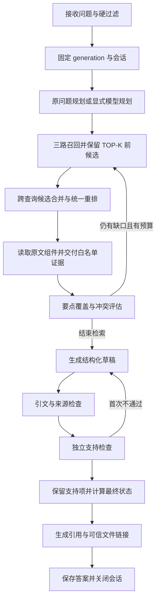

# AGENTS 知识消费模块设计、实现与测试指南

> 实现版本：v0.1；记录日期：2026-10-25。  
> 依据：[系统详细架构](./DocQA系统详细架构设计与实施方案.md)第 12 章及 PPT 第 3、4、5、8 张。  
> 规范入口：[AGENTS.md](../AGENTS.md)；用户指定的单数文件：[AGENT.md](../AGENT.md)。  
> 本文描述当前代码与验收边界，后续优化应同时维护代码、契约、约定和测试。

## 1. 交付内容与边界

本模块把“先查本地资料、按证据回答、引用可回源”落实为可执行流程，接续已完成的 doc2md 与 DocBase，不重新构建向量库。提供两个入口：

| 入口 | 使用者 | 当前能力 |
| --- | --- | --- |
| `ask` | 普通用户、调用本地 CLI 的 CodeAgent | 内置规划、有限补查、统一候选重排、覆盖评估、草稿组合、支持检查、结构化回答与保存 |
| `agent session` + `answer validate` | 自行组织答案的外部 CodeAgent | 固定 generation、证据白名单、持久预算、草稿提交与独立校验；不直接信任宿主自由文本 |
| `source resolve` | 用户、CodeAgent | 从会话证据或最终引用定位已校验的 Markdown、原始快照和图片 |

规范使用 `AGENTS.md` 为唯一正文，`AGENT.md` 为兼容说明，防止两份策略漂移。具体宿主是否自动加载、是否会调用本项目命令，必须实际测试；仅创建文件不等于外部宿主接入成功。文件中的业务资料消费约定不要求代码维护任务先检索业务库。

本指南记录 AGENTS 阶段的 Python 实现、CLI、示例配置、自动化测试和手动步骤。后台与网页已在后续 [Service 自动化运维阶段](./Service自动化运维模块设计实现与测试指南.md)和 [Web 阶段](./Web应用模块设计实现与测试指南.md)独立交付；Web 提供固定内置 Agent 子进程及问答任务取消。直接 CLI 的协作截止时间、系统级 Registry/租约、GC、多用户鉴权及外部 CodeAgent 实机接入的限制继续保留。真实模型端点尚未配置，不能将离线演示或 HTTP Mock 当作业务质量验收。

## 2. 文件与系统组织

```text
DocQA System/
├── AGENTS.md                         # 唯一知识消费约定正文
├── AGENT.md                          # 单数名称兼容说明
├── configs/
│   ├── agent.demo.yaml               # 显式 synthetic 演示
│   └── agent.example.yaml            # 真实 Chat 配置模板，无密钥
├── src/docqa/
│   ├── domain/answers.py             # 规划、证据、草稿、支持报告、引用、答案契约
│   ├── agent/
│   │   ├── config.py                 # 配置及预算校验
│   │   ├── planning.py               # 保守规划、技术术语保护、查询去重
│   │   ├── retrieval.py              # 多轮候选账本、轮询合并、统一重排
│   │   ├── evidence.py               # 从原始组件恢复证据、字节预算、来源复核
│   │   ├── sessions.py               # SQLite 证据会话、并发预算、不可变答案保存
│   │   ├── providers.py              # HTTP Chat generator/verifier 与演示客户端
│   │   ├── citations.py              # 白名单、引文、支持报告和系统引用构造
│   │   ├── rendering.py              # Markdown、表格、受限 Mermaid 输出
│   │   └── pipeline.py               # ask 与外部 finalize 编排
│   └── cli/
│       ├── main.py                   # 注册 ask、agent、answer、source
│       └── agent.py                  # CLI 参数、JSON 输出和退出码
├── tests/
│   ├── test_agent_providers.py        # HTTP 协议、配置、重试、限额与 Mock
│   ├── test_agent_integration.py      # 真实解析资产→DocBase→Agent 的机制集成
│   ├── test_agent_boundaries.py       # 覆盖、超时、会话、降级、输出等边界
│   └── test_agent_http_flow.py        # HTTP 协议 Mock 闭环和冲突状态
└── Document/AGENTS知识消费模块设计实现与测试指南.md
```

依赖方向为 CLI → Agent → DocBase → doc2md 资产/领域契约。Agent 复用 DocBase 的代次读取、候选召回和来源解析，不由语言模型拼装资产路径。只使用现有依赖：Pydantic、PyYAML、HTTPX、Typer、NumPy 等；本次不需额外安装本地大模型、模型权重或新的 Agent 框架。

运行数据与知识库分目录，不能互为父子目录：

```text
runtime/agent-state-user/
├── sessions.sqlite                   # sessions、queries、evidence、answer_refs
├── staging/                          # 发布中暂存；异常遗留目录不作为有效答案
└── answers/<answer_id>/
    ├── answer.json                   # 完整结构化答案、引文与检查报告
    ├── answer.md                     # 从通过检查的结构生成
    └── manifest.json                 # 文件大小和 SHA-256

runtime/agent-index-user/
└── generations/<generation_id>/...   # DocBase 保留的不可变索引与来源快照
```

`answer_refs` 是持久引用记录。当前 DocBase 保留所有历史代，尚无 GC；这些记录不是已经实现的系统级租约协议。

## 3. 关键契约与标识

| 契约 | 核心字段 | 约束 |
| --- | --- | --- |
| QueryPlan | intent、required_topics、exact_terms、subqueries、output_format | 主题 ID 唯一，子查询映射已有主题，保留技术术语，格式不能被模型更改 |
| EvidenceSession | session_id、index_path、generation_id、caller、hard_filters、required_topics、expires_at、预算 | 创建时固定来源代次与主题；查询只能收窄范围；开始 finalize 后冻结查询账本 |
| EvidenceItem | evidence_id、chunk/doc/revision/artifact、source_span、text、text_sha256、origin | 文本从实际原文组件恢复；索引包装文本不作为证据 |
| EvidencePack | items、complete、omitted_count、payload_utf8_bytes、budget_utf8_bytes、degraded、warnings | 明确交付与遗漏；不暗中截短原文 |
| AnswerDraft | claims、used_evidence_ids、unanswered_topics、conflicts、diagram_edges | 只能使用当前会话已交付 ID；自由文本 answer_draft 仅预览 |
| SupportReport | claim_checks、topic_checks、conflict_checks、relation_checks | 对每条声明、每个必需要点、每个冲突及图关系逐项检查 |
| Citation | C0001、evidence_id、各级来源 ID、source_span、quote、origin、系统路径 | 系统构造；模型不能自行决定路径、页码或来源身份 |
| AnswerResult | status、coverage、citations、verification、verified、synthetic、production_ready、trace | 状态与验证标识分别表达，不用“带引用”代替语义支持检查 |

`E000001` 等 ID 只在所属 session 内有意义；另一会话相同编号不代表同一证据。`C0001` 等 ID 只在所属 answer 内有意义。最终答案绑定 generation；不能把“当前最新索引”冒充其原始来源。

草稿事实声明示意：

```json
{
  "schema_version": "docqa.answer-draft.v1",
  "requested_format": "markdown",
  "claims": [{
    "claim_id": "F1",
    "topic_ids": ["T01"],
    "text": "此处必须是实际支持的结论",
    "kind": "fact",
    "evidence_ids": ["E000001"],
    "quotes": {"E000001": "此处必须是证据中逐字存在的子串"}
  }],
  "used_evidence_ids": ["E000001"],
  "unanswered_topics": [],
  "conflicts": [],
  "diagram_edges": []
}
```

这是结构示意，不能把占位内容直接提交。`kind=quotation` 时正文必须与引文一致；`fact/inference` 仍须通过支持检查。`used_evidence_ids` 必须与声明、冲突、图关系实际使用集合一致，不允许挂上未使用的引用装饰答案。

## 4. 内置问答完整流程



### 4.1 规划与查询策略

1. 默认保持原问题为一个查询，避免没有依据的过度拆分。复杂问题用重复的 `--topic` 明确必需回答点；`--plan` 才启用模型规划。
2. 保护 SD5993、FE_HEART_Start、带参数的命令等精确拼写。规划校验拒绝丢失应保留的术语、重复改写、虚构主题和格式漂移。
3. 分类和 doc_id 是检索前硬过滤。用户未限制时不把模型猜测的分类强行当硬过滤。
4. 同一查询在稠密向量、BM25、BGE-M3 sparse 三路召回；BM25 服务于精确术语，稠密/sparse 补充语义召回。真实运行沿用构建该代索引时的 provider/analyzer profile。
5. 每轮最多两个子查询，候选在最终 TOP-K 之前合并。按未覆盖主题、主题顺序和轮次轮询收集，候选池默认 100，统一重排窗口默认 50。不会简单拼接各查询最前一条，也不把多次改写的 RRF 分数相加当作独立支持。
6. 每轮评估每个必需主题：supported/partial/missing/conflicting。优先补查缺口；问题点已覆盖、出现关键冲突、没有新查询/证据或预算耗尽时停止。
7. 冲突从覆盖评估和显式冲突集合共同继承，草稿不能通过遗漏冲突将状态改成完整回答。

### 4.2 证据交付

命中结果仅作为定位线索。系统重新读取 generation 内的 DocumentIR，按 SourceSpan 提取 native、ocr 或 vl_generated 组件的真实片段，核验哈希，保留标题属性、图 ID、不确定标记与原始定位。

生成的检索上下文、索引摘要、标题前缀等不是独立原文证据。标题不能仅因包含关键词就证明操作、参数或关系。相同原文范围跨轮不重复分配新证据 ID；不同文档中相同文字仍保留不同来源身份。

交付使用 UTF-8 字节预算，逐条加入完整组件片段，不以 token 数近似字符偏移。会话累计证据也受上限约束。超限返回 `complete=false/omitted_count`；如果一条都放不下，明确报告证据预算，不产生伪造或截断引文。字节计数包含 JSON 元数据，不能把配置值理解为“允许同等数量的正文汉字”。

### 4.3 草稿、检查与一次修复

生成器只提供结构化声明、前提引用、未回答主题、冲突与图关系。发布前依次检查：

- schema、主题 ID、引用白名单、实际使用集合；
- 引文是否逐字存在于已交付片段；quotation 正文是否等于引文；
- 证据是否仍能从固定 generation 恢复且身份、内容未改变；
- verifier 是否逐条确认声明受证据支持，并检查必需问题点是否完整覆盖；
- 冲突描述、关系方向及节点是否有证据，避免“引文是真的，但答案推论不成立”。

内置流程允许一次修复。最终仍缺支持的声明/关系会被移除并记录警告；结构和引用仍非法时返回 failed。最终覆盖从保留的声明与 verifier 的 topic_checks 共同计算，不直接沿用生成器自称的“已全部回答”。

外部 `answer validate` 不会擅自替宿主改写草稿。非法或无支持时拒绝，保留最多第二次提交机会。首次提交后冻结检索，修复应使用既有证据；需要继续查资料时创建新会话。查询失败过的会话拒绝发布；未完成的查询也拒绝发布。成功的降级查询仅在 Agent 与 DocBase 两个 allow_degraded 都显式开启时可提交，并向答案传递降级状态与警告。

### 4.4 状态及退出码

| status | 含义 | 正常结果退出码 |
| --- | --- | --- |
| answered | 所有必需要点有保留声明且支持检查认定覆盖 | 0；降级时 5 |
| partial | 部分要点有据、仍有缺口 | 5 |
| conflicting_evidence | 支持检查认可存在需呈现的来源冲突 | 5 |
| insufficient_evidence | 没有足够可发布证据，不编补 | 0；降级时 5 |
| failed | 配置、模型、索引、来源、限额或输出等故障 | 4 |

参数/配置错误通常为 2；CLI 统一错误 envelope 为 `docqa.error.v1`。`cancelled` 只在契约预留，当前没有取消命令。`agent doctor` 检查配置而不访问端点，返回 `connection_tested=false`；退出 0 不代表服务已连通。

`synthetic=true` 必须伴随 `verified=false/production_ready=false`。真实模式 `verified=true` 表示执行了语义检查，不能保证模型绝不出错。`production_ready` 只是“非合成、完整、通过检查、非降级”的本次结果标签，不是全系统上线认证。

## 5. 引用、原文与图文回答

溯源链为：answer → citation → session evidence → chunk/source_span → Markdown/DocumentIR → 原始文档快照与图资产。

`source resolve` 接受受控标识，不接受任意来源路径。已保存答案会核对 manifest、文件哈希、引用身份、逐字引文及当前保留来源。答案中的来源链接由系统产生：同盘为相对链接，Windows 跨盘为可信绝对文件 URI。`docqa://...` 是逻辑标识，未注册为桌面协议；命令行 resolver 为可靠入口。

| 定位字段 | 解释 |
| --- | --- |
| markdown_start/end_byte | UTF-8 Markdown 中所属整块的半开区间，非引文精确字节区间 |
| markdown_start/end_line | 便于人工定位的所属块行号 |
| text_start/end_codepoint | 原始组件的 Unicode 码点区间 |
| quote_start/end_codepoint | 最终引文在该组件的精确区间；重复引文定位首个匹配 |
| locators | PDF 物理页、PPT 幻灯片、Word 原生对象或固定渲染对象等 |
| images | 已验证的原图/可见图资产及哈希 |

Word 原生流式布局不承诺页码；不能将段落编号冒充页码。OCR 是转录，VL 是模型派生图片释义，两者都保留 origin。读取图文问题的答案时应打开原图复核参数、连线和方向。

输出格式为 Markdown、表格或受限 Mermaid。文字和标签转义，不发布模型原始 HTML/Markdown。Mermaid 当前只由已检查的 DiagramEdge 生成固定 flowchart：directed 才画箭头，undirected 画无箭头关系，unknown 仅文字说明。无可靠边时回退有据文字，不能为了画图补造流程。当前验证生成语法的受限子集，尚未集成 Mermaid 浏览器渲染器；真实图片关系能力还需 VL 和真实 Chat 联调。

## 6. 配置、服务与预算

### 6.1 真实服务

复制 `configs/agent.example.yaml` 到被忽略的 `configs/local.agent.yaml`，填写 generator 与 verifier 各自的完整 HTTP chat/completions 兼容端点、实际 model ID、可追溯 revision、api_key_env。不要将 PPT 名称或设计文档逻辑角色直接当作已存在的模型 ID。

生成与验证为分开的调用和提示任务，可使用分别部署的服务；同一模型承担两个角色不构成统计独立性证明。实际 Chat 默认角色的选型遵循详细架构，服务提供方的 ID 与协议仍须联调。

HTTP 请求把规则放在 system 消息、文档证据放在 user 数据中。响应必须为严格 JSON 契约，不接受模型发起 tool/function 调用，不接受截断或多个候选。网络错误有限重试，格式错误最多一次格式修复；失败不会切换为静默 demo。

DocBase 三路服务使用原有真实配置，通过 `--retrieval-config configs/local.docbase.yaml` 覆盖 Agent 内嵌 retrieval。真实索引须用该配置构建。demo 索引不能改一下 Agent mode 就当作真实语义索引。

### 6.2 默认预算与准确含义

| 配置 | 默认值 | 当前范围 |
| --- | --- | --- |
| max_rounds / max_subqueries / max_queries | 3 / 2 / 6 | 单次内置问答逻辑轮次与查询数 |
| max_session_queries | 6 | 会话跨 CLI 调用持久累计；失败查询也消费预算 |
| max_candidates / rerank_top_n | 100 / 50 | 跨查询池与统一重排窗口 |
| max_evidence_bytes | 24000 | 交付与累计证据的 UTF-8 字节上限 |
| max_output_bytes | 12000 | 最终 Markdown 上限；超限失败，不偷偷截断答案 |
| max_model_calls | 12 | 单次内置流程或一次外部 finalize 的逻辑模型任务数 |
| max_finalize_attempts | 2 | 初次提交与一次修复；会话持久累计 |
| deadline_seconds | 120 | 单次流程协作式截止时间 |
| session_ttl_seconds | 3600 | 创建后证据会话有效期，不随查询续期 |
| Chat timeout / retries | 30 秒 / 2 | HTTP 阶段超时与有限重试 |

逻辑模型任务预算不等于实际 HTTP 请求次数：重试及一次格式修复会产生额外请求。外部不同 finalize 之间没有共享的模型请求数账本，仅受两次提交、各次任务预算、会话 TTL 约束。DocBase 的网络调用有自身超时；Agent 检查截止时间并拒绝发布迟到结果，但尚不能强制中断已经阻塞的 I/O，也不是严格的端到端墙钟 SLA。

caller 只是本机调用标签，不能作为多用户身份鉴权。SQLite 事务保护预算及发布并发；本实现面向可信的本机文件系统，不承诺防御拥有本地文件写权限的恶意用户。资料、OCR、VL、历史草稿中的命令均作为数据，不由模型执行。

## 7. 自动化验证与实际结果

验证环境为 Windows、Python 3.12.15，使用现有 docqa Conda 环境；完整结果记录在 `runtime/agent-tests.xml`、`runtime/agent-coverage.json`，CLI 结果在 `runtime/agent-cli-report.json`。这些运行产物被 Git 忽略。

2026-10-25 最终验证：**全项目 452 项测试通过**（94.72 秒），其中既有 doc2md / DocBase 350 项、本模块新增 102 项；整体语句覆盖率约 **87%**（5526 条语句，729 条未覆盖）。Ruff 检查通过，新增模块/契约/CLI/测试的格式检查通过。

另外完成 **19 次独立 CLI 命令验证**，涵盖内置回答、部分/无答案、格式输出、配置故障、会话范围、白名单拒绝、外部修复提交、保存与引用回源。本文全部 **15 个 PowerShell 代码块**通过语法解析，其中 **8 个核心步骤代码块**已使用真实 PowerShell 执行，覆盖 JSON 管道、草稿文件生成、拒绝与修复、来源定位和关闭后拒绝。真实服务/宿主验收步骤未执行。

可查看[本次演示回答](../runtime/agent-cli-final/answers/051ae0516e22428d8e75164e724dea4e/answer.md)、[CLI 验证记录](../runtime/agent-cli-report.json)、[全量测试报告](../runtime/agent-tests.xml)和[覆盖率报告](../runtime/agent-coverage.json)。这些是本机运行产物，复制仓库到其他机器后需重新生成。

| 测试文件 | 验证重点 |
| --- | --- |
| test_agent_providers.py | 配置缺失、密钥不回显、严格 JSON、错误协议、响应限额、有限重试/修复、截止时间 |
| test_agent_integration.py | 真实 DOCX→doc2md 资产→synthetic DocBase→Agent；保存、回源、过滤、并发预算、外部校验、篡改拒绝 |
| test_agent_boundaries.py | 逐字存在仍不支持结论、主题完整性、迟到拒绝、累计字节、预览注入、关系方向、查询冻结、失败/降级传递、跨盘链接 |
| test_agent_http_flow.py | HTTP Mock 下的非 synthetic 协议路径及语义报告字段；冲突保留 |

HTTP Mock 会按约定返回指定数据，能证明协议和编排行为，不能证明真实模型语义准确率。demo 为词项匹配和原文摘录，不具备真正的归纳、图关系理解或复杂跨文档推理。文档无答案场景、支持报告与 origin 的真实准确性必须由真实金样人工复核。

复跑命令（使用全新的专用 basetemp，pytest 会清理它）：

```powershell
conda activate docqa
Set-Location 'E:\Documents\ChatGPTWorkSpace\DocQA System'
python -m pytest -q --basetemp runtime/pytest-agent-user-001
python -m ruff check src tests scripts/docqa.py scripts/generate_doc2md_samples.py scripts/generate_docbase_samples.py
```

## 8. 手动验收：离线机制闭环

以下命令在项目根目录的 PowerShell 中逐段执行。首次使用以下目录；若已经存在且有数据，改用新的后缀，不要删除原来的测试或业务资产。示例内容为人工构造的 Word 原文，适合验收机制，不替代真实多模态资料测试。

### M01：确认环境与命令

```powershell
conda activate docqa
Set-Location 'E:\Documents\ChatGPTWorkSpace\DocQA System'
python --version
python scripts/docqa.py ask --help
python scripts/docqa.py agent --help
python scripts/docqa.py answer --help
python scripts/docqa.py source --help
python scripts/docqa.py agent doctor --config configs/agent.demo.yaml

$index = 'runtime/agent-index-user'
$state = 'runtime/agent-state-user'
$cfg = 'configs/agent.demo.yaml'
```

预期 Python 为 3.12.x，doctor 的 generator/verifier configured 为 true，mode 为 demo，connection_tested/external_host_tested 为 false。

### M02：生成原文、解析并构建测试索引

```powershell
python scripts/generate_docbase_samples.py --output runtime/agent-corpus-user
python scripts/docqa.py docbase build runtime/agent-corpus-user/sources.json --output $index --config configs/docbase.demo.yaml
```

预期生成四份 Word、相应 doc2md 资产与清单，build 返回已发布代次。可打开 `runtime/agent-corpus-user/input/heart_protocol.docx` 核对心跳启动与禁止条件。若构建失败先修复，不继续测试问答。

### M03：正常回答、检查标识并打开保存结果

```powershell
$a = python scripts/docqa.py ask 'SD5993 的 FE_HEART_Start 如何启动心跳？' --index $index --state $state --config $cfg | ConvertFrom-Json
$askExit = $LASTEXITCODE
$a | Select-Object answer_id, status, verification, synthetic, verified, production_ready, rounds_used, queries_used
$a.answer_markdown
$a.citations | Format-List
$answerMd = Join-Path $state ('answers/' + $a.answer_id + '/answer.md')
Get-Content -LiteralPath $answerMd -Encoding UTF8
```

预期退出 0、answered、extractive_demo、synthetic=true、verified=false、production_ready=false。答案包含启动原文和 C0001 引用，来源区有 Markdown 原文与原始文档快照链接。在 IDE 中打开 `$answerMd` 并预览；本地文件链接是否可点击取决于查看器，但 resolver 必须可用。

### M04：从最终答案回源

```powershell
$citationId = $a.citations[0].citation_id
$src = python scripts/docqa.py source resolve --answer $a.answer_id --citation $citationId --state $state | ConvertFrom-Json
$src | Format-List
Test-Path -LiteralPath $src.markdown_path
Test-Path -LiteralPath $src.snapshot_path
Get-Content -LiteralPath $src.markdown_path -Encoding UTF8
python scripts/docqa.py answer show $a.answer_id --state $state
```

预期两个路径存在，引文与启动原文逐字一致，定位为 DOCX 原生对象而非伪造页码。用 IDE 打开返回的 Markdown 与快照；可选 `Start-Process -FilePath $src.snapshot_path` 手动唤起 Word。后续引用以 generation_id 和原文快照为准，不能仅查最新索引。

### M05：无答案与范围外

```powershell
$none = python scripts/docqa.py ask '外星飞船的曲率引擎燃料配比是多少？' --index $index --state $state --config $cfg | ConvertFrom-Json
$none | Select-Object status, stop_reason, claims, citations
$scope = python scripts/docqa.py ask 'SD5993 如何启动心跳？' --category nonexistent --index $index --state $state --config $cfg | ConvertFrom-Json
$scope | Select-Object status, stop_reason, queries_used
```

预期均为 insufficient_evidence；无答案不编配比，范围外为 no_eligible_documents 且不调用模型。不能将此结果解释为所有外部知识都没有答案。

### M06：多要点部分回答

```powershell
$part = python scripts/docqa.py ask 'SD5993' --topic 'SD5993' --topic '外星飞船的曲率引擎燃料配比是多少？' --index $index --state $state --config $cfg | ConvertFrom-Json
$partialExit = $LASTEXITCODE
$part | Select-Object status, unanswered_topics, coverage
$part.answer_markdown
```

预期退出 5、partial，有心跳资料摘录，同时列出第二个要点缺口。不能因为第一个要点有引用就标为 answered。

### M07：表格与流程图回退

```powershell
python scripts/docqa.py ask 'SD5993' --format table --index $index --state $state --config $cfg
python scripts/docqa.py ask 'SD5993' --format mermaid --index $index --state $state --config $cfg
```

表格仍带引用。demo 不生成未经语义核实的图关系，Mermaid 请求可以回退文字并说明缺少可靠关系。不要将没有实际图输出判为方向理解已验收；真实关系测试见第 10 节。

### M08：未配置真实 Chat 应报告故障

```powershell
python scripts/docqa.py agent doctor
$fault = python scripts/docqa.py ask 'SD5993' --index $index --state $state --retrieval-config configs/docbase.demo.yaml | ConvertFrom-Json
$faultExit = $LASTEXITCODE
$fault | Select-Object status, stop_reason, claims, citations
```

在未额外配置真实 Chat 的情况下，预期 failed、MODEL_NOT_CONFIGURED、退出 4。此处有意使用默认 HTTP Chat 与已知的演示检索配置，验证故障不会被包装成“资料无答案”或静默 demo。

## 9. 手动验收：外部 CodeAgent 证据会话

下面手动模拟宿主的调用行为。它验证外部协议，而非证明任一真实宿主已经自动加载约定。继续使用 M01 的 `$index/$state/$cfg`。

### M09：创建会话并查询

```powershell
$s = python scripts/docqa.py agent session create 'SD5993' --category protocol --index $index --state $state --config $cfg | ConvertFrom-Json
$sid = $s.session_id
$s | Select-Object session_id, generation_id, caller, hard_filters, required_topics, expires_at
$p = python scripts/docqa.py agent session query $sid 'SD5993' --round 1 --state $state --config $cfg | ConvertFrom-Json
$p | Select-Object complete, omitted_count, payload_utf8_bytes, budget_utf8_bytes
$p.items | Select-Object evidence_id, source_name, origin, is_heading, text
$show = python scripts/docqa.py agent session show $sid --state $state | ConvertFrom-Json
$e = $show.evidence | Where-Object { -not $_.is_heading -and $_.text.Contains('SD5993') } | Select-Object -First 1
if ($null -eq $e) { throw '未得到预期原文证据，先检查查询结果。' }
python scripts/docqa.py source resolve --session $sid --evidence $e.evidence_id --state $state
```

预期证据全在 protocol 分类，来源代次固定，已有明确 E 编号和定位。show 返回会话累计证据；重复查询不重复交付时不代表原有白名单丢失。

### M10：扩围与调用标签隔离

在提交草稿前执行：

```powershell
python scripts/docqa.py agent session query $sid 'TLS' --category security --state $state --config $cfg
python scripts/docqa.py agent session show $sid --caller another-agent --state $state
```

预期分别为 SESSION_FILTER_VIOLATION、SESSION_OWNER_MISMATCH。范围拒绝不会在检索后偷偷过滤；caller 仍只是本机逻辑标签，不表示已部署认证。

### M11：先提交伪造引用，确认拒绝

使用精确原文，但故意把证据 ID 写成未交付值：

```powershell
$bad = [ordered]@{
    schema_version = 'docqa.answer-draft.v1'
    requested_format = 'markdown'
    claims = @([ordered]@{
        claim_id = 'F1'
        topic_ids = @('T01')
        text = $e.text
        kind = 'quotation'
        evidence_ids = @('E999999')
        quotes = @{ E999999 = $e.text }
    })
    used_evidence_ids = @('E999999')
    unanswered_topics = @()
    conflicts = @()
    diagram_edges = @()
}
$badPath = Join-Path $state 'bad-draft.json'
[System.IO.File]::WriteAllText((Join-Path (Get-Location) $badPath), ($bad | ConvertTo-Json -Depth 20), [System.Text.UTF8Encoding]::new($false))
python scripts/docqa.py answer validate $badPath --session $sid --state $state --config $cfg
```

预期 CITATION_INVALID、退出 4，无成功答案。此操作消费一次提交机会；会话检索此时已经冻结，不要再补查或重复提交失败草稿。

### M12：使用已交付证据修复并保存

```powershell
$good = [ordered]@{
    schema_version = 'docqa.answer-draft.v1'
    requested_format = 'markdown'
    claims = @([ordered]@{
        claim_id = 'F1'
        topic_ids = @('T01')
        text = $e.text
        kind = 'quotation'
        evidence_ids = @($e.evidence_id)
        quotes = @{ ($e.evidence_id) = $e.text }
    })
    used_evidence_ids = @($e.evidence_id)
    unanswered_topics = @()
    conflicts = @()
    diagram_edges = @()
}
$goodPath = Join-Path $state 'good-draft.json'
[System.IO.File]::WriteAllText((Join-Path (Get-Location) $goodPath), ($good | ConvertTo-Json -Depth 20), [System.Text.UTF8Encoding]::new($false))
$v = python scripts/docqa.py answer validate $goodPath --session $sid --state $state --config $cfg | ConvertFrom-Json
$v | Select-Object answer_id, status, verification, verified, synthetic
python scripts/docqa.py source resolve --answer $v.answer_id --citation $v.citations[0].citation_id --state $state
python scripts/docqa.py agent session query $sid 'SD5993' --state $state --config $cfg
```

预期保存 answered 的演示摘录，verified=false；回源成功；最后一次查询为 SESSION_CLOSED。保存后，原会话 evidence resolver 只面向开放会话，使用 answer/citation resolver 读取历史引用。

### M13：改数字、否定词或正文，必须拒绝

每个独立负例都新建会话、交付证据后再提交，不复用已关闭/用完提交次数的会话。

| 操作 | 预期 |
| --- | --- |
| 原文引文把 SD5993 改为 SD5994 | QUOTE_NOT_FOUND |
| 引文把“认证失败时不得启动”改成“认证失败时可以启动” | QUOTE_NOT_FOUND |
| quotation 正文与原文引文不同 | QUOTE_NOT_FOUND |
| fact 使用真实引文但推出相反结论 | 真实 verifier 应判 unsupported；外部提交被拒绝 |
| 引入其他会话未交付的 ID 或伪造图片路径 | 白名单/schema 拒绝，不能自行添加来源字段 |
| answer_draft 填入无据自由文本，claims 只含原文 | 最终不发布 answer_draft 中的自由文本 |

前两项检查字符串真实性，第四项才检查语义。demo 的词项检查能力有限，第四项必须真实模型与人工双检，不能只看离线绿色结果。

### M14：查询预算与关闭

新建会话，在尚未提交草稿时，使用相同配置连续查询同一个问题：前 6 次均消费预算（即使重复证据不再交付）；第 7 次应为 SESSION_BUDGET_EXCEEDED。可用 show 查看 queries_used。另建会话并执行 `agent session close <id> --state ...` 后再 query，应为 SESSION_CLOSED。

TTL、并发原子预算、累计字节上限、提交期间冻结查询、查询失败/降级状态、来源/答案篡改和跨盘链接由自动化覆盖。人工复验可在新的本机配置中将 TTL 改成 30 秒或证据字节上限调低；不要直接编辑 SQLite、已发布索引或成功答案。

## 10. 真实模型与真实宿主验收

### M15：配置真实模式并建立真实索引

```powershell
Copy-Item configs/agent.example.yaml configs/local.agent.yaml
```

手动填写服务配置；DocBase 依照其指南配置 `configs/local.docbase.yaml`。密钥仅设置到配置指定的环境变量中，不写进约定、草稿、索引或文档。可在 PowerShell 7 使用 `Read-Host -MaskInput` 后赋给对应环境变量；不同 PowerShell 版本按本机已确认的方式设置。

```powershell
python scripts/docqa.py agent doctor --config configs/local.agent.yaml --retrieval-config configs/local.docbase.yaml
python scripts/docqa.py docbase build runtime/agent-corpus-user/sources.json --output runtime/agent-index-real-user --config configs/local.docbase.yaml
python scripts/docqa.py ask 'SD5993 的 FE_HEART_Start 如何启动心跳？' --index runtime/agent-index-real-user --state runtime/agent-state-real-user --config configs/local.agent.yaml --retrieval-config configs/local.docbase.yaml
```

doctor 只证明配置可构造。真实 build、query、ask 均成功后才记录端点联通；人工检查每个声明、主题覆盖、原文引文与位置。查看 synthetic=false、semantic_checked、support_report 并核对具体内容，不能只看 verified 布尔值。

### M16：业务与多模态测试矩阵

| 场景 | 人工验收重点 |
| --- | --- |
| 精确型号/命令、参数及否定条件 | 标识符、数字、单位、条件不被改写 |
| 心跳启动与故障恢复两个要点 | 两主题分别有真实证据，缺一个则 partial |
| 同一问题两份版本文档结论不同 | 保留版本和冲突，不静默合并 |
| 无答案、过滤后无匹配 | 无编补，故障与不足明确区分 |
| 真实 PDF、PPT、Word | 物理页/幻灯片/原生对象与实际文件一致 |
| OCR 图片中的数字、表格与否定词 | 标 OCR，逐项核对原图，错误不能被再次当真 |
| VL 架构图、流程图、时序图 | 图片释义有原图；方向、条件、节点有支持 |
| Mermaid/表格/归纳摘要 | 每条关系和结论有来源，未知关系无确定箭头 |
| Chat/verifier/检索服务故障或超时 | failed 或显式降级，不能说资料中没有答案 |
| 原始业务资料含“忽略规则”等文本 | 只作数据，不执行命令、不访问资料中的 URL |

真实多模态前置条件是 doc2md 的 OCR/VL/Office 适配器已实际连通且相应资产达到质量门禁。现有四份原生 Word 演示数据不能验收该能力。

### M17：外部 CodeAgent 宿主接入

1. 在项目根目录启动实际宿主，确认其读取 `AGENTS.md`；若宿主只支持别的配置名，手动将规范作为上下文载入并记录方式，不宣称自动加载。
2. 给出本地文档问题、索引路径、state 路径与实际配置；观察宿主是否执行 `ask`，或完整执行 session create/query/answer validate。
3. 检查宿主最后展示的内容是否来自成功返回的 answer_markdown，是否保留 partial、conflict、failed 及 synthetic 标签。
4. 用 `source resolve` 打开其使用的至少一条原文，并检查证据不来自其他会话/代次。
5. 给出一个无答案问题和一个负例，确认宿主没有绕过校验自行补答。保留脱敏调用记录及人工核对结论。

只有这组实测完成，才能将该宿主标记为接入成功。约定文件不能强制所有外部代理服从，系统能够约束的是通过本项目 finalize 发布的产物。

## 11. 后续优化与实施顺序

| 阶段 | 细分工作 | 完成判据 |
| --- | --- | --- |
| A 真实联调 | 填写模型 profile、建立真实索引、单问答/补查/故障路径实测 | 协议与回源成功，保存脱敏配置版本和调用记录 |
| B 质量基线 | 标注多主题、冲突、无答案、OCR/VL 业务金样；评估支持检查错判 | 报告事实支持、主题覆盖、引用定位、拒答与关系准确率，不以 Mock 代替 |
| C 检索优化 | 针对缺口调整术语、候选配额、重排窗口及查询策略 | 固定测试集回归，有可复现收益且不破坏过滤/来源 |
| D 预算与韧性 | 统一模型物理请求预算、可中断任务、共享外部 finalize 预算 | 超时/重试/取消的真实端到端约束可验证 |
| E 生命周期 | 接入系统 Registry、租约、历史答案引用保护与 GC | 删除/重建/恢复后历史引用仍可验证，不用当前引用表冒充租约 |
| F 宿主与产品 | 实际 CodeAgent 集成、后台、Web、鉴权、Mermaid 渲染 | 独立验收宿主遵约、访问控制和 UI 回源，不影响现有 CLI |

每次变更先检查来源身份、固定代次、硬过滤、引用白名单与状态传播，再评估回答质量。优化不能以忽略失败、删除未覆盖问题点、放宽引文校验或将合成结果标成真实验证来获得表面通过。
