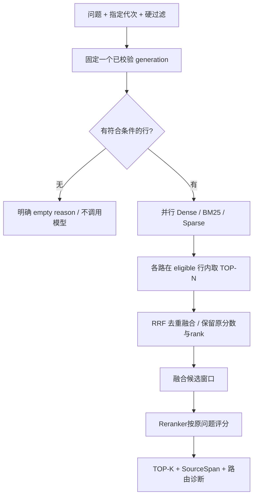

# DocBase 模块设计、实现与测试指南

> 模块版本：DocBase v0.1 / generation 与 Chunk 契约 v1  
> 日期：2026-10-24  
> 项目：`E:\Documents\ChatGPTWorkSpace\DocQA System`  
> 依据：[系统详细架构](./DocQA系统详细架构设计与实施方案.md)、[任务梳理](./DocQA系统任务统一梳理.md)、[doc2md 实现指南](./doc2md模块设计实现与测试指南.md)及 8 张 PPT。  
> 使用顺序：第 1～8 章说明实现与边界，第 9 章记录实际验证，第 10 章开始逐步手测，第 11 章进行真实模型联调。

## 1. 本次交付与验收口径

已实现独立 DocBase：读取经过校验的 doc2md 资产，按结构与来源切片，构建稠密向量、中文 BM25、独立稀疏权重倒排三路索引，查询时进行硬过滤、召回、RRF 融合、Reranker 重排，返回可定位到原文的 TOP-K。另提供增量计算缓存、不可变索引代次、SQLite 单一发布指针、来源解析和证据组评估。

**真实模型模式默认启用但必须配置服务。**已有 HTTP 适配器接收真实 Embedding、BGE-M3 `lexical_weights` 和重排结果，缺少端点 / 模型 / 版本 / 维度等配置时明确失败，不自动替换成假模型。当前未获得公司的真实模型端点或凭据，真实模型连通性与效果仍待第 11 章联调。

**离线演示模式需要显式选择。**`mode: demo` 或 `--demo` 使用确定性合成概念 / 哈希特征及合成重排分数，仅用于验证程序机制；它不属于真实 Embedding、BGE-M3 或神经重排。演示资产和结果始终标记 `synthetic=true`、`production_ready=false`，不能把演示指标当成业务召回率。

| 能力 | 已实现 | 验证边界 |
| --- | --- | --- |
| IR / Markdown 来源契约接入、质量门禁 | 是 | 真实 doc2md 资产集成测试 |
| 章节 / 段落 / 表格 / OCR / VL 切片与来源范围 | 是 | 自动化含长表、长单元格、图语义和多字节文字 |
| 中文与技术术语 BM25 | 是，真实本地算法 | 公式手算、中文分词、完整标识符、过滤测试 |
| 稠密向量精确余弦检索 | 是 | NumPy 真实计算；HTTP 编码结果通过 Mock 验证 |
| 独立 learned sparse 权重内积 | 是，独立倒排算法与真实服务适配路径 | HTTP Mock 与显式 demo；真实 BGE-M3 服务待联调 |
| RRF 与重排 | 是 | 去重、排序、索引乱序 / 缺项、失败 / 降级测试 |
| 不可变代次、合并 / 替换、计算缓存 | 是 | 幂等、失败保留旧代、历史读、CAS / ABA 测试 |
| 自包含来源包与完整性验证 | 是 | 原输入移走仍可验证；Windows 长路径与篡改测试 |
| 检索评估与五种基线模式 | 是 | 按来源证据组计分，不以重复 Chunk 膨胀召回 |
| Agent 补查 / 答案生成 | DocBase 阶段未实现；2026-10-25 已续接 | 见 [AGENTS 指南](./AGENTS知识消费模块设计实现与测试指南.md) |
| 后台 Service | DocBase 阶段未实现；2026-10-25 已续接 | 见 [Service 指南](./Service自动化运维模块设计实现与测试指南.md) |
| Web | DocBase 阶段未实现；2026-10-25 已续接 | 见 [Web 指南](./Web应用模块设计实现与测试指南.md) |
| GC | 未实现 | 保留历史代，后续独立设计 |

本工具返回证据候选，不生成答案。稠密最近邻即使有结果也不证明资料能够回答问题；没有使用未经校准的固定相似度阈值判断“有答案”。

## 2. 文件组织和模块职责

```text
src/docqa/
├─ domain/rag.py                # Chunk、SourceSpan、构建与检索结果
├─ docbase/
│  ├─ __init__.py                # build_index / query / eval_retrieval 公共入口
│  ├─ config.py                  # DocBaseOptions / ServiceOptions / YAML
│  ├─ providers.py               # HTTP 与显式 demo 三种模型 Port
│  ├─ chunker.py                 # 来源绑定、结构切片和组件投影
│  ├─ analyzer.py                # 术语保护、冻结 jieba、词典指纹
│  ├─ lexical.py                 # BM25 与 sparse 独立倒排算法
│  ├─ storage.py                 # generation、mmap、来源验证、SQLite CAS
│  ├─ pipeline.py                # 选择来源、合并、编码缓存、完整构建和发布
│  ├─ retrieval.py               # 固定代次、预过滤、召回、融合、重排、resolve
│  └─ evaluation.py              # 来源证据组标注与检索评估
└─ cli/docbase.py                # build / query / test / verify / resolve / info / doctor

configs/docbase.example.yaml     # 真实服务脱敏模板
configs/docbase.demo.yaml        # 明确标记的演示配置
scripts/generate_docbase_samples.py
tests/test_docbase_*.py
Document/DocBase模块设计实现与测试指南.md
```

不新增依赖即可使用当前 docqa 环境中的 NumPy、jieba、httpx、Pydantic、Typer、Rich 和 portalocker；没有自动下载模型、安装 GPU 框架或更改 conda 环境。已有 requirements 文件仍是兼容范围，不是锁文件。

## 3. 输入契约与质量门禁

### 3.1 支持的建库输入

1. **单个 doc2md 资产目录**：包含 `manifest.json/document.ir.json/document.md/source_map.json`。
2. **doc2md 输出根目录**：读取 `catalog.sqlite`，按每个文档当前登记的 revision 选择最近登记的解析资产；不扫描全部历史目录后混入多个版本。
3. **显式来源列表 JSON**：用于多个 doc2md 根目录或精确冻结成员。相对路径以 JSON 所在目录为基准。

```json
{
  "schema_version": "docqa.docbase-sources.v1",
  "artifacts": [
    "parsed/artifacts/实际artifact_id"
  ]
}
```

每个来源先执行 doc2md 完整性校验，并且必须 `status=complete`。`review_required/partial` 会被拒绝，不能通过建库入口绕过图片语义缺口。同一显式集合包含相同 `doc_id` 的多个版本会报 `DUPLICATE_DOCUMENT`，需要明确选择一个版本。

**不接受独立裸 Markdown 文件。**它缺少可信的版本、块、图片与原文映射，不能满足本项目全链路溯源。当前应通过 doc2md 输出资产入库；若以后新增 Markdown 原生导入器，需要同时补建来源契约，不能仅按文件正文拼一个虚构页码。

doc2md 根目录内最新观察到的源版本尚无成功解析资产时，报 `SOURCE_NOT_READY`。整批选择中有不合格文档会阻止本次发布，旧 DocBase 代次保持不变；本版没有“悄悄跳过坏来源并宣布全量成功”的模式。

### 3.2 合并、替换与空库

- 默认 **merge**：选中的文档按 `doc_id` 更新，原代其他成员保留；修改成功前旧版仍可查询。
- `--replace`：下一代成员严格等于本次选择集合；未选文档从新的默认查询集合移除，历史代保留。
- 无输入不能意外清空知识库。只有同时显式 `--replace --allow-empty` 才允许空目标发布。
- merge 不自动监控删除、推断重命名或对账文件系统。移动 / 删除源文件不会物理删除历史证据；这些生命周期操作仍需后续系统服务设计。

## 4. 结构切片和来源设计

### 4.1 文本与预算

每个 Chunk 包含 `display_text`、`index_text`、章节路径、分类、源版本、图引用和多个 `source_spans`。展示文字区分 `[原生]`、`[OCR 派生]`、`[VL 派生]`。复制的章节、续表首行和图注单独记录为 `generated_context`，不冒充新的原文证据。

本版默认目标 / 最大 / 重叠预算分别为 **2400 / 3600 / 320 UTF-8 字节**，包含来源类型标签和复制上下文。它们是明确的字节限额，**不是目标架构中 600 / 900 / 80 token 的精确实现**。未拿到实际 tokenizer，不能将中文字符数伪装为 token 数；真实服务还必须确认输入限制及不静默截断。

长内容优先在自然边界切分，再使用能回映原字符串的字节窗口；技术标识符、命令参数、URL 和路径受到边界保护。单个标识符放不进硬预算时显式报 `CHUNK_IDENTIFIER_TOO_LONG`，不从中间截断。上下文耗尽预算、无有效来源和不合法范围同样明确失败。

### 4.2 各类结构处理

| 结构 | 处理 |
| --- | --- |
| 标题 / 段落 / 列表 | 保留原块次序和章节，不跨文档 / revision；同节短块可合并 |
| 表格 | 按原始行分组；超长行 / 单元格分段仍绑定原行与字符范围；首行复制只作为未确认表头的上下文 |
| 图片 OCR / VL | 同一图的短语义尽量组合；过长分块仍保留 figure_id 与各组件来源 |
| 图注 | 只作明确标记的上下文；仅有自动图题而无实际正文 / OCR / VL 时不虚造知识 |
| 重复图片 / 重复正文 | 保留不同来源身份；可共享计算结果，不能合并丢失来源 |
| excluded_from_index 块 | 不进入检索语义 |

VL 投影包含可读的观察、节点、关系方向、解释与不确定项，原始几何信息留在 IR。无向关系明确显示“无向”，不渲染为双向箭头；单独 `no_semantic_content` 状态不构成可索引知识。

### 4.3 SourceSpan 的精度

```text
block_id + component
text_start_codepoint / text_end_codepoint      # 对明确组件的精确半开字符范围
source_text_sha256                           # 所选原组件范围的 UTF-8 摘要
markdown_start_byte / markdown_end_byte      # 所属整 Block 的保守字节映射
locators                                    # doc2md 版本绑定来源定位
figure_id 或 table_row_start / table_row_end # 按组件使用
origin                                      # native / ocr / vl_generated
```

`component` 为 `block_text/table_row/figure_ocr/figure_vl`。表格行规范文本为 `' | '.join(cells)`；VL 为固定版本的可读投影。源组件字符范围和 Markdown 字节范围不能混用：经过转义 / 表格渲染后，本版只承诺 Markdown 定位到所属整块，不声称精确到其内部子字节。

`chunk_id` 是除自身外完整 Chunk 契约的规范 JSON 摘要，因此绑定 artifact、chunk profile、原范围与投影内容；相同正文出现在不同来源不会被合并。加载代次时重新校验来源组件并按冻结选项重切，核对完整 Chunk 投影。

## 5. 三路索引、融合与重排

### 5.1 稠密路

按确切 `index_text` 和 `input_type=document` 编码，校验批次数量、顺序、维度、有限数和非零向量。客户端进行 L2 归一化，保存为 float32 `[N,D]`；查询以 `input_type=query` 和同一编码 profile 生成归一化向量。

只读加载使用 `mmap_mode='r'`、`allow_pickle=False`。按硬过滤后的行分块精确计算余弦内积，不复制全量矩阵做一次大排序。每路分数并列按已排序的 chunk_id 行顺序确定，RRF 再显式按 chunk_id 稳定排序。

### 5.2 BM25 路

分析器使用检索专用 Unicode 归一化视图和大小写折叠，原文引文不改写。先保护完整型号 / 标识符 / 参数 / 路径，再使用独立 jieba 分词器（HMM=False）及冻结术语集处理中文，不删除否定词。

分析器 profile 绑定实际 jieba 版本、内置词典字节摘要、术语和规则代码。已初始化词典在受锁保护的私有缓存中复用，词典映射冻结，按不同词典 / 术语隔离，不能让一个用户词典污染其他配置。

```text
IDF(t) = ln(1 + (N - df(t) + 0.5) / (df(t) + 0.5))
score(q,d) = Σ(t∈unique(q)) IDF(t) × tf(t,d)(k1+1)
             / (tf(t,d) + k1(1-b+b×dl(d)/avgdl))
```

默认 `k1=1.2,b=0.75`；N、df、avgdl 固定在整代语料，过滤不重算 IDF。没有共同词项时返回空，不用零分随机填满结果。

### 5.3 learned sparse 路

独立接收服务返回的 BGE-M3 `token_id → lexical weight`，校验非负、有限、词表范围、非空正权重和输出位置，不以 BM25 / TF-IDF 充当该路。分数为共同 token 权重内积：

`s(q,d)=Σ(t∈q∩d) w(q,t)×w(d,t)`。

文档与 query 必须具有同一模型 / tokenizer / 前缀 / 版本 profile。没有共同 token 时返回空；当前不启用任意低权重裁剪。服务只提供 dense 时，该服务不满足本模块 sparse 端口。演示模式里的哈希 token 仅为合成机制测试。

### 5.4 查询时序



默认三路各 50、RRF 前 50 送重排、最终最多 8；三个预算独立。`RRF(c)=Σ weight(route)/(60+rank(route,c))`，没有返回的路贡献零。同一路重复行只算一次票，不相加三种原始分数当概率。

重排校验候选索引全集、唯一性与分数；可恢复服务乱序，缺项 / 重复 / 越界不可静默接受。返回完整 `route_ranks/route_scores/rrf_score/rerank_score/final_rank`。可以调整查询用 Reranker 而不重建文档向量，实际查询配置与服务指纹计入 `retrieval_profile_id`。

### 5.5 过滤、模式与失败

- `--category`、`--doc-id` 为硬约束，在**每路 TOP-N 之前**生效，Agent 后续不能扩大用户范围。
- `hybrid`：三路 + RRF + Reranker；`rrf`：三路 + RRF；`dense/bm25/sparse`：显式单路基线。这些基线是主动选择的实验模式，不是隐藏降级。
- 默认 strict：已请求的必需路 / 重排失败就报错；`empty` 与失败分开。
- 仅显式 `allow_degraded=true` 或 `--allow-degraded` 可保留成功路；返回 `status=degraded`、错误诊断、`production_ready=false`，CLI 退出 5。全路失败仍报错。
- profile 不一致是配置错误，不能通过允许降级绕过。BM25 分析器、dense/sparse 文档与 query 表示必须一致。
- `collect_candidates` 提供最终 TOP-K 截断前的融合窗口；DocBase 阶段未实现多轮计划与上下文装配，2026-10-25 已由 [AGENTS 模块](./AGENTS知识消费模块设计实现与测试指南.md)消费该接口，完成跨查询合并与有限补查。

## 6. 持久化、缓存和发布

```text
runtime/某个DocBase根目录/
├─ registry.sqlite                       # 唯一 current_generation + publish_sequence
├─ .docbase.lock                         # 本机同库单写者 OS 锁
├─ cache/dense/<key>.json
├─ cache/sparse/<key>.json
├─ staging/build-*/                      # 未发布候选
└─ generations/<UUID>/
   ├─ manifest.json                     # 文件哈希、体积、行数、模型与能力标签
   ├─ profiles.json                     # 切片/分词/模型/实现指纹，不保存密钥值
   ├─ members.json                      # 本代文档/类别/版本快照
   ├─ catalog.sqlite                    # 只读 Chunk 行和成员
   ├─ dense/vectors.npy
   ├─ dense/row_ids.jsonl
   ├─ bm25/index.json                    # postings、tf、dl、统计与分析器指纹
   ├─ sparse/index.json                  # 独立token权重postings与行计数
   └─ sources/
      ├─ artifacts/<artifact_id>/...     # 完整doc2md资产、图、MD、IR和映射
      └─ blobs/<前两位>/<hash>.<ext>     # 原文快照，内容地址去重
```

**相对目标架构的明确取舍：**当前 BM25 / sparse 使用透明 JSON 倒排，未实现第 9.8 节拟定的 NumPy CSR 文件。算法、独立性、共享行集合与验证不变，但大规模装载开销需要后续测量，不能宣称已完成高容量 CSR 优化。

### 6.1 增量和缓存

未变化成员保留已校验来源；文档表征缓存绑定确切输入文本、`input_type`、完整服务指纹及实现摘要。前缀、维度、归一化、模型 / tokenizer / 部署版本变更均影响相应缓存。dense / sparse 分别缓存并校验内容摘要和数值约束；坏缓存明确报错，不当作模型成功输出。

同一目标成员、切片和 profile 的 build key 命中当前代时直接复用，不递增发布序号。新增 / 修改成员时复用可用计算，但重新组装全体行、矩阵与 postings，三路一起发布。当前没有独立 query 编码缓存、页面检查点、部分增量 postings 原位更新。

### 6.2 发布与历史读

本机同库写锁覆盖构建；暂存包完整校验、刷新文件、移动到唯一最终目录后，SQLite CAS 比较当前代与单调 `publish_sequence` 再切换指针。发布和指针修改只有一个数据库权威，没有并列可写 active.json。序号检查防止 G1→G0→G1 的 ABA 误提交。

构建失败时旧 current 不变。查询入口固定一个代次，之后一直读其不可变包；本版**保留所有历史代、不实施 GC**，所以不需要依赖可过期读租约来防删除。全局 Registry、任务 owner/fencing、持久任务恢复、回滚命令和安全 GC 尚未实现，不能将此本地指针库说成完整系统任务平台。

文件移动与 SQLite 不是跨系统事务。异常可能留下未引用的完整包或缓存；不作为默认查询对象，也不会自动删除。断电耐久性仍依赖系统 / 磁盘，加载会重新验证。

### 6.3 验证和来源可用性

加载校验文件集合、摘要与体积、无目录逃逸、SQLite 只读内容、Chunk 行 / ID、向量 shape / dtype / 单位范数、postings 范围 / 统计、source spans 和源文档版本。BM25 会按冻结分析器复算，Chunk 会按来源重新投影；仅重算一份文件哈希不能掩盖错误来源。

每代复制完整来源包及快照，所以源目录移动后历史引用仍能解析；代次文件不能只复制向量矩阵而丢弃 sources。Windows 内部文件操作使用扩展绝对路径，避免深层图片路径受传统 260 字符限制；返回的来源路径可能带 `\\?\` 前缀，应原样传给支持它的文件 API。

校验判断内部一致性，不能证明服务真的运行了声明模型或图片释义符合事实；也不是带签名的防伪系统。更换切片 / 分词规则会导致旧资产与当前重投影不兼容，应重建，不默认承诺跨任意代码版本加载。

## 7. 模型 HTTP 契约和真实接入

配置模板为 `configs/docbase.example.yaml`，本机副本建议 `configs/local.docbase.yaml`（Git 忽略）。默认 `mode=http`，缺配置时报 `MODEL_NOT_CONFIGURED`。`doctor` 仅检查本地配置形状 / 指纹，不调用网络，`connection_tested=false`。

### 7.1 docbase.http.v1

这是本项目明确约定的适配协议，**未认定公司服务原生兼容**。必须填完整 endpoint；如果实际协议不同，应改写独立适配器，不能修改返回值伪装三路。

Dense / sparse 的请求包含 `model/revision/tokenizer_revision/input/input_type/truncate:false`，`input` 是按配置前缀处理后的文本批次；sparse 另要求 `return_sparse:true`。以下仅展示主要返回字段：

```json
{"data":[{"index":0,"embedding":[0.6,0.8]}]}
```

```json
{"data":[{"index":0,"lexical_weights":{"123":0.8,"456":0.3}}]}
```

重排请求包含同样模型版本信息、`query/documents/truncate:false`，返回：

```json
{"results":[{"index":0,"relevance_score":2.1},{"index":1,"relevance_score":-0.4}]}
```

这些是协议示例，不是本次真实模型输出。每批 index 必须是 0～n-1 的完整唯一集合。不同批次重排分数必须具有同一标度、以 query-document 对为含义，不能返回批内归一化名次冒充可比较分数。任意分数都不直接等于“有答案概率”。

### 7.2 约束和保密

服务指纹绑定 URL 摘要、实际模型 / 部署 / tokenizer 版本、维度或词表边界、前缀等；不保存密钥值和端点明文。密钥从 `api_key_env` 读取。端点不允许内嵌认证、query 或 fragment，不自动跟随重定向，不使用隐式环境代理；公司内网若需要特殊代理 / CA，需针对实际部署扩展配置。

HTTP 检查响应体积、索引、维度、有限数、词表和明确的 truncated / length 结束标志；限流 / 瞬态故障有限次重试。配置 `timeout` 是 HTTPX 的 I/O 等待超时，不是整个查询 / 线程池 / 全部重试的总 deadline。

`max_input_utf8_bytes` 包含实际前缀，超额明确拒绝，不自行截断。它不替代真实 tokenizer 预算，服务必须承诺不静默截断；服务不报告隐藏截断时，客户端无法从向量本身证明输入完整。

`production_ready=true` 只表示该结果没有 synthetic 标记且满足当前结构 / 调用门禁，不是对公司部署、模型身份或业务准确率的认证。真实验收记录必须单独完成；降级结果会将该值置 false。

### 7.3 Python API 与 CLI 返回

```python
from pathlib import Path
from docqa.docbase import build_index, query, eval_retrieval
from docqa.docbase.config import load_options
from docqa.docbase.retrieval import resolve_chunk
from docqa.docbase.storage import verify_generation

options = load_options(Path("configs/docbase.demo.yaml"))
built = build_index(
    Path("runtime/docbase-manual-user/sources.json"),
    Path("runtime/docbase-api-user"),
    options=options,  # 默认合并；replace=True 表示显式完整目标集合
)
result = query(
    Path("runtime/docbase-api-user"), "如何启动心跳？",
    options=options, categories=["protocol"], top_k=2,
)
checked = verify_generation(Path(built.generation_dir))
if result.hits:
    source = resolve_chunk(
        Path("runtime/docbase-api-user"), result.hits[0].chunk_id,
        generation_id=result.generation_id,
    )
```

仓库脚本会自动加入 src；其他 Python 进程要直接导入，可先按现有环境指南注册本地包 `python -m pip install -e . --no-deps`。测试可注入三种 provider，并明确注入对象是 Mock；不改变 HTTP 默认必须配置的要求。

| 结果 | 关键字段 |
| --- | --- |
| BuildResult | generation_id/dir、build_key、publish_sequence、reused、documents/chunks、cache_hits、synthetic/production_ready |
| QueryResult | 固定generation、retrieval_profile_id、应用的硬过滤、mode、routes、候选数量、hits和warnings |
| RetrievalHit | chunk/document/artifact身份、正文、章节、类别、来源范围、figure引用、路由rank/score、RRF和重排分数 |
| resolve | 代次内可信artifact / Markdown / snapshot路径与原范围，不接受模型给出的任意文件路径 |

CLI 成功 / 可解释空结果返回 0；参数 / 配置错误通常 2；模型缺配置、解析资产不合格、构建 / 校验 / 必需检索失败返回 4；显式降级查询返回 5。`test` 有调用失败返回 4，但指标低且调用都成功仍为 0；当前没有隐含的业务质量达标阈值。错误使用统一 `docqa.error.v1` 信封。

## 8. 评估设计

评估文件 `docqa.docbase-eval.v1` 按原文 `doc_id/revision_id/block_id/component/字符范围` 标注，而不把一次切片生成的 chunk_id 当永久真值。表格另绑定原始行，图片 OCR / VL 另绑定 figure_id，防止不同单元格 / 图出现位置因相同字符偏移误命中。

每个 `evidence_groups` 内列表是一个必需事实的可替代证据；多个 group 表示需要多个事实。重复或重叠 Chunk 只能命中同一 group 一次，必须完整包含标注范围，少量交集不算覆盖。标注过期 / 范围不存在，或某组全部替代证据被硬过滤排除时直接拒绝评估。

对可回答样本按问题做宏平均：Recall@K、HitRate@K、MRR@K、CompleteCoverage@K。失败调用按零计入正例分母，并单列失败码。无答案样本不进入 recall / MRR 分母，另列负例总数、已完成 / 失败数和 `unanswerable_with_hits_rate`；它表示“返回候选比例”，**不等于误答率**。

一次评估固定同一代，默认对比 `dense/bm25/sparse/rrf/hybrid`。当前各模式独立执行，额外模型调用和延迟不同；报告不能据此宣称等成本优化。没有业务达标阈值，CLI 退出 0 只表示评估调用完成，不表示召回质量已满足业务验收。

## 9. 实际测试记录

最终全项目回归：**350 项全部通过，147.31 秒；代码行覆盖率 87%（3740 statements，476 missed）**，其中原 doc2md 的 138 项继续通过，本次 DocBase 新增 212 项。覆盖率统计整个 `src/docqa`，不把独立 CLI 子进程运行并入该统计，也不把 Mock 分支覆盖当成真实模型效果验证。

执行环境：Windows AMD64、Python 3.12.15，解释器 `D:\Program_Files\anaconda_envs\docqa\python.exe`；NumPy 2.5.4、jieba 0.42.1、httpx 0.28.1、Pydantic 2.14.1、pytest 9.1.1、pytest-cov 7.1.0。测试用专用 runtime basetemp，未修改现有环境。

最终执行命令：

```powershell
python -m pytest -q --basetemp runtime/t-db-final-02 `
  --cov=docqa --cov-report=term-missing `
  --cov-report=json:runtime/docbase-coverage.json `
  --junitxml=runtime/docbase-tests.xml
```

| 新增测试组 | 数量 | 主要验证 |
| --- | --- | --- |
| chunker + lexical / analyzer | 50 | UTF8范围、图文/表格切片、完整标识符、BM25手算、独立稀疏内积、冻结词典隔离与并发缓存 |
| providers | 68 | 完整HTTP批次与索引、维度/词表/有限数、拒绝截断、限流重试、保密、显式synthetic |
| storage | 39 | 来源自包含、重投影、mmap、postings与元数据、组合篡改、CAS/ABA、Windows长图路径 |
| retrieval | 41 | 各路预过滤、融合去重、strict/degraded、模型错配、归一化、重排乱序、五基线与评估分母 |
| pipeline | 7 | 复用、合并/替换/空库、失败保留current、历史读取、资产质量门禁、真实CLI入口 |
| evaluation边界 | 7 | 证据组不重复计分、不串表格行/图片、缓存数值边界 |

新增源码与测试的 Ruff 检查及格式检查通过，原环境脚本不在本次格式重排范围内。

本次真实 CLI 冒烟已执行 **17 次独立子进程调用**：配置探测、四文档 / 四 Chunk 建库、同代复用、混合查询、分类硬过滤、空范围、无词项 BM25、来源解析、完整校验、current 信息、五模式评估、非法 TOP-K、未配置真实服务、模式不匹配和显式空库，均符合预期退出码。

固定演示样例在 K=2 时四个可回答问题五种模式的标注集 Recall / MRR 为 1.0；这是人工构造语料与合成模型的机制结果。一个无答案问题仍返回候选，`unanswerable_with_hits_rate=1.0`，也验证了不能用“有命中”冒充“能回答”。这些数值不作为真实模型或业务效果结论。

本机报告（Git 忽略）：

- `runtime/docbase-tests.xml`：全量测试结果。
- `runtime/docbase-coverage.json`：代码覆盖率。
- `runtime/docbase-cli-report.json`：17 次实际 CLI 结果摘要。
- `runtime/docbase-evaluation-smoke.json`：演示评估明细。
- `runtime/docbase-cli-final/`：实际演示索引与来源包。

未安装 / 配置真实模型服务，未下载模型或向公司模型发送真实业务资料。HTTP 测试使用 MockTransport；图语义部分使用标明用途的测试输入验证来源链，不能算作真实 OCR / VL / BGE 效果验收。

## 10. 手动测试：先完成离线流程验收

以下均在 PowerShell 执行。不要先接业务大库，先使用生成的非业务样例确认入口、状态与来源。示例目录使用新的 `runtime/docbase-manual-user`，与本次已运行的 `runtime/docbase-smoke-001` 分开。

### D01：环境与入口

```powershell
conda activate docqa
Set-Location -LiteralPath 'E:\Documents\ChatGPTWorkSpace\DocQA System'
python --version
python -c "import sys; print(sys.executable)"
python scripts/check_environment.py --dev
python scripts/docqa.py docbase --help
python scripts/docqa.py docbase doctor
python scripts/docqa.py docbase doctor --config configs/docbase.demo.yaml
```

预期 Python 3.12.x，解释器属于 docqa；帮助包含七个子命令。未配真实服务的 doctor 显示 `configured=false`、`configuration_error=MODEL_NOT_CONFIGURED`；演示配置显示 configured=true、synthetic=true；两者都应 `connection_tested=false`，doctor 退出 0 不代表真实服务连通。

终端中文若乱码，可先设置：

```powershell
$env:PYTHONIOENCODING = 'utf-8'
[Console]::OutputEncoding = [System.Text.UTF8Encoding]::new()
$OutputEncoding = [System.Text.UTF8Encoding]::new()
```

### D02：生成资料与标注

```powershell
python scripts/generate_docbase_samples.py --output runtime/docbase-manual-user
Get-ChildItem -LiteralPath runtime/docbase-manual-user
Get-ChildItem -LiteralPath runtime/docbase-manual-user/input
```

预期出现 `input/parsed/sources.json/evaluation.json/README.md`。input 包含四份可打开的真实 DOCX：

| 文件 | category | 内容 |
| --- | --- | --- |
| heart_protocol.docx | protocol | SD5993、FE_HEART_Start、心跳启动 / 停止 |
| recovery.docx | operations | 心跳超时后的连接恢复 |
| storage.docx | storage | 不可变 generation、失败保留旧索引 |
| tls.docx | security | TLS 证书校验与凭据 |

生成器已调用真实 doc2md 解析纯文字文件并得到 complete 资产，不依赖 OCR / VL。目录非空时生成器拒绝覆盖；复测选择新的目录名。不要修改此时的评估 JSON 或原文，先做完 D11 的冻结评估。

### D03：首次建库

```powershell
$build = python scripts/docqa.py docbase build runtime/docbase-manual-user/sources.json `
  --output runtime/docbase-user --config configs/docbase.demo.yaml | ConvertFrom-Json
$buildExit = $LASTEXITCODE
$buildExit
$build | Format-List
Get-ChildItem -LiteralPath $build.generation_dir
```

预期退出 0，`documents=4`、`chunks=4`、`reused=false`、`publish_sequence=1`，带 synthetic=true 和 production_ready=false。交互终端显示构建阶段进度，JSON 保持在 stdout；进度不应混入 ConvertFrom-Json 输入。流水线不需要进度时可加 `--no-progress`。

目录中应有完整三路文件、只读 catalog 和 sources。只看到向量而缺失来源，或只有一份 BM25 文件，没有独立 sparse 文件，不算本步骤通过。

### D04：混合检索与分数检查

```powershell
$q = python scripts/docqa.py docbase query 'SD5993 的 FE_HEART_Start 如何启动心跳？' `
  --index runtime/docbase-user --config configs/docbase.demo.yaml --top-k 3 | ConvertFrom-Json
$queryExit = $LASTEXITCODE
$queryExit
$q | Select-Object status,generation_id,synthetic,production_ready,retrieval_mode
$q.hits | Select-Object final_rank,source_name,category,rrf_score,rerank_score
$q.routes | ConvertTo-Json -Depth 5
$q.hits[0].display_text
$q.hits[0].source_spans | ConvertTo-Json -Depth 12
```

预期退出 0、status=ok，第一来源为 `heart_protocol.docx`；路由诊断包含 dense、bm25、sparse、reranker。最终返回不超过 3 条，来源和正文与 Word 一致，原生 Word 定位没有虚构页码。三种 raw score 标度不同，不比较其数值大小推断“哪路更可靠”。

### D05：单路与 RRF 基线

```powershell
python scripts/docqa.py docbase query 'FE_HEART_Start' --index runtime/docbase-user `
  --config configs/docbase.demo.yaml --mode bm25 --top-k 2
python scripts/docqa.py docbase query '心跳超时后怎样恢复连接？' --index runtime/docbase-user `
  --config configs/docbase.demo.yaml --mode dense --top-k 2
python scripts/docqa.py docbase query '心跳超时后怎样恢复连接？' --index runtime/docbase-user `
  --config configs/docbase.demo.yaml --mode sparse --top-k 2
python scripts/docqa.py docbase query '心跳超时后怎样恢复连接？' --index runtime/docbase-user `
  --config configs/docbase.demo.yaml --mode rrf --top-k 2
```

检查 mode 与 routes 对应。BM25 应找到完整术语；RRF 应有三路排名但 `rerank_score=null`，hybrid 才有重排。演示中的语义概念是预先构造的，不能据此判断真实中文语义泛化能力。

### D06：类别与文档硬过滤

```powershell
$filtered = python scripts/docqa.py docbase query '如何校验证书？' `
  --index runtime/docbase-user --config configs/docbase.demo.yaml `
  --category security --top-k 1 | ConvertFrom-Json
$filtered.hits | Select-Object source_name,category
$filtered.applied_filter | ConvertTo-Json

$protocolDocId = $q.hits[0].doc_id
$byDoc = python scripts/docqa.py docbase query '如何启动心跳？' `
  --index runtime/docbase-user --config configs/docbase.demo.yaml `
  --doc-id $protocolDocId | ConvertFrom-Json
$byDoc.hits | Select-Object doc_id,source_name
```

预期第一条过滤只返回 security / tls.docx，第二条只返回指定 doc_id。重复 `--category` 或 `--doc-id` 表示该字段的候选列表；两个字段同时给出时取交集。过滤后相关证据不足也不能混入范围外资料补齐 TOP-K。

### D07：空范围、无词项与无答案

```powershell
python scripts/docqa.py docbase query '心跳' --index runtime/docbase-user `
  --config configs/docbase.demo.yaml --category NOT_EXIST
python scripts/docqa.py docbase query 'ZXYQ_NONEXIST_987654' --index runtime/docbase-user `
  --config configs/docbase.demo.yaml --mode bm25
python scripts/docqa.py docbase query '外星飞船的曲率引擎燃料配比是多少？' `
  --index runtime/docbase-user --config configs/docbase.demo.yaml
```

预期前两个分别是 `empty/no_eligible_documents`、`empty/no_matches`，不是错误或随机补齐。第三个 hybrid 可能返回相似度较低的候选；应判定“检索工具没有生成答案”，不能将返回正文解释为该问题已有可靠解答。后续 Agent 还需证据充分性检查。

### D08：反向解析到原文

```powershell
$resolved = python scripts/docqa.py docbase resolve $q.hits[0].chunk_id `
  --index runtime/docbase-user --generation $q.generation_id | ConvertFrom-Json
$resolved | Format-List
Test-Path -LiteralPath $resolved.snapshot_path
Get-Content -LiteralPath $resolved.markdown_path -Encoding UTF8
```

预期 snapshot_path 存在，Markdown 与源 Word 内容一致，source_spans 的 block / revision / artifact 与命中一致。打开该来源包中的 Markdown 预览及原文快照核对；不要另行按文件名猜当前源文件。若返回 Windows 扩展路径，保留其前缀供文件 API 使用。

### D09：完整性与发布信息

```powershell
python scripts/docqa.py docbase verify runtime/docbase-user
python scripts/docqa.py docbase info runtime/docbase-user
```

预期 valid=true，current_generation_id 等于 `$build.generation_id`，publish_sequence=1。该验证证明索引与来源自洽，不证明合成模型是业务可用模型。

### D10：幂等复用

```powershell
$again = python scripts/docqa.py docbase build runtime/docbase-manual-user/sources.json `
  --output runtime/docbase-user --config configs/docbase.demo.yaml | ConvertFrom-Json
$again.reused
$again.generation_id -eq $build.generation_id
$again.publish_sequence -eq $build.publish_sequence
```

预期三项 True。改变语料、切片 / 分词 / 实现代码或模型 profile 后应产生新 build key，不能继续要求复用旧代。

### D11：固定评估集

```powershell
$eval = python scripts/docqa.py docbase test runtime/docbase-manual-user/evaluation.json `
  --index runtime/docbase-user --config configs/docbase.demo.yaml --top-k 2 `
  --report runtime/docbase-user-evaluation.json | ConvertFrom-Json
$evalExit = $LASTEXITCODE
$evalExit
$eval | Select-Object generation_id,synthetic,cases,failed_calls
$eval.summaries | ConvertTo-Json -Depth 10
```

预期 5 个样本、5 种模式，failed_calls=0、synthetic=true。本次固定构造数据的四个可回答问题在 K=2 时指标为 1.0；无答案问题单列且可以有命中。把这些结果理解为机制校验，不能写进业务评估报告当真实准确率。

打开 `evaluation.json` 检查：标注指向原始块 / revision / 字符范围，而非 chunk_id；可回答问题有必需 evidence_groups，无答案问题为空。修改输入版本后旧标注应过期，需重新标注，不直接沿用旧指标。

### D12：默认真实模式明确拒绝缺配置

```powershell
python scripts/docqa.py docbase build runtime/docbase-manual-user/sources.json `
  --output runtime/docbase-unconfigured-user --no-progress
$LASTEXITCODE
python scripts/docqa.py docbase query '心跳' --index runtime/docbase-user
$LASTEXITCODE
python scripts/docqa.py docbase query '心跳' --index runtime/docbase-user `
  --config configs/docbase.demo.yaml --top-k 0
$LASTEXITCODE
```

预期依次 `MODEL_NOT_CONFIGURED / 4`、`PROFILE_MISMATCH / 4`、`INVALID_REQUEST / 2`。第二条是未指定 demo 配置却读取演示代，不能把它自动当作真实服务结果。

### D13：内容修改后的增量更新与历史读取

先记录原代：

```powershell
$oldGeneration = $build.generation_id
```

用 Word 打开 `runtime/docbase-manual-user/input/heart_protocol.docx`，追加 `MANUAL_UPDATE_002：新增心跳重连说明。`，保存并关闭。建立保持原 category 的 doc2md 配置并重新解析：

```powershell
@'
category: protocol
office_render: never
ocr_mode: disabled
'@ | Set-Content -LiteralPath runtime/docbase-manual-user/doc2md-update.yaml -Encoding utf8

$updatedSource = python scripts/docqa.py doc2md parse runtime/docbase-manual-user/input/heart_protocol.docx `
  --output runtime/docbase-manual-user/parsed `
  --config runtime/docbase-manual-user/doc2md-update.yaml --strict | ConvertFrom-Json

$updated = python scripts/docqa.py docbase build $updatedSource.artifact_dir `
  --output runtime/docbase-user --config configs/docbase.demo.yaml | ConvertFrom-Json
$updated | Format-List
python scripts/docqa.py docbase query 'MANUAL_UPDATE_002' --index runtime/docbase-user `
  --config configs/docbase.demo.yaml --mode bm25
python scripts/docqa.py docbase query 'MANUAL_UPDATE_002' --index runtime/docbase-user `
  --config configs/docbase.demo.yaml --mode bm25 --generation $oldGeneration
```

预期仍有 4 文档，新 generation，发布序号递增，未变化文档出现 dense / sparse 缓存命中。新代可找到新增标记，旧代无该标记且仍可查询，旧来源仍可 verify。旧代查询不依赖被修改的当前 Word 文件。

本步骤后原始 evaluation.json 含旧 revision；若用它评估新代，应报 `EVALUATION_SOURCE_MISMATCH`。这是正确拒绝过期真值，不是检索退步。

### D14：显式目标集合与空库保护

对独立测试知识库操作：

```powershell
python scripts/docqa.py docbase build $updatedSource.artifact_dir `
  --output runtime/docbase-subset-user --config configs/docbase.demo.yaml --replace
python scripts/docqa.py docbase build --output runtime/docbase-empty-user `
  --config configs/docbase.demo.yaml --replace
$LASTEXITCODE
python scripts/docqa.py docbase build --output runtime/docbase-empty-user `
  --config configs/docbase.demo.yaml --replace --allow-empty
python scripts/docqa.py docbase query '心跳' --index runtime/docbase-empty-user `
  --config configs/docbase.demo.yaml
```

预期子集库只有明确选择的一份文档；未授权空目标的构建报 `EMPTY_BUILD_REJECTED / 4`；显式空代发布后查询返回 `empty/index_empty`。不要在实际业务库上使用 replace 清空，除非目标集合确实如此。

### D15：运行自动化与 Git 检查

```powershell
python -m pytest -q --basetemp runtime/pytest-docbase-user-001
python -m ruff check src tests scripts/docqa.py scripts/generate_doc2md_samples.py scripts/generate_docbase_samples.py
python -m ruff format --check src tests scripts/docqa.py scripts/generate_doc2md_samples.py scripts/generate_docbase_samples.py
git --no-optional-locks -c core.fsmonitor=false status --short
```

basetemp 必须是新的专用测试目录，pytest 会清理指定目录，不能指向项目根、手动样例或真实文档。runtime、缓存和 `configs/local.*.yaml` 已忽略；源码、测试、脱敏模板及文档可纳入 Git。本次未自动提交。

## 11. 手动测试：真实模型联调

### D16：准备三种真实能力

向服务方确认以下信息，不用 PPT 中的展示名称推定实际可用 ID：

| 服务 | 必须确认 |
| --- | --- |
| Dense | 完整端点、实际 model / revision、向量维度、query/document前缀、tokenizer版本、最大输入、批量与不截断语义 |
| BGE-M3 sparse | 真正 lexical_weights、token ID词表边界、tokenizer版本、重复token聚合规则、非负权重、非empty约定 |
| Reranker | 实际模型 / 版本、完整索引返回、分数含义与跨批标度、query+document输入限制 |
| 通用 | docbase.http.v1兼容情况、Bearer认证、网络 / CA、限流、数据访问授权 |

```powershell
Copy-Item -LiteralPath configs/docbase.example.yaml -Destination configs/local.docbase.yaml
```

仅首次复制；已有本机配置时编辑原文件。填入真实 endpoint、model、revision、tokenizer_revision、dimension / vocab_size 与必要前缀；保留 `mode: http`。不知道维度时应先通过服务方提供的受控探测确认，不填写猜测值通过本地检查。

如果没有认证，可将相应 `api_key_env: null`；有认证时将密钥放入环境变量。下面仅示范一项，其余两项使用各自授权密钥输入，不假定三项共用一个密钥：

```powershell
$serviceSecret = Read-Host '请输入 Embedding 服务密钥' -AsSecureString
$env:DOCQA_EMBEDDING_KEY = [System.Net.NetworkCredential]::new('', $serviceSecret).Password
Remove-Variable serviceSecret
python scripts/docqa.py docbase doctor --config configs/local.docbase.yaml
```

预期配置完整，但仍 `connection_tested=false`。密钥不要写进 YAML、源代码、Git 或普通命令历史。配置的环境变量名可以相同，前提是实际服务授权确实相同。

### D17：真实三路建库与查询

使用**另一份未改动的生成样例**和**独立真实模型输出目录**，避免与 synthetic 代混淆：

```powershell
python scripts/generate_docbase_samples.py --output runtime/docbase-real-input-user
$realBuild = python scripts/docqa.py docbase build runtime/docbase-real-input-user/sources.json `
  --output runtime/docbase-real-user --config configs/local.docbase.yaml | ConvertFrom-Json
$realBuildExit = $LASTEXITCODE
$realBuildExit
$realBuild | Format-List

$realQuery = python scripts/docqa.py docbase query '心跳超时后如何恢复连接？' `
  --index runtime/docbase-real-user --config configs/local.docbase.yaml --top-k 3 | ConvertFrom-Json
$realQuery | Select-Object status,synthetic,production_ready,retrieval_profile_id
$realQuery.routes | ConvertTo-Json -Depth 5
$realQuery.hits | Select-Object final_rank,source_name,rrf_score,rerank_score
python scripts/docqa.py docbase verify runtime/docbase-real-user
```

预期真实请求发生，synthetic=false，三路和重排状态可检查，精确术语能召回 heart_protocol，恢复问题能召回 recovery；逐条对照原文。失败时先读错误码，不能根据空 `$realBuild.generation_dir` 继续读取文件。

首次缺配置 / 认证 / 协议不匹配应明确失败，而非返回 demo。如果服务只有 dense、没有 lexical_weights，本阶段真实三路验收未完成，应补服务或适配器，不把 BM25 再调用一次冒充 sparse。

### D18：真实评估、profile 错配与故障

```powershell
python scripts/docqa.py docbase test runtime/docbase-real-input-user/evaluation.json `
  --index runtime/docbase-real-user --config configs/local.docbase.yaml --top-k 2 `
  --report runtime/docbase-real-evaluation.json
```

记录每模式指标、失败和延迟，再建立人工复核的业务金样集；四份样例不够证明业务泛化。分别检查术语、改写问题、否定条件、多文档证据、无答案和图语义，固定 dev / test，不能在同一测试集反复调参后仍声称独立测试结果。

对专用测试服务做可控制故障：

1. 修改 query 使用的 dense / sparse revision 或 tokenizer_revision：应 `PROFILE_MISMATCH`，允许降级也不能绕过；恢复后正常。
2. 保持模型指纹不变但使用不存在的密钥环境变量 / 停用测试端点：默认 hybrid 应 `RETRIEVAL_FAILED / 4`，不能当空结果。
3. 同一故障显式加 `--allow-degraded`：若其他路成功，返回 degraded、诊断与退出 5；全部路失败仍失败。单独重排失败时允许降级才回退 RRF，rerank_score=null。
4. 修改一份测试源后构建，并让实际编码调用失败：`info` 的 current_generation 和序号必须不变，恢复服务后可重建。完整 build 命中缓存不会发请求，应先确保有新输入，避免假测故障。
5. 调整真实 Reranker 版本无需重建文档向量，但 retrieval_profile_id 应变化；调整文档编码器或分析器必须重建。

仅对非业务测试条件操作，不暂停生产服务制造故障。本版网络超时不是全流程 deadline，记录实际等待时间和重试，不期待立即取消所有在途请求。

### D19：图文知识与多模态来源验收

先按 doc2md 指南完成真实 OCR / VL / Office 联调。将一份含图片知识的文档解析到 complete，检查 IR 中 figure OCR / VL 释义和定位，再用其 artifact_dir 建入真实 DocBase。

设计一个答案只在图里的问题，逐项检查：三路召回是否找到相关 Chunk；display_text 是否明确 `[VL 派生]`；figure_id 是否正确；resolve 是否能打开该图、所属 Markdown 和原文页；连线 / 节点是否与原图一致。不得通过手工把失败来源改写为 complete 来完成验收。

扫描 / shape 文档若仍 review_required，DocBase 拒绝入库是质量门禁正常工作。覆盖缺口需先在解析模块修复或建立经过记录的人工审核机制，当前没有自动放行入口。

## 12. 完成判据与反馈记录

| 门禁 | 当前证据 / 用户下一步 |
| --- | --- |
| 本地实现与算法 | 源码、自动化、17次CLI机制验收已交付 |
| 基础人工验收 | 用户按D01～D15逐项对照原文填写结果 |
| 真实三路能力 | D16～D18配置实际模型并验证；当前未宣告通过 |
| 多模态检索 | D19真实图语义与原文来源核对；依赖doc2md真实解析质量 |
| 业务质量 / 容量 | 冻结金样、实际指标、1万/5万/10万Chunk按需测量，尚无容量承诺 |

| 用例 | 配置 / 模型 / 代次 | 预期与实际差异 | 状态 / 退出码 | 结论 |
| --- | --- | --- | --- | --- |
| D03建库与D10复用 | 待填 | 待填 | 待填 | 待填 |
| D04～D07检索 / 过滤 | 待填 | 待填 | 待填 | 待填 |
| D08～D09来源 / 校验 | 待填 | 待填 | 待填 | 待填 |
| D11评估 | 待填 | 待填 | 待填 | 待填 |
| D13版本 / 历史 | 待填 | 待填 | 待填 | 待填 |
| D17～D18真实服务 | 待填 | 待填 | 待填 | 待填 |
| D19真实图语义 | 待填 | 待填 | 待填 | 待填 |

反馈时提供用例编号、脱敏命令、错误码、Python / 服务版本、generation_id、最小非敏感样例和预期来源。不要粘贴密钥或业务全文。

## 13. 后续优化与已知限制

| 优先级 | 工作 | 验收方式 |
| --- | --- | --- |
| P0 | 对接实际三服务、确认真实tokenizer预算和无截断 | 正常、边界、错配与故障联调记录 |
| P0 | 冻结中文 / 术语 / 图语义 / 无答案业务金样 | 来源标注、按模式对比、人工复核 |
| P1 | 大库CSR / 流式建库、验证缓存与受控容量 | 不牺牲完整性的峰值内存、时延与正确率基准 |
| P1 | 完整作业deadline、取消、进度/任务持久化 | 超时 / 中断 / 恢复测试 |
| P1 | 系统Registry、版本迁移、回滚与安全GC | 单权威、CAS、读引用保护与删除审计 |
| P1 | 实际tokenizer切片、长表策略与上下文多样性 | 证据覆盖与输入预算无回归 |
| P2 | Agent多问题候选合并、补查、证据包与引用校验 | 多事实完整覆盖、无证据不答 |

当前构建会在内存组装完整向量 / JSON 倒排；查询每次执行完整来源与索引验证，不是大规模低延迟服务。没有 ANN、独立稀疏模型本机推理、分布式任务、自动GC、完整备份 / 迁移协议、问答阈值或生产负载测量。保留所有代次与来源包会持续占用磁盘；不要手工删除正在引用的包来模拟已实现GC。

## 14. 技术依据

- [BGE-M3官方文档](https://bge-model.com/bge/bge_m3.html)：learned sparse与dense是不同表示，共同token权重内积是稀疏评分依据；demo不能代替真实lexical_weights。
- [NumPy load](https://numpy.org/doc/stable/reference/generated/numpy.load.html)：只读mmap和allow_pickle=False；本项目另加shape、dtype、范数与来源一致性门禁。
- [jieba官方仓库](https://github.com/fxsjy/jieba)：中文分词、用户词典与HMM配置；冻结和隔离是本项目的实现决定。
- [RRF原论文](https://cormack.uwaterloo.ca/cormack/cormacksigir09-rrf.pdf)：排名融合；权重、窗口和参数需通过固定语料评估。
- [HTTPX超时](https://www.python-httpx.org/advanced/timeouts/)：I/O超时不能解释为整个检索工作流的硬截止时间。
