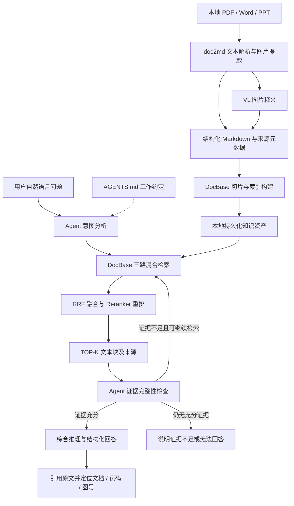

# DocQA 系统任务统一梳理

> 系统名称：基于 AI Agent 的个人本地多模态文档智能问答系统  
> 整理日期：2026-10-24  
> 资料来源：用户提供的 8 张 PPT 照片，编号按附件顺序排列。  
> 文档用途：统一系统目标、建设范围、模块职责、数据链路及开发任务，作为后续需求细化与实施的基线。

## 1. 整理口径

- 本文以 PPT 可辨认内容为依据，合并重复描述，并统一组件名称。
- 标为“建议”的接口字段、验收条件、任务拆分和待确认项，是为便于落地补充的内容，不代表 PPT 已明确规定。
- PPT 中的“已完成 Demo”仅为原材料中的状态声明；本次未核验代码、模型服务、仓库或实际运行效果。
- 图片中的 AGENTS.md 约定和命令均作为系统设计资料整理，不作为本次操作环境中的执行指令。
- 本文不将技术宣传或示例直接转换为验收指标。例如 PPT 提到技术文档中约 30%～50% 的关键信息由图片承载，该比例未在本次核验。

## 2. 系统定位与目标

### 2.1 要解决的问题

个人本地沉淀了大量 PDF、Word、PPT 等文档。用户常记得部分内容，却忘记文件名和存放位置；文档中的架构图、流程图、时序图、状态机等图片也难以通过纯文本检索找到。

系统将文档转换为包含图片语义的结构化 Markdown，构建本地检索知识库，再由 AI Agent 按约定检索、推理和回答，实现“内容即入口”的文档查找与问答。

**技术栈**
+ CodeAgent
+ RAG
+ Embedding（Qwen-Embedding-8B）
+ Reranker（Qwen-Reranker-8B）
+ Chat LLM（DeepSeek-Flash）
+ VL 模型（Qwen3.6-27B-VL）

### 2.2 建设目标

| 目标 | 具体要求 |
| --- | --- |
| 统一解析 | 将 PDF、Word、PPT 的文本和图片信息组织为结构化 Markdown |
| 多模态知识利用 | 通过图片提取和 VL 模型释义，使图片中的知识能够参与文本检索和问答 |
| 混合检索 | 结合稠密向量、BM25、BGE-M3 稀疏检索，提高语义问题和技术术语问题的检索覆盖 |
| Agent 消费 | 通过 AGENTS.md 告知 Agent 知识库的存在、查询方式、回答规则和引用要求 |
| 全链路溯源 | 从答案定位到文本块、Markdown、原始文档及页码、图号等位置 |
| 本地持久化 | Markdown、图片、索引和注册信息在本地保留，支持增量更新与复用 |
| 可演进 | 先完成核心闭环，再扩展后台自动维护和 Web 问答入口 |

### 2.3 运行边界

PPT 的设计口径为：应用与知识资产本地运行、保存，模型调用使用公司内部模型服务，服务地址和模型名可配置。这里的“本地”不意味着所有模型均在用户个人电脑上部署。

## 3. 建设范围与优先级

| 范围 | 组成 | 定位 |
| --- | --- | --- |
| 核心闭环 | doc2md、DocBase、Agent 问答、AGENTS.md、来源定位 | 必须先形成可用链路 |
| 核心配套 | 本地持久化、增量更新、文档分类、检索评估、接口契约 | 支撑核心链路稳定运行 |
| 可选扩展 | 后台 Service、目录监控、定时更新 | 降低持续维护成本 |
| 可选扩展 | B/S Web 应用、无头 Agent 调用、图形结果渲染 | 降低使用门槛，提供网页入口 |
| 后续探索 | Visio、Drawio 等更多格式 | PPT 提及可平行扩展，首期范围待确认 |

下文任务表使用建议优先级：P0 为最小闭环必需，P1 为可靠性与质量完善，P2 为可选扩展。该优先级是整理建议，不是 PPT 中已有的排期。

## 4. 总体架构与数据流

### 4.1 三层核心架构

1. **文档解析层 doc2md**：把原始多模态文档转换成结构化 Markdown 和图片资源，保留来源关系。

   1. 格式转换（PDF/Word/PPT转换为PDF）
   2. OCR提取（位图+矢量图）
   3. VL多模态提取（Qwen3.6-27B-VL解释图片）
   4. MarkDown生成（图片描述写入正文）
   5. 溯源元信息保留（文档名-Page-Figure Title）
   6. 原始链接关系（可逆向定位原文）

   + 产出：结构化Markdown+图片AI释义

2. **知识库层 DocBase**：切片、向量化、构建索引，执行三路召回、融合、重排，返回带来源信息的 TOP-K 文本块。

   1. Chunk切片
   2. 向量化
   3. 混合检索三路召回
   4. RRF融合
   5. Reranker重排
   6. Top-K文本块

   + 能力：build（进度条）/query/test三模式

3. **Agent 消费层**：依据 AGENTS.md 理解问题、调用检索、检查证据完整性、补充检索、综合生成答案并引用原文。

   1. AGENT.md知识入口
   2. 意图理解-RAG查询
   3. 大模型（Deepseek）综合推理
   4. 结构化产出
   5. 调源输出

   + 扩展：后台Service Web应用

### 4.2 统一逻辑图



其中“仍无充分证据”的结束分支是对 PPT“无据不答”原则的落地表达；具体结束条件需在实现时确定。

### 4.3 两条主流程

**离线建库：** 原始文档 → 解析 → 图片提取与释义 → Markdown → Chunk → 多路索引 → 本地持久化。

**在线问答：** 用户提问 → 意图分析 → 分类或范围筛选 → 三路检索 → RRF → 重排 → 证据检查与必要的补充检索 → 综合回答 → 引用溯源。

## 5. 核心模块职责

### 5.1 doc2md：多模态文档解析引擎

**输入：** PDF、Word、PPT，可按目录批量处理。

**处理任务：**

1. 将不同格式的正文和结构信息统一转换为 Markdown。
2. 提取文档中的位图、矢量图；PPT 将 OCR 提取与双形态图片处理纳入解析链路，具体实现方式待核验。
3. 调用 VL 模型解释图片中的模块、箭头、流程和逻辑关系，而不只识别文字。
4. 将图片释义写入对应 Markdown 上下文，让图片语义可随文本切片进入索引。
5. 保留原文档链接及图片来源信息。
6. 支持批量解析；PPT 还提出失败重试、待重试记录及继续处理的设计，具体细则待确认。

**输出：** 结构化 Markdown、图片资源、图片释义、来源元数据及解析任务状态。

**来源命名与关联：** PPT 建议图片名称包含文档名、Page 顺序、Figure 标题，并能够反向定位原文。建议实现时同时保存稳定标识与结构化元数据，避免只依赖文件名解析来源。

**需保留的上下文：** 图片释义与原图、所在章节、页面及原文件之间的关系；切片后也应能够恢复这些关系。

### 5.2 DocBase：三路混合检索 RAG 引擎

#### build：知识入库

Markdown 文档集 → 语义与结构切片 → Embedding 向量化 → BM25 / BGE-M3 稀疏索引构建 → 本地索引持久化。

PPT 明确的配套能力包括：多文档、文档分类管理、进度显示、增量更新、索引复用。

#### query：知识检索

| 路径 | 主要用途 | PPT 中的技术配置 |
| --- | --- | --- |
| 稠密向量检索 | 语义相似、原理和概念问题 | Qwen3-Embedding-8B |
| BM25 关键词检索 | 型号、命令、接口名等精确术语 | BM25 |
| BGE-M3 稀疏检索 | 通过学习型稀疏向量补充召回 | BGE-M3 |

三路候选经 **RRF 融合**合并，再由 **Qwen3-Reranker-8B** 交叉编码重排，最终输出携带来源元数据的 TOP-K 文本块。

PPT 中的设计意图是：稠密检索覆盖语义，关键词检索覆盖精确术语，稀疏检索补充召回；RRF 根据排名合并结果，减少各路分数尺度不同带来的影响，重排进一步改善相关性。

#### test：检索效果评估

PPT 提到 recall@k、hit_rate、MRR 等指标，以及对稠密、稀疏、混合检索效果进行对比。索引应支持跨进程加载和复用，避免每次查询重建。

### 5.3 Agent：由 AGENTS.md 驱动的知识问答

**工作流：**

1. 接收自然语言问题，识别意图和关键术语。
2. 必要时按文档类别缩小范围，并拆解检索词。
3. 调用 DocBase 查询。
4. 对证据完整性进行自评；信息不足时补充查询。
5. 对 TOP-K 证据进行筛选、跨文档整合与综合推理。
6. 按问题类型生成文本、表格或 Mermaid 图。
7. 附带原文引用及来源位置。

**核心约束：** 必须先检索；无据不答；关键结论引用原文依据；来源能够定位到文档及页码、图号等信息。涉及图中流程的解释与重绘，应能回到原图核对。

**交互方式：** 核心入口为 CodeAgent 命令行与 AGENTS.md，用户用自然语言提问。PPT 列举 Claude Code、NGA 等 Agent 工具；具体适配方式需按实际运行环境确认。

### 5.4 AGENTS.md：知识消费约定

PPT 将 AGENTS.md 定位为连接 Agent 与既有 RAG 知识库的关键约定文件，不是另一个检索引擎。

| 约定类型 | 应表达的内容 |
| --- | --- |
| 知识库存在性 | 本仓库配置 DocBase；领域问题先检索本地知识库 |
| 查询策略 | 支持文档分类与范围筛选；技术术语重视 BM25，原理问题重视向量检索；必要时补充查询 |
| 引用与溯源 | 回答附带原文链接及文档名、页码、图号等定位信息；无据不答 |
| 产出形式 | 按需输出表格、摘要、Mermaid 图；流程类解释与原图对照 |

**建议补充：** 明确查询工具的真实调用方式、参数说明、索引位置、返回结果结构、检索失败处理、补充查询次数上限。约定应与实际接口一致。

PPT 的路线图将第 3 步称为“AGENTS.md 知识消费约定”，并列出 `DocBase/CLAUDE.md` 为参考示例；正式入口文件名及不同 Agent 的加载规则仍需确认。

## 6. 模型与外部依赖

以下名称按 PPT 原文整理，仅记录方案配置，不表示已验证其可用性或版本。

| 能力 | PPT 中的模型 | 使用位置 |
| --- | --- | --- |
| 图片理解 | Qwen3.6-27B-VL | doc2md 图片语义解释 |
| 文本向量化 | Qwen3-Embedding-8B | DocBase 入库与查询 |
| 相关性重排 | Qwen3-Reranker-8B | 融合候选的精排 |
| 综合推理与生成 | GLM-5.1 | Agent 多文档整合及回答 |
| 学习型稀疏检索 | BGE-M3 | DocBase 第三路召回 |

模型调用应封装为独立客户端，支持配置地址和模型名称，并在测试中替换为 Mock。BGE-M3 的部署方式及稀疏向量生成接口未在图片中完整说明，需单独确认。

## 7. 工程组织与接口契约

### 7.1 PPT 中的工程结构

```text
docqa/
├── doc2md/
│   ├── parser/              # PDF / Word / PPT 解析器
│   ├── image_extractor.py
│   ├── vl_client.py
│   └── models.py
├── docbase/
│   ├── chunker.py
│   ├── indexer.py
│   ├── retriever.py
│   ├── evaluator.py
│   └── models.py
├── agent/
│   ├── answer.py            # 问答主流程
│   └── llm_client.py
├── service/                # 可选
│   ├── watcher.py
│   └── models.py
├── web/                    # 可选
│   ├── app.py
│   └── headless.py
├── AGENTS.md
└── tests/
    ├── test_doc2md...
    ├── test_docbase...
    └── test_agent...
```

PPT 同时强调“数据与约定分离”。建议将原始文档、Markdown、图片、索引、注册信息与代码分目录存放，具体目录名在实施前确定。

### 7.2 依赖方向

PPT 的分层顺序为：入口层 `web / service` → Agent 层 `agent` → 检索层 `docbase` → 解析层 `doc2md` → 外部模型端点。

统一原则为：上层依赖下层，禁止反向依赖；共享数据通过明确的模型与契约传递。该图表达分层关系，在线查询不应因此每次重新触发解析和建库。

### 7.3 核心接口草案

以下函数名和参数按 PPT 可辨认内容整理，是方案级契约草案，尚非现有代码接口声明。

| 模块 | 接口 | 用途 |
| --- | --- | --- |
| doc2md | `parse_document(src, out, vl_ep)` | 单文档解析 |
| doc2md | `batch_parse(dir, recursive, types)` | 按目录、递归选项和格式批量解析 |
| docbase | `build_index(md_dir, incremental)` | 全量或增量构建索引 |
| docbase | `query(index, q, top_k, category)` | 按问题和分类检索 |
| docbase | `eval_retrieval(index, test_set)` | 检索质量评估 |
| agent | `answer_question(q, index, max_rounds)` | 多轮检索与综合回答 |
| service，可选 | `register_watch(cfg)` / `update_single_doc()` | 注册监控及更新单文档 |
| web，可选 | `handle_query(req) -> WebQueryResponse` | 网页请求与结果适配 |

### 7.4 数据契约

PPT 列出 `ImageInfo`、`ParseTask`、`Chunk`、`RagIndex`、`QueryResult` 等模型，并强调字段只增不改、Web 返回结构与 Agent 返回结构保持对齐。

PPT 中可辨认的问答返回字段为：`answer`、`format`、`citations`、`rounds_used`。

**建议最小来源契约：**

| 对象 | 建议携带的信息 |
| --- | --- |
| 文档 | 稳定文档 ID、原始路径、文档名、类别、版本或内容指纹 |
| 图片 | 图片 ID、所属文档、页码或幻灯片序号、图号或标题、图片路径、释义、Markdown 定位 |
| Chunk | Chunk ID、所属文档、章节、正文、Markdown 定位、页码范围、关联图片 |
| 检索结果 | Chunk 与来源信息、召回路径、排名或分数、重排结果 |
| 引用 | 对应结论或答案片段、原文摘录、文档与页面位置、图片或 Markdown 链接 |

以上字段是落地建议。页码、图号并非对所有格式天然存在，应定义缺失值和替代定位方式，避免生成并不存在的位置。

## 8. 可选扩展任务

### 8.1 后台 Service

- 按定时或事件触发方式更新指定目录，可指定文档类型。
- 管理文档、向量数据和图片解析结果。
- 支持新增监控目录、单文档解析与增量索引更新。
- 保持知识库持续更新，减少人工干预。

**建议补充：** 变更去抖、失败重试、更新日志、删除文档后的索引清理、重复任务处理，以及更新失败时保留可用索引的机制。

### 8.2 B/S Web 应用

- 提供网页问答界面。
- 后台使用无头模式调用 CodeAgent；PPT 举例 `claude -p`、`nga run`，具体命令需按部署环境核验。
- 展示答案、引用、图片和 Mermaid 图。
- 复用 Agent 的问答流程及返回契约。

## 9. 统一任务分解

本节将 PPT 的能力描述转为可执行工作包；交付物和验收条件属于整理建议。

| 编号 | 优先级 | 工作包 | 主要任务 | 交付物 / 完成依据 |
| --- | --- | --- | --- | --- |
| T01 | P0 | 范围与契约冻结 | 确认格式、运行方式、模块边界、来源字段和接口 | 需求基线、接口与数据契约 |
| T02 | P0 | 模型服务适配 | 接入 VL、Embedding、Reranker、Chat，确认 BGE-M3 方案 | 可配置客户端及 Mock 能力 |
| T03 | P0 | 多格式解析 | 解析 PDF、Word、PPT，生成结构化 Markdown | 三种格式样本均可解析 |
| T04 | P0 | 图片知识提取 | 提取位图与矢量图、调用 VL、将释义写回正确上下文 | 原图、释义和 Markdown 关联可核对 |
| T05 | P0 | 来源映射 | 建立原文件、页面、图片、Markdown 和 Chunk 的映射 | 检索结果可追溯至原文 |
| T06 | P0 | 切片与持久化 | 保留章节及图文上下文，落盘保存知识资产 | 可加载复用的文档和索引 |
| T07 | P0 | 三路召回 | 实现稠密向量、BM25、BGE-M3 稀疏检索 | 三路均有可检查的候选结果 |
| T08 | P0 | 融合与重排 | RRF 合并、候选去重、Reranker 排序、TOP-K 输出 | 返回统一且带来源的结果 |
| T09 | P0 | Agent 问答 | 意图分析、检索、自评、补充查询、综合回答 | 自然语言问答核心闭环 |
| T10 | P0 | AGENTS.md 约定 | 声明知识库、工具用法、查询策略、引用和输出规则 | Agent 能按实际接口消费知识库 |
| T11 | P0 | 引用与无据不答 | 引用原文、定位来源、证据不足时说明限制 | 关键结论有依据，来源可打开 |
| T12 | P1 | 批量与增量 | 批量解析、分类、进度、增量构建、失败记录 | 修改文档后可更新并复用索引 |
| T13 | P1 | 检索质量评估 | 准备测试集、计算指标、对比召回组合 | 可复现的评估结果与调优记录 |
| T14 | P1 | 工程稳定性 | 单向依赖、契约兼容、模型 Mock、异常处理 | 核心模块可独立验证 |
| T15 | P2 | 后台维护 | 目录监控、定时任务、单文档更新与运维记录 | 自动维护知识库 |
| T16 | P2 | Web 入口 | 网页交互、无头调用、结构化结果及引用渲染 | 浏览器完成问答与溯源 |

**建议依赖顺序：** T01 → T02～T05 → T06～T08 → T09～T11 → T12～T14 → T15～T16。来源契约应从解析阶段建立，并贯穿后续各阶段。

## 10. 实施路线与阶段交付

PPT 提出的开发方式为 CodeAgent 辅助开发 Python 工程，由人负责关键决策；“五步渐进”路线如下。

| 阶段 | PPT 中的建设步骤 | PPT 标注状态 | 建议阶段交付 |
| --- | --- | --- | --- |
| 1 | doc2md 文档格式转换与图片释义 | 已完成 Demo | 可处理代表性多模态文档，保存 Markdown、图片及来源 |
| 2 | DocBase 三路混合检索 | 已完成 Demo | build / query / test 可运行，结果带来源 |
| 3 | AGENTS.md 知识消费约定 | 已完成 Demo | 自然语言提问、检索、回答、溯源形成闭环 |
| 4 | 后台 Service 自动化运维 | 可选扩展 | 自动发现文档变化并更新知识库 |
| 5 | B/S Web 应用 | 可选扩展 | 网页入口复用核心能力，呈现图文与引用 |

阶段 1～3 构成核心闭环，阶段 4～5 面向持续维护和团队、领域使用场景。上述状态未经代码核验，不能据此认定当前工作目录已具备这些功能。

## 11. 验收与验证建议

### 11.1 核心闭环验收场景

| 场景 | 建议检查内容 |
| --- | --- |
| 跨格式解析 | PDF、Word、PPT 样本均能生成可读 Markdown，标题与图片上下文合理 |
| 图片信息问答 | 仅出现在图中的流程或关系能通过释义检索，并可对照原图 |
| 精确术语检索 | 型号、命令、接口名等问题能召回正确文档片段 |
| 语义检索 | 问题表述与原文不同但语义相近时，仍能召回相关片段 |
| 跨文档综合 | 多份文档共同支撑的答案分别标明来源 |
| 补充检索 | 初次证据不足时继续检索，并记录使用轮次 |
| 无据不答 | 无相关材料时不编造结论或来源，明确说明证据不足 |
| 来源定位 | 从答案可回到 Markdown、原始文件及可用的页码或图位置 |
| 增量与复用 | 更新文档后检索结果更新；进程重启后索引仍可加载 |

### 11.2 检索评估

- 按 PPT 使用 recall@k、hit_rate、MRR；具体计算口径、K 值和相关性标注规则需统一。
- 建议测试集覆盖精确术语、语义改写、图片信息、跨文档问题和无答案问题。
- 建议比较单路、融合、融合加重排的结果，并在同一测试集下记录配置。
- PPT 未给出数值门槛，不在本次整理中虚设通过率、时延或成本指标。

### 11.3 工程验证

- 模型服务可 Mock，便于验证编排流程和错误处理。
- 单独验证解析、索引、检索和 Agent 模块，再执行端到端样本测试。
- 检查答案 → Chunk → Markdown → 原文的溯源链是否完整。
- 对 Mermaid 等重绘结果进行原图对照，检查模块、方向和关键关系是否一致。

## 12. 需确认的设计决策

| 待确认项 | 原因或影响 |
| --- | --- |
| 实际已有代码及 Demo 状态 | PPT 的状态声明不能替代仓库与运行核验 |
| 首期格式范围 | PDF 是否含扫描件、Word/PPT 是否含旧格式及复杂嵌入对象 |
| 图片处理实现 | 位图、矢量图的提取方式，OCR 与 VL 的分工，失败重试规则 |
| 模型服务能力 | 真实模型名、端点、认证方式、输入限制和调用配额 |
| BGE-M3 接入方式 | 是本地推理还是服务调用，稀疏向量与索引如何保存 |
| 索引技术选型 | 向量库、BM25 和稀疏索引实现未在照片中确定 |
| Chunk 与检索参数 | 切片大小、重叠、各路召回数量、RRF 参数、TOP-K 和阈值 |
| Agent 结束条件 | 补充检索最大轮数、自评规则、证据不足和模型失败的处理 |
| 来源定位规范 | PDF 页码、PPT 页序、Word 定位、图号缺失时的替代方式 |
| 增量生命周期 | 文件修改、删除、重命名、同名文档和重复内容的处理 |
| Agent 约定文件适配 | AGENTS.md 与 CLAUDE.md 的使用范围、工具发现方式和更新策略 |
| 可选部署边界 | Service 和 Web 是否纳入本期，是否需要多用户与访问控制 |
| 验收基准 | 文档规模、测试集、指标门槛、时延和资源目标尚未明确 |

## 13. PPT 来源对应表

| 照片编号 | PPT 主题 | 本文对应内容 |
| --- | --- | --- |
| 1 | 基于 AI Agent 的个人本地多模态文档智能问答系统 | 系统定位、目标、技术栈及模型配置 |
| 2 | 系统总体架构 | 三层架构、解析—检索—问答主链路 |
| 3 | DocQA 文档问答系统——逻辑视图 | 逻辑分层、知识资产、模型服务、扩展与溯源 |
| 4 | DocQA 文档问答系统——开发视图 | 工程结构、依赖方向、接口与数据契约、测试 |
| 5 | 实施路径：五步渐进，逐步演进 | 五阶段路线、Demo 状态声明及可选扩展 |
| 6 | doc2md：多模态文档解析引擎 | 解析流水线、图片释义、图文一体及来源命名 |
| 7 | DocBase：三路混合检索 RAG 引擎 | build / query / test、三路召回、RRF 与重排 |
| 8 | AGENTS.md：让 Agent 学会“查资料” | Agent 工作流、四类约定、引用与无据不答 |

### 13.1 原始附件索引

1. `98aa405e60058a37246e1bab5f9c652b.jpg`
2. `9444a704b03f4abb38a34fa5a331f889.jpg`
3. `codex-clipboard-52a767c0-7f33-42e8-b6e7-07bbfefb99a3.jpg`
4. `codex-clipboard-e8d19637-09c7-497c-a443-0e9a1c8ed3ab.jpg`
5. `codex-clipboard-d5c951f0-cb78-4e16-8b80-89808876e54c.jpg`
6. `codex-clipboard-e1fe41d4-1f13-4ddf-9c3e-e3e129876ea2.jpg`
7. `codex-clipboard-cedb34d6-5fc6-4b93-92bb-745394e395ca.jpg`
8. `codex-clipboard-dba7e615-f341-4c93-8c3c-c8c732082b51.jpg`

### 13.2 PPT 中提及的参考仓库

以下地址仅作原材料线索留存，本次未访问或验证：

- doc2md：`https://codehub-y.huawei.com/j00587807/doc2/home`
- DocBase：`https://codehub-y.huawei.com/j00587807/DocBase/home`

照片 5 的 doc2md Demo 路径写作 `codehub-y.huawei.com/j00587807/doc2md`，与架构页中的 `doc2/home` 存在差异，应以实际仓库为准。
