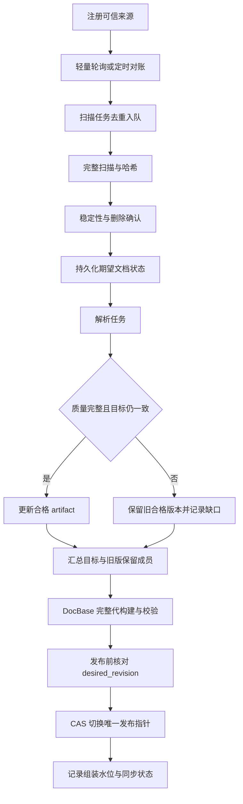

# Service 自动化运维模块设计、实现与测试指南

> 版本：v0.1；日期：2026-10-25。  
> 对应：[系统详细架构](./DocQA系统详细架构设计与实施方案.md)第 10、14.1、15 章，S5 生命周期与 S6-01/02 后台任务。  
> 项目目录：`E:\Documents\ChatGPTWorkSpace\DocQA System`。

## 1. 本阶段交付

实现了可独立运行的本地后台维护模块，复用 doc2md 解析和 DocBase 发布逻辑：

| 能力 | 已实现行为 |
| --- | --- |
| 目录监控 | 注册多个互不重叠的可信目录；启停、移除、分类和扫描间隔管理 |
| 类型与递归 | PDF / DOCX / PPTX 选择、大小写扩展名、递归或仅当前层；DOC / PPT 需显式启用旧格式转换 |
| 自动发现 | 默认每 3 秒轻量元数据轮询，变化只入队；默认每 1800 秒完整 SHA256 扫描补漏 |
| 增量更新 | 未变化复用；修改保留 doc_id，解析新版；复用模型缓存后组装完整不可变 generation |
| 文档管理 | 列表、详情、单文档解析、强制重解析、逻辑移除和恢复 |
| 索引管理 | 构建入队、当前代/统计、完整性校验、失败保留旧代、历史代继续可查询 |
| 图片管理 | 查询 figure、原图路径/哈希、定位、OCR/VL 状态与释义；显式触发所属文档图片重解析 |
| 自动任务 | SQLite 队列、去重、有限重试、失败检查、人工重试、排队取消、重启恢复、容量背压 |
| 运行控制 | 单任务 work、有限批次 run --once、持续 run、协作式 stop、状态/水位/心跳 |

本阶段采用本机 CLI worker。没有自动安装 Windows SCM 服务、创建计划任务或开启 Web/远程管理端口。长期运行方式见第 10 节。图片管理针对文档内图片；不把独立 PNG/JPEG 当作新的 doc2md 文档格式。图片重解析以所属文档为事务单元，不原位修改旧 figure 或旧索引。

## 2. 代码与目录结构

```text
src/docqa/service/
├── config.py        # ServiceOptions、可信根与预算
├── scanner.py       # 路径安全、递归发现、元数据探测、流式哈希、单文件检查
├── registry.py      # 来源/文档期望状态、事务与水位
├── queue.py         # 持久任务、去重、重试、恢复、容量限制
└── pipeline.py      # 调度、对账、解析、发布及运维用例
src/docqa/cli/service.py
configs/service.example.yaml
configs/service.demo.yaml
tests/test_service_{scanner,queue,pipeline,cli}.py
```

`cli/main.py` 注册 `service` 命令组；DocBase 的 `build_index()` 增加可选 `publication_guard` 上下文钩子。原调用不传钩子时行为不变，Service 使用它在复用结果或发布新代前核验期望水位。

```text
runtime/service-user/
├── service.sqlite       # sources、documents、metadata，schema=1
├── jobs.sqlite          # 持久任务队列，独立 schema
├── .worker.lock         # 进程存活期间的 OS 单 worker 互斥
├── .mutation.lock       # 短元数据/发布条件互斥
├── parsed/              # doc2md catalog、artifacts、blobs、OCR/VL 缓存
└── index/               # Service 专用 DocBase registry、generations、计算缓存
```

Service 根目录必须与监控目录双向分离，不能监控自己的 parsed/index/state，也不能将状态根放进被监控树中。每个 Service 根管理一个独立索引；不要让独立 DocBase CLI 向这个托管索引混入其他文档。现有业务索引不会被自动接管或覆盖。Agent state 应另设目录，通过 `ask --index <Service根>/index` 消费。

## 3. 全流程与增量语义



### 3.1 来源授权与发现

`allowed_source_roots` 是本机配置给定的授权上界，默认空，不能自动从 CLI 输入扩大。注册目录必须位于授权范围内。源路径、祖先、文件都检查链接与 Windows junction/reparse point；特殊文件被拒绝。不同监控根不允许重叠，避免相同路径重复登记。

跳过 Office `~$` 临时文件、`.tmp/.part/.swp`、常见缓存与隐藏目录；按源的类型、递归配置选择文件。所有扫描都设文件数、文件大小和目录条目上限；目录条目最多 100 万。元数据轮询不读正文，仍检查文件能否打开及前后状态。完整扫描流式计算 SHA256，检查路径、句柄、目录及目录成员集合前后是否一致。

扫描权限失败、目录断连、链接、资源超限、写入中变化均标记不完整。可处理其中已发现的稳定文件，但不能据此推断任何未发现成员已经删除。元数据探测可能漏掉“大小和 mtime 都未改变”的修改，周期完整哈希负责补漏。

### 3.2 新增、变更与删除

| 情况 | 确定行为 |
| --- | --- |
| 新文件 | 生成 UUID doc_id；相同观察结果持续 settle_seconds 后解析 |
| 同路径内容变化 | 保留 doc_id；新目标版本、新 revision/artifact；成功后替换成员 |
| 仅 mtime 改变 | 完整哈希相同则不重新解析或发布 |
| 新版本解析/图片质量失败 | 保存错误和最新尝试资产；继续使用旧合格 artifact，明确未同步 |
| 不同路径、相同内容 | 不按 hash 合并 doc_id，避免将复制件误判为移动 |
| 文件缺失 | 默认至少两次成功完整扫描，且距首次缺失不少于 settle_seconds，才逻辑排除 |
| 根断连/不完整扫描 | 不增加缺失确认，不批量移除 |
| 文件重新出现 | 因 missing 移除的记录恢复摄入，保留 doc_id，即使内容相同也重新满足当前目标 |
| 手动 document remove | 不再因普通扫描自动恢复；需 document restore |
| source --disabled | 暂停新增摄入，保留已发布成员，不等于移除 |
| source remove | 排除所属在管文档并构建新代；不删除源文件、历史快照或已保存答案 |
| 再 add 已移除的同一路径 | 复用 source_id，恢复源移除造成的在管记录；按新类型/递归范围恢复，手动移除记录保留 |

不自动推断重命名：移动视为新路径新增与旧路径稳定缺失。当前没有显式保持身份的 rename API，也没有物理 purge。

单文件 `service parse` 要求文件属于已启用来源，遵守其类型与递归范围，不枚举整个父目录。它直接进行稳定快照检查，跳过跨扫描的 3 秒去抖；doc2md 仍会验证读取期间变化。

### 3.3 目标、合格版本与水位

文档记录包含 `observed_sha256/observed_since`、`desired_sha256`、`target_version`、`good_version`、`artifact_dir`、`latest_attempt_artifact`、缺失计数、移除原因、状态与错误码。详情额外从活动代读取 published artifact/revision 和 `target_satisfied`。

全局三个水位分别为：

- `desired_revision`：已持久化的目标集合变更序号。
- `assembled_revision`：最近成功组装的目标快照水位；允许明确保留旧版。
- `synced_revision`：该次组装时所有在管目标均满足的水位，失败保留旧版时不冒进。

判断实际同步完成应检查 `status.unsatisfied_documents`、各源 `scan_error`、失败任务与文档详情，不能只看 assembled 或 CLI 退出 0。索引的实际版本始终以 DocBase 的单一 SQLite 发布指针为准，Service 水位不是第二个活动代指针。

### 3.4 图片与向量管理

`images list` 优先展示最新尝试资产，便于检查未通过质量门禁的图；同时标出旧索引是否仍在保留。每图保留定位、OCR 文本、semantic_state、vision 结构、图片路径与哈希。

`images reparse <doc_id>` 提升该文档 analysis_epoch，合入 doc2md analysis_revision；解析资产与 VL 缓存键随之变化。原文件未改也会重新执行图像分析。成功后整体发布新 artifact；失败不会混拼新图释义和旧正文。

仅有 native 文本的 demo 无需 OCR/VL；带图文档在未配置 VL 时会明确 review_required，不会作为完整文档偷偷入库。真实服务配置变更后应重启持续 worker，再执行重解析。当前不支持选择某一个 figure 局部提交，也未实现逐图检查点恢复。

向量管理采用 DocBase 完整 generation 重组，复用未变解析资产和 dense/sparse 计算缓存；不是 active 上的原位 upsert/delete。构建失败保留当前指针；删除可发布空代；历史代保留，历史 Agent 引用不因本次逻辑移除而被物理删除。

## 4. 任务、并发、恢复与背压

任务状态：`queued → running → succeeded / failed / retry_wait`，retry_wait 到期可再次领取；queued/retry_wait 可取消。任务包含去重键、owner、attempt、available_at、心跳、结果、错误码和被后继替代的标识。

- 扫描按 source 去重；解析按 doc_id + target_version 去重；构建合并为待执行批次。运行中的任务可有一个后继，但同键不能并发执行。
- 默认最多 3 次尝试，指数退避初值 5 秒；只重试声明为可恢复的错误。耗尽后不通过重新建任务无限重试；需新目标、人工 retry 或 force。
- 默认最多 1000 个活动任务、每轮最多执行 100 个。内部队列满时保留期望状态，先排空已有工作，再补排，容量为 1 也能前进。显式请求可能返回队列满错误或单文档 deferred，不能当作已执行成功。
- 任务 payload/result 各最多 64 KiB；只保存精简元数据，不放文档全文或密钥。结果由 SQLite 持久记录，CLI stdout 保持纯 JSON。
- 取消解析目标后不会由同版本自动补排复活，可人工 retry 或 force 生成新目标。取消扫描任务不等于停用来源，未来调度仍可扫描；要暂停请用 source update --disabled。
- running 任务不支持强制 cancel；stop 在任务/等待间隙生效，正在进行的解析或模型 I/O 先完成。Ctrl+C 为人工中断入口。

worker 获取 `.worker.lock` 后才恢复遗留 running 任务。该 OS 锁随进程死亡释放，不以心跳 TTL 抢占活 worker。持续运行约每 2 秒更新 worker 心跳；元数据繁忙或存储故障可能延迟心跳，因此不能只按心跳过期删除数据或接管。

来源、文档与 desired_revision 的变更由短互斥加同一个 Service SQLite 事务原子提交。队列是另一个库，不能宣称跨库事务；重启/每轮补排从持久期望状态修复漏入队。极端崩溃可留下无对应目标的排队任务，执行时被安全拒绝或判旧，不获得发布权。

构建前冻结成员；模型调用期间不持 mutation 锁。准备完成后在 publication_guard 中重新比较期望水位，变化则 SERVICE_TARGET_STALE，保留旧代并处理下一批。DocBase 仍按其 generation/sequence CAS 发布。发布成功但任务响应未落库时，重试利用同一 build_key 复用当前代，不重复发布。没有模拟分布式 fencing/租约或跨机器共享写入。

## 5. 配置与 CLI

配置模板为 `configs/service.example.yaml`，演示为 `configs/service.demo.yaml`。无需新增 Python 依赖，继续使用现有 Python 3.12 Conda 环境。

| 参数 | 默认 | 说明 |
| --- | --- | --- |
| allowed_source_roots | 空 | 必须显式配置可信目录 |
| types | pdf/docx/pptx | add 未显式指定时使用 |
| settle_seconds | 3 | 新增/修改稳定观察时间 |
| scan_interval_seconds | 1800 | add 的默认完整扫描间隔 |
| missing_confirmations | 2 | 完整成功扫描的缺失确认次数 |
| max_files | 10000 | 单次扫描文件上限 |
| max_pending_jobs | 1000 | 活动队列容量 |
| max_attempts / retry_base_seconds | 3 / 5 | 有限重试 |
| max_jobs_per_tick | 100 | 单轮最多执行数量 |
| parse / retrieval | 原模块配置 | 嵌入 doc2md / DocBase 配置，不存密钥值 |

相对可信根按 YAML 所在目录解释，保留词法路径以供链接检查。持续进程启动时读取一次配置，不热加载 YAML；source update 是即时的持久管理操作。解析设置改变会产生新的待解析目标，retrieval 设置改变会触发新索引组装。外部工具、模型或代码升级后应调整 analysis_revision 或显式重解析/重建，不声称自动探测所有部署变化。

所有命令的 `--state` / `--config` 位于叶子命令后：

| 领域 | 命令 |
| --- | --- |
| 来源 | `service source add/list/update/remove/search` |
| 摄入 | `service scan [source_id]`、`service parse <path> [--source ID] [--force]` |
| 文档 | `service documents`、`service document show/remove/restore <doc_id>` |
| 图片 | `service images list/reparse <doc_id>` |
| 索引 | `service index build/status/verify [--generation ID]` |
| 任务 | `service job list [--job-state failed]`、`show/retry/cancel <job_id>` |
| 运行 | `service work`、`run --once`、`run [--poll-seconds 3] [--max-ticks N]`、`stop`、`status` |

source update 支持启停、分类和间隔；类型或递归范围需先移除再重新 add 同一目录。重复 add 已注册的活动目录返回原记录，不修改其策略，应核对返回的 types/recursive。

一般命令成功返回 0；参数/配置错误通常 2，执行错误通常 4；run 的本批次有失败任务返回 5，work 的任务失败返回 4；Ctrl+C 返回 130。`run --once` 可能仍有 settling、retry_wait、下一轮待处理或失败的旧目标，退出 0 只代表本次执行未发生新失败，务必继续检查 status。

常见错误：SOURCE_ROOT_NOT_CONFIGURED / SOURCE_ROOT_NOT_ALLOWED / SOURCE_ROOT_OVERLAP、SCAN_INCOMPLETE、SOURCE_NOT_READY、SERVICE_QUEUE_FULL、SERVICE_TARGET_STALE、SERVICE_ALREADY_RUNNING。原解析/模型/索引错误码保留，不将其归类成“资料无答案”。

## 6. 已执行验证

2026-10-25 全项目 **639 项测试通过**，包含既有 452 项和 Service 新增 187 项；全量运行 272.51 秒，语句覆盖率约 **88%**（6819 条语句、835 条未覆盖）。新增测试包括队列 51、扫描 33、CLI 契约 77、真实模块集成 26。Ruff 检查通过。

完成 **41 次独立 CLI/进程验证**：来源授权与递归、初次摄入、增量修改、单文档强制解析、图片重解析入口、启停、逻辑移除/恢复、类别更新、索引校验、旧代查询、持续轮询启动与协作停止。详见[CLI 记录](../runtime/service-cli-report.json)、[全量测试报告](../runtime/service-tests.xml)、[覆盖率报告](../runtime/service-coverage.json)。运行产物被 Git 忽略，迁移仓库后需重新生成。

集成测试使用真实小型 DOCX、doc2md 资产与 DocBase；图片测试包含未配置 VL 的门禁和注入测试客户端的重解析/缓存失效验证。检索使用显式 synthetic，图片测试客户端是 Mock：不能据此宣布真实 OCR/VL、向量三模型或生产业务质量通过。

核心回归覆盖：变化保持身份、旧代保留、两次删除确认、同内容重新出现、断根/不完整扫描不删、队列容量 1、有限重试不绕过、发布前目标变化、OS worker 互斥、重启恢复、取消不复活、源/文档/水位事务回滚、图片旧版保留。

最终还对来源重新注册的类型收窄边界及 Service 集成/CLI 的 103 项测试补充复验，全部通过。本文 16 个 PowerShell 代码块通过语法解析，注册/递归发现、批次执行/详情和单文档操作的 3 个核心代码块已实际执行通过。

## 7. 手动测试：准备与正常摄入

以下在项目根目录 PowerShell 执行。仅使用人工测试目录。若目录已有资料，先换一组新路径并调整本机配置中的 allowed_source_roots，不覆盖已有资产。

### M01 环境与样例

```powershell
conda activate docqa
Set-Location 'E:\Documents\ChatGPTWorkSpace\DocQA System'
python scripts/docqa.py service --help
python scripts/generate_docbase_samples.py --output runtime/service-fixtures-user
New-Item -ItemType Directory -Path runtime/service-input-user/nested | Out-Null
Copy-Item -Path runtime/service-fixtures-user/input/*.docx -Destination runtime/service-input-user
Move-Item -LiteralPath runtime/service-input-user/recovery.docx -Destination runtime/service-input-user/nested/recovery.docx
$serviceState = 'runtime/service-user'
$serviceConfig = 'configs/service.demo.yaml'
```

预期四份原生 Word，其中 recovery 位于子目录。demo 配置仅授权该输入目录，默认 3 秒稳定性检查、无 OCR/VL、显式合成检索。

### M02 注册、递归发现

```powershell
$source = python scripts/docqa.py service source add runtime/service-input-user --types docx --category protocol --recursive --state $serviceState --config $serviceConfig | ConvertFrom-Json
$sourceId = $source.source_id
$source | Format-List
python scripts/docqa.py service source list --state $serviceState --config $serviceConfig
$found = python scripts/docqa.py service source search $sourceId --state $serviceState --config $serviceConfig | ConvertFrom-Json
$found.files | Select-Object path, size, content_sha256
```

预期授权成功、complete=true、发现四份文件，包含 nested/recovery.docx。search 仅发现，不执行解析或发布。注册父目录后再注册其子目录应拒绝重叠。

### M03 执行有稳定观察窗口的后台批次

```powershell
python scripts/docqa.py service run --max-ticks 5 --poll-seconds 1 --state $serviceState --config $serviceConfig
python scripts/docqa.py service status --state $serviceState --config $serviceConfig
$docs = python scripts/docqa.py service documents --state $serviceState --config $serviceConfig | ConvertFrom-Json
$one = $docs | Where-Object { (Split-Path -Leaf $_.path) -eq 'heart_protocol.docx' } | Select-Object -First 1
$docId = $one.doc_id
python scripts/docqa.py service document show $docId --state $serviceState --config $serviceConfig
```

预期四份 ready、索引 documents=4、unsatisfied_documents 为空、target_satisfied=true。初次 run --once 可能只完成发现、仍 settling；不能因为尚未过 3 秒就判定失败。

### M04 索引查询与 Agent 衔接

```powershell
python scripts/docqa.py service index status --state $serviceState --config $serviceConfig
python scripts/docqa.py service index verify --state $serviceState --config $serviceConfig
python scripts/docqa.py docbase query 'SD5993 的 FE_HEART_Start 如何启动心跳？' --index runtime/service-user/index --config configs/docbase.demo.yaml
python scripts/docqa.py ask 'SD5993 的 FE_HEART_Start 如何启动心跳？' --index runtime/service-user/index --state runtime/service-agent-user --config configs/agent.demo.yaml
```

预期索引校验有效，query 命中心跳，ask 提供引用与回源；synthetic=true、verified=false。Agent state 与 Service/index 分离。各配置的 analyzer 与模型 profile 必须与构建一致。

### M05 不变复用、单文档强制解析

```powershell
$before = python scripts/docqa.py service index status --state $serviceState --config $serviceConfig | ConvertFrom-Json
python scripts/docqa.py service scan $sourceId --state $serviceState --config $serviceConfig
python scripts/docqa.py service run --once --state $serviceState --config $serviceConfig
$after = python scripts/docqa.py service index status --state $serviceState --config $serviceConfig | ConvertFrom-Json
$before.generation_id -eq $after.generation_id
python scripts/docqa.py service parse runtime/service-input-user/heart_protocol.docx --source $sourceId --force --state $serviceState --config $serviceConfig
python scripts/docqa.py service run --once --state $serviceState --config $serviceConfig
python scripts/docqa.py service document show $docId --state $serviceState --config $serviceConfig
```

无变化时 generation 相同；force 提升分析版本，doc_id 保持，artifact 可变化。显式单文档解析不要求先遍历其全部兄弟文件。

## 8. 手动测试：增量、失败与生命周期

### M06 修改内容，观察自动更新

在 Word 中修改测试心跳文档并保存，或执行以下固定测试路径命令：

```powershell
python -c "from docx import Document; d=Document(); d.add_paragraph('SD5993 新版心跳间隔为两秒。'); d.save('runtime/service-input-user/heart_protocol.docx')"
python scripts/docqa.py service run --max-ticks 5 --poll-seconds 1 --state $serviceState --config $serviceConfig
python scripts/docqa.py service document show $docId --state $serviceState --config $serviceConfig
python scripts/docqa.py docbase query 'SD5993 新版心跳间隔' --index runtime/service-user/index --config configs/docbase.demo.yaml
```

预期无需手动 scan，元数据轮询发现变化；doc_id 保持、target_version 增加、索引换代、查询新版。可给 query 增加之前的 --generation 验证旧代仍可读。

### M07 暂停、恢复与调整周期

```powershell
python scripts/docqa.py service source update $sourceId --disabled --state $serviceState --config $serviceConfig
python scripts/docqa.py service run --once --state $serviceState --config $serviceConfig
python scripts/docqa.py service source update $sourceId --enabled --interval-seconds 60 --state $serviceState --config $serviceConfig
python scripts/docqa.py service run --max-ticks 5 --poll-seconds 1 --state $serviceState --config $serviceConfig
```

暂停期间旧索引继续可用，新增摄入暂停；启用后重新对账。interval 是完整哈希周期，poll 是轻量变化探测周期，两者不同。

### M08 解析失败与任务诊断

```powershell
[System.IO.File]::WriteAllBytes((Join-Path (Get-Location) 'runtime/service-input-user/broken.docx'), [byte[]](1,2,3,4))
python scripts/docqa.py service parse runtime/service-input-user/broken.docx --state $serviceState --config $serviceConfig
python scripts/docqa.py service run --once --state $serviceState --config $serviceConfig
python scripts/docqa.py service job list --job-state failed --state $serviceState --config $serviceConfig
python scripts/docqa.py service status --state $serviceState --config $serviceConfig
```

预期本批次有失败时退出 5；broken 不能成为合格成员，已有四份仍可查。status 报未满足目标；失败不会无限重建任务。修好测试文件后可 `service parse <path> --force`，也可针对仍匹配当前目标的 job 执行 retry。

清理本负例用逻辑移除，不需要物理删除：

```powershell
$broken = python scripts/docqa.py service documents --state $serviceState --config $serviceConfig | ConvertFrom-Json | Where-Object { (Split-Path -Leaf $_.path) -eq 'broken.docx' } | Select-Object -First 1
python scripts/docqa.py service document remove $broken.doc_id --state $serviceState --config $serviceConfig
python scripts/docqa.py service run --once --state $serviceState --config $serviceConfig
```

### M09 文档逻辑移除与恢复

```powershell
python scripts/docqa.py service document remove $docId --state $serviceState --config $serviceConfig
python scripts/docqa.py service run --once --state $serviceState --config $serviceConfig
python scripts/docqa.py service document show $docId --state $serviceState --config $serviceConfig
python scripts/docqa.py service document restore $docId --state $serviceState --config $serviceConfig
python scripts/docqa.py service run --once --state $serviceState --config $serviceConfig
```

预期移除后 in_current_index=false，源文件仍在；恢复后同 doc_id 再次满足目标。普通扫描不会复活手动移除的文档。source remove 为整个源的逻辑排除，重新 add 相同目录可恢复其在管记录。

### M10 稳定删除确认

仅对新建的演示副本操作，不删除原资料：

```powershell
Copy-Item -LiteralPath runtime/service-input-user/heart_protocol.docx -Destination runtime/service-input-user/delete-demo.docx
python scripts/docqa.py service parse runtime/service-input-user/delete-demo.docx --state $serviceState --config $serviceConfig
python scripts/docqa.py service run --once --state $serviceState --config $serviceConfig
Remove-Item -LiteralPath runtime/service-input-user/delete-demo.docx
python scripts/docqa.py service scan $sourceId --state $serviceState --config $serviceConfig
python scripts/docqa.py service run --once --state $serviceState --config $serviceConfig
python scripts/docqa.py service index status --state $serviceState --config $serviceConfig
Start-Sleep -Seconds 3
python scripts/docqa.py service scan $sourceId --state $serviceState --config $serviceConfig
python scripts/docqa.py service run --once --state $serviceState --config $serviceConfig
python scripts/docqa.py service documents --include-removed --state $serviceState --config $serviceConfig
```

预期第一次完整缺失扫描保留副本成员，第二次达到稳定窗口后逻辑排除。离线盘/权限失败不具备删除资格；此类保护已有自动化覆盖，手工请仅在测试根验证。

## 9. 手动测试：图片、队列与运行

### M11 图片状态与重解析

将一份带图片的测试 DOCX/PDF/PPTX 放入授权树，等待稳定后摄入。查询其 doc_id：

```powershell
python scripts/docqa.py service documents --state $serviceState --config $serviceConfig
$imageDocId = Read-Host '输入上方列表中带图文档的 doc_id'
python scripts/docqa.py service images list $imageDocId --state $serviceState --config $serviceConfig
python scripts/docqa.py service images reparse $imageDocId --state $serviceState --config $serviceConfig
python scripts/docqa.py service run --once --state $serviceState --config $serviceConfig
```

输入实际带图文档 ID。demo 不配置 VL，因此图会明确标 disabled/ocr_only、review_required，旧合格成员继续保留。返回 image_path 可在 IDE/图片查看器中打开；检查 figure 定位、原图、OCR 与 vision 结构。不要把未配置模型时的 review_required 当作解析成功。

真实联调：复制 service.example.yaml 为被 Git 忽略的 local.service.yaml，在 parse 中合入已验证的 OCR/Office/VL 配置，在 retrieval 中合入已验证的 dense/sparse/reranker 配置。密钥通过 api_key_env 指定的环境变量提供。先停止旧 worker，再用新配置运行并 reparse。需核对真实图片方向、数字、单位和释义，不能只看质量标签。

### M12 任务、重试、取消和单步

```powershell
python scripts/docqa.py service job list --state $serviceState --config $serviceConfig
python scripts/docqa.py service work --state $serviceState --config $serviceConfig
python scripts/docqa.py service index build --state $serviceState --config $serviceConfig
python scripts/docqa.py service run --once --state $serviceState --config $serviceConfig
```

从列表复制 job_id，再执行 `service job show/retry/cancel <job_id>`。retry 是人工新尝试预算；cancel 只接受未运行任务。work 每次最多处理一个任务，可能是 scan、parse 或 build，不承诺“一次 work 就完成整次摄入”。

### M13 持续运行与停止

终端 A：

```powershell
python scripts/docqa.py service run --poll-seconds 3 --state $serviceState --config $serviceConfig
```

终端 B 在相同项目目录使用相同 state/config：

```powershell
python scripts/docqa.py service status --state runtime/service-user --config configs/service.demo.yaml
python scripts/docqa.py service stop --state runtime/service-user --config configs/service.demo.yaml
```

预期 A 在当前任务结束后返回 stop_requested=true。并发启动第二个 worker 应报 SERVICE_ALREADY_RUNNING；查询和入队仍可使用。强行终止测试进程后重启，遗留 running 任务在拿到 OS 锁后恢复，不能按心跳 TTL 抢占仍存活进程。

### M14 新增监控根与分类

新增根必须是当前监控树以外的独立目录。先停止持续 worker，在本机配置 allowed_source_roots 中加入第二个可信根，再 `source add <第二目录> --types pdf,docx,pptx --recursive`。两根内容分别登记，不能把第二目录设为第一目录子树。

分类修改用 `source update <source_id> --category <新分类>`，再运行 worker；系统重新解析目标元数据并发布。类型或递归变更应先 source remove 再 add，期间旧发布状态以 status 为准；不要修改 SQLite 或旧 artifact。

## 10. 定时运行、部署与后续边界

### 10.1 运行方式

持续 `service run` 本身已包含变化轮询与定期完整扫描。也可以用 Windows 任务计划程序周期调用 `run --once`；两种方式选一种管理同一 state，避免无意义的 worker 竞争。

任务计划程序手动设置：

1. 程序选择 `python -c "import sys; print(sys.executable)"` 返回的 docqa 环境 Python 完整路径，不依赖计划任务自动 conda activate。
2. 参数填写带完整路径的 `scripts/docqa.py service run --once --state ... --config ...`，路径有空格时加双引号。
3. “起始于”设置为项目根目录；使用有权限读取来源和本机密钥环境变量的用户。
4. 选择合适触发周期，启用“已有实例运行时不启动新实例”，记录退出码与 Service 状态。
5. 如需开机运行或隐藏后台窗口，按本机管理方式配置任务；本阶段没有自动注册任务、修改系统服务或启动项目外进程。

修改 YAML 后重启持续 worker；相同 state 不应交替使用不一致的解析/模型配置。不得用 HTTP 默认未配置模板覆盖正在使用的真实配置并宣称同步成功。

### 10.2 已知边界和下一步

- 目前面向可信单机、本地文件系统。没有跨机器分布式 worker、多用户认证或远程管理 API。
- 默认轮询元数据，未安装 watchdog；大量文件的扫描、内存、磁盘和模型吞吐需实测，不承诺未测量的容量或 p95。
- 原生文档解析与模型调用为串行 worker，长调用会推迟发现下一轮事件和 stop 响应；不是可强制中断的实时服务。
- 未实现逐页/逐图检查点、硬取消、持续滚动日志/告警平台、在线一致备份、迁移根目录工具、回滚、GC 或物理 purge。
- 历史代与图片全部保留以保护已保存引用；空间管理先看实际占用，不手工清理被引用资产。备份前应停 worker 与其他 writer，并同时保留完整 Service 根；数据库含绝对路径，跨根恢复不能直接当作已支持迁移。
- 当前 Service 数据库不是目标架构的全局 Registry/fencing/读租约平台。S6-01/02 的本机队列与自动对账已落地，不表示 S5 全部可靠性、容量及备份门禁已经完成。

Web 已在后续 [Web 工作台阶段](./Web应用模块设计实现与测试指南.md)交付，复用内置问答、固定 generation 并只读 Service 状态；Service 管理仍使用本指南 CLI。建议后续顺序：真实 OCR/VL 与向量服务联调 → 业务金样与容量基线 → 逐阶段可恢复任务/可中断 I/O → 系统级生命周期与引用保护 GC → 团队访问控制。

复跑测试可用全新的专用临时目录：

```powershell
python -m pytest -q --basetemp runtime/pytest-service-user-001
python -m ruff check src tests scripts/docqa.py scripts/generate_doc2md_samples.py scripts/generate_docbase_samples.py
```

pytest 会清理 basetemp，因此不要将其指向真实资料或日常 Service 根。
