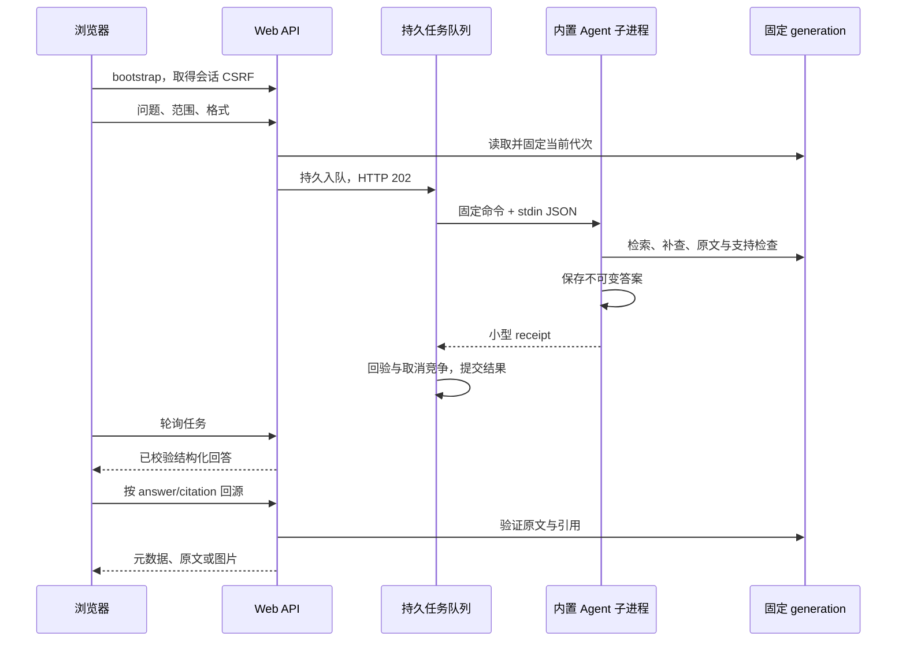

# Web 应用模块设计、实现与测试指南

> 版本 v0.1；日期 2026-10-25。  
> 对应：[详细架构](./DocQA系统详细架构设计与实施方案.md)第 13.3、14.2～14.3 章。  
> 用户已明确选择：**先使用项目内置受控 Agent**，本阶段不接入外部 Claude Code/NGA 等宿主。

## 1. 交付与使用入口

本模块提供本地 B/S 网页工作台。用户通过浏览器提问、选择文档范围、查看任务、阅读回答、打开原文/图片、查看表格与关系图，不需要在 CodeAgent 命令行中完成问答。

后台采用 FastAPI + Uvicorn，网页使用原生 HTML/CSS/JavaScript，无 npm 构建、远程字体、CDN 或第三方浏览器渲染库。服务器管理单个持久问答队列，每个问题通过固定 Python 无头子进程运行已有内置 Agent，保留原来的 RAG、补查、主题完整性、引用与支持检查。

已提供：问题/分类/文档/必答要点输入，Markdown/表格/关系图选择，任务轮询与取消，浏览器会话历史，明确回答状态，证据抽屉，原始快照下载和安全图片预览，可选 Service 只读状态，桌面与窄屏布局。

本阶段没有外部 CodeAgent 进程适配、团队鉴权、远程监听、网页上传解析、源目录注册或删除管理。Service 管理继续用独立 CLI；普通问答页不暴露破坏性运维接口。

本机实测[桌面工作台截图](../runtime/web-browser-desktop.png)、[移动端截图](../runtime/web-browser-mobile.png)；图渲染单独使用[明确标记的 Mock 关系数据截图](../runtime/web-browser-graph-mock.png)。运行产物不随 Git 版本保存，需在本机测试后生成。

## 2. 文件与系统组织

```text
src/docqa/web/
├── config.py       # 固定后台路径、loopback、容量与运行时配置
├── models.py       # HTTP 问题契约，禁止客户端指定路径/命令
├── security.py     # Host/Origin、会话、CSRF、实际流限长及安全响应头
├── tasks.py        # SQLite 任务/会话归属、消费线程、取消和发布竞争
├── runner.py       # 固定 Python 子进程、环境白名单、超时/输出限额和回验
├── worker.py       # 单问题无头入口，调用原 answer_question
├── app.py          # HTTP 传输、资源解析及网页投影
└── static/
    ├── index.html  # 中文工作台
    ├── app.js      # 状态、请求、结构化展示、SVG、引用抽屉
    └── styles.css  # 桌面与移动布局、键盘焦点及可访问性
src/docqa/cli/web.py
configs/web.demo.yaml
configs/web.example.yaml
requirements-web.txt
tests/test_web_*.py
```

静态文件加入 setuptools package-data，安装项目后也能随包读取。主 CLI 延迟加载 Web 依赖，既有 doc2md/DocBase/Agent/Service 命令不因导入 Web 而启动 HTTP 或工作线程。

```text
runtime/web/
├── .web-secret                 # 本机签名密钥，原子初始化，不通过 HTTP 提供
├── .secret.lock
├── .web-worker.lock            # 单进程消费者互斥
├── questions.sqlite            # 任务、所属浏览器会话、状态与 receipt
├── runs/<job_id>/              # 子进程专属工作目录，不落盘请求/密钥/日志
└── agent/<job_id>/
    ├── sessions.sqlite         # 该问题的内置 Agent 证据/答案记录
    └── answers/<answer_id>/    # 原有不可变 answer.json/md/manifest
```

Web state、知识索引不能互为父子目录。推荐消费 Service 的 `<Service根>/index`，Web 根另设；也能读取独立 DocBase。当前不实施 GC，不能手工删除被历史答案使用的 generation 或来源资产。

## 3. 一次网页问答的全流程



### 3.1 受控无头入口

运行命令固定为当前 Python 的 `-m docqa.web.worker`，不用 shell，不把问题拼入命令行，不允许浏览器传可执行文件、工作目录、模型端点、索引或状态路径。

stdin JSON 只包含服务器固定的配置/路径和已验证问题范围。子进程环境继承必要 Windows/临时目录/Python 运行变量，以及五个模型角色显式 api_key_env 指定的变量；无关秘密、代理变量、用户 PYTHONPATH 等不继承。环境变量名若占用 PATH/PYTHON 等运行设置会拒绝。

这属于**固定内置代码的进程隔离与资源管理**，不是任意第三方 Agent 的 OS 沙箱，也不是外部 CLI 接入证明。若将来接入外部宿主，需要另行实测工具禁用、权限、协议及隔离，不能简单替换可执行文件就宣称受控。

### 3.2 回答质量与版本

提交时固定 generation，排队期间索引更新不改变本问题的依据。category/doc_id 是硬过滤；空列表与未指定不同，不能在后台自动扩大。多要点通过 topics 明确，生成器与支持检查器沿用既有预算和流程。

子进程调用原 `answer_question()`；不另写简化版 prompt/RAG。worker 和父进程均从 SessionStore 回读保存答案及引用，校验问题、generation、调用者、过滤和来源。stdout 仅返回 answer_id/session_id/status，不能用一段自由文本冒充已验证答案。

网页展示的核心字段含义与 AnswerResult 一致。HTTP 额外提供受控资源 URL 和主题文本，去掉原始 trace、服务器文件路径及本地文件链接。页面从 claims、conflicts、coverage、citations、diagram_edges 生成界面，不执行模型 Markdown/HTML。

answered、partial、conflicting_evidence、insufficient_evidence、failed、cancelled 分别展示；partial 列缺口，失败不是“资料没有答案”。synthetic=true 时始终明确标记演示，verified=false，不因网页包装改变真实验证等级。

### 3.3 图形与来源

表格仍从经过检查的声明和引用生成。关系图直接将已检查的 DiagramEdge 转为固定 SVG：确定方向才有箭头，无方向为普通连线，方向未知为虚线并有文字说明；关系附来源入口，支持缩放和 SVG 下载。

不执行模型给出的任意 Mermaid 字符串。mermaid 格式请求表示结构化关系图意图；当前不是通用 Mermaid 语言渲染器，不支持任意时序图/甘特图脚本。没有可靠边时回退有据文字，不为了画图添加关系。循环/自环保守排布，过长标签有预览截断与完整文字说明。

引用抽屉显示逐字片段、原生/OCR/VL 标识、版本与实际定位，提供 Markdown 和原始快照下载。Word 原生对象不伪造页码。图片先经固定引用 resolver 验证，再用 Pillow 限定像素并转为 PNG，避免直接内嵌原始 SVG/HTML。

## 4. 队列、取消与恢复

任务有 queued/running/succeeded/failed/cancelled，运行中可附 cancel_requested 和 cancelling 阶段。HTTP 202 只表示入队；浏览器按 job_id 轮询到终态。

默认最多 20 个活动任务，一个消费者、一个问题子进程；队列满 HTTP 429。消费者由 FastAPI lifespan 管理，先拿到 OS worker 锁再恢复与开始接收，消费者失效返回 WORKER_UNAVAILABLE，不继续接受无消费者异步请求。禁止 Uvicorn 多 worker 或共享 state 的重复实例。

取消与完成在同一个 SQLite 写事务决定：取消先提交，结果 receipt 不发布；完成先提交，取消不能假装撤销成功。队列取消立即终态；运行取消请求终止并回收该子进程。远端模型可能已经开始推理，不能保证远端费用/执行被撤销。

启动时遗留 running 标失败 WEB_WORKER_RESTARTED，queued 可继续消费，不自动重复已经不确定完成的模型调用。每个任务有独立 Agent 根；即使异常中断留下私有答案，也不能绕过任务所有权和结果提交直接通过 HTTP 暴露。

进度只报告实际 queued/starting/running/complete/终态，不伪造百分比或模型细分阶段。默认 runner 墙钟上限 150 秒，Agent 协作式预算 120 秒；stdin 最多 1 MiB，stdout/stderr 各最多 1 MiB，超限/超时拒绝结果并回收进程。

shutdown 请求取消活动任务，尝试等待最多 15 秒。父进程的 SQLite 等待、引用文件回验或 OS 进程回收可能更久；超时返回错误且保留 worker 锁，不能宣称严格 15 秒停机或在旧线程还运行时接管。

## 5. HTTP 与本机安全

| 方法和路径 | 作用 |
| --- | --- |
| GET `/`、`/static/app.js`、`/static/styles.css` | 固定网页资产，无目录列表 |
| GET `/api/v1/health/live` | 存活，无知识内容 |
| GET `/api/v1/bootstrap` | 会话、CSRF、知识范围、依赖状态、Service 只读摘要 |
| GET `/api/v1/health/ready` | 消费者、索引与必需配置检查；不代表模型已连通 |
| POST `/api/v1/questions` | 入队问答，202 |
| GET `/api/v1/jobs`、`/jobs/{id}` | 本会话历史与任务 |
| POST `/api/v1/jobs/{id}/cancel` | 取消，需要 JSON body，例如 `{}` |
| GET `/api/v1/queries/{answer_id}` | 本会话已提交答案 |
| GET `/api/v1/queries/{answer_id}/citations/{citation_id}` | 引用元数据 |
| GET `.../citations/{citation_id}/content?kind=markdown/snapshot/image` | 固定来源资源；image 用数字序号 |

默认绑定且只允许 `127.0.0.1`；Host 精确允许当前端口的 127.0.0.1/localhost，Origin 必须与当前本机来源一致。拒绝跨站 Fetch Metadata、代理转发头、重复敏感头与 WebSocket，不开 CORS，Uvicorn 不信任代理头。

HttpOnly、SameSite=Strict 签名 Cookie 标识浏览器会话；CSRF token 只存页面内存，API 用 X-DocQA-Token。除 bootstrap/live 外的 JSON API 连 GET 也校验 token；GET content 下载/图片无法自加头，使用有效 Cookie、来源限制和任务归属校验。不要将 token 放 URL 或 localStorage。

本机签名密钥在锁内写临时文件、fsync 后原子发布。会话只隔离浏览器记录，不能等同团队认证；拥有本机文件权限的用户仍能读取状态。关闭/清除浏览器 Cookie 后，旧记录可能不再出现在该浏览器；当前没有账号恢复或共享记录入口。

资源先核验 answer 的会话归属和 citation，再经原有 resolver 确认路径。客户端不能指定任意绝对路径下载。默认资源上限 32 MiB，PNG 预览最多 2000 万像素；大文件可通过本机 CLI 回源，Web 不暗中截断资源。

所有响应带 CSP、自源脚本/样式、nosniff、no-store、no-referrer、防 iframe 等头。所有内容用 DOM textContent 或固定 SVG 属性生成，原文脚本和 URL 都是数据。请求实际流默认限 64 KiB，不依赖可伪造 Content-Length。错误返回稳定 code 和脱敏消息，不输出请求正文、密钥、栈或服务器目录。

当前实现详细架构 HTTP 接口中的问答、任务、健康与引用子集；没有对外暴露外部证据会话/草稿提交或管理任务 API。选择内置 Agent 后，这些接口不是网页完成问答的前提。

## 6. 配置与依赖

实际测试环境为 Python 3.12.15、FastAPI 0.162.0、Starlette 1.10.0、Uvicorn 0.54.0、HTTPX 0.28.1。Web 依赖独立列入 requirements-web.txt；开发依赖文件已包含它。

```powershell
conda activate docqa
Set-Location 'E:\Documents\ChatGPTWorkSpace\DocQA System'
python -m pip install -r requirements-web.txt
python scripts/docqa.py web --help
python scripts/docqa.py web doctor --config configs/web.demo.yaml
```

doctor 不发模型请求。可直接用 Python 脚本入口，不依赖 uvicorn.exe 已在 PATH。

| 配置 | 默认/含义 |
| --- | --- |
| host / port | 127.0.0.1 / 8765 |
| index / state | 固定索引与独立 Web 根；YAML 相对路径按配置文件目录解释 |
| service_state | 可选，只读状态关联，不自动运行 Service |
| backend | 只接受 builtin |
| max_pending_jobs | 20 |
| max_body_bytes / max_asset_bytes | 64 KiB / 32 MiB |
| runner_timeout_seconds | 150 |
| agent | 嵌入完整 AgentOptions，含 retrieval 的已验证 DocBase 配置 |

真实配置复制 web.example.yaml 到被 Git 忽略的 configs/local.web.yaml。将已验证的 generator/verifier、dense/sparse/reranker、术语配置合入 agent；模型名、端点、revision 不能从 PPT 字符串推定。密钥仍使用 api_key_env。持续服务启动读取一次配置，修改后重启。

## 7. 已执行测试

本机实际执行结果（2026-10-25，Windows / Python 3.12.15）：

| 检查 | 实际结果 | 记录 |
| --- | --- | --- |
| 全项目回归 | 817 passed，293.85 秒，覆盖率约 87% | `runtime/web-tests.xml`、`runtime/web-coverage.json` |
| 最终 Web 专项回归 | 179 passed，24.67 秒 | `runtime/web-final-tests.xml` |
| 专项组成 | HTTP/任务 31、运行器 53、安全 94、图文闭环 1 | `tests/test_web_*.py` |
| 真实 Chrome 操作 | 13 项通过，无 JavaScript/CSP 错误 | 下方浏览器报告 |
| 静态检查 | src、tests 和 CLI 脚本 Ruff 通过；Web Python 格式、JS 语法通过 | `ruff check` / `ruff format --check` / `node --check` |

全量回归完成后，补充了 1 项真实带图文件的 HTTP 回源测试，并调整页面就绪提示、要点文本与预览文案，随后重新执行全部 179 项 Web 测试及浏览器验证。因此两行测试记录有重叠，不相加为测试总数；目前用例集合共 818 项。全量覆盖率不含子进程内部执行的额外行覆盖。

可复现命令（每次换全新的 basetemp，勿指向用户数据）：

```powershell
python -m pytest -q --basetemp runtime/pytest-web-all-user
python -m pytest -q tests/test_web_app.py tests/test_web_runner.py tests/test_web_security.py tests/test_web_images.py --basetemp runtime/pytest-web-only-user
python -m ruff check src tests scripts/docqa.py
python -m ruff format --check src/docqa/web src/docqa/cli/web.py tests/test_web_app.py tests/test_web_runner.py tests/test_web_security.py tests/test_web_images.py
node --check src/docqa/web/static/app.js
```

扩展 Ruff 到全部 scripts 时，既有 `scripts/check_environment.py` 有一项 I001 导入排序问题；本次未修改该环境检查脚本，未将这次扩展检查报告为全通过。

运行器测试包含真实 DOCX→doc2md→DocBase→子进程问答、旧代固定、双侧来源回验、环境白名单、取消/超时进程回收、输入输出限额、严格 receipt 与缺模型故障。HTTP 测试覆盖核心状态不漂移、Cookie/CSRF、会话隔离、限流、取消/完成竞争、原文下载、初始化并发、启动失败清锁、非法 Unicode 等。安全中间件另有流限长、伪长度、重复头、代理/跨站与响应头测试。

图文闭环用真实嵌图 DOCX、doc2md 资产和 DocBase 索引测试 PNG 重编码、私有图片元数据移除、回源权限与源资产篡改拒绝。VL 和语义支持检查明确使用 Mock，保存结果仍是 synthetic，不代表真实图片理解已验收。

真实 Chrome 已完成 13 项浏览器检查，记录在 [浏览器验证报告](../runtime/web-browser-report.json)：实际无头问答、原文抽屉与下载、表格、缺证据、部分回答、分类范围、重载历史、移动端无横向溢出，以及无 JavaScript/CSP 错误。关系图方向和脚本型文本使用明确标记的传输 Mock 验证，仅证明显示安全，不证明真实模型关系准确率。

浏览器测试用 Playwright 1.64.1 驱动已安装 Chrome，使用 runtime 下独立测试配置，不读取日常浏览器数据；未下载新浏览器。Playwright 是开发检查工具，普通用户运行 Web 不需要安装它。

手动 W01/W02 的核心流程已用另一组全新样例/索引/状态目录与本机配置独立复跑：生成 4 份文档、构建 4 个片段、doctor 通过，真实 CLI 启动后 live/bootstrap/ready/主页均返回 200，ready 与 worker_ready 均为 true；测试服务已终止并回收。记录见 [手动启动复跑报告](../runtime/web-manual-check-report.json)。文档中的 PowerShell 代码块另经过 AST 语法检查；这不代替真实模型和用户资料的后续验收。

真实 Chat、OCR/VL 和向量服务仍待本机联调；synthetic、HTTP Mock、浏览器渲染与真实业务质量分别验收。Starlette TestClient 对现有 HTTPX 有一条兼容层弃用提示，当前测试通过；不为消除此提示而替换业务 HTTPX 协议栈。

## 8. 手动测试：从零启动演示

### W01 准备合成机制样例

仅使用全新的 runtime 目录，已有资料请换名并同步修改本机 Web 配置，不覆盖业务文件：

```powershell
conda activate docqa
Set-Location 'E:\Documents\ChatGPTWorkSpace\DocQA System'
python scripts/generate_docbase_samples.py --output runtime/web-corpus-user
python scripts/docqa.py docbase build runtime/web-corpus-user/sources.json --output runtime/web-index-user --config configs/docbase.demo.yaml
if (Test-Path -LiteralPath configs/local.web.demo.yaml) { throw '本机配置已存在，请换一个新文件名并同步修改后续命令' }
Copy-Item configs/web.demo.yaml configs/local.web.demo.yaml
```

编辑 local.web.demo.yaml，将 index 改为 `../runtime/web-index-user`，state 改为 `../runtime/web-user`。不要误把 Agent state 指到索引内；配置中的 analyzer_terms 必须与构建一致。

### W02 启动与网页初始状态

```powershell
python scripts/docqa.py web run --config configs/local.web.demo.yaml
```

保持此终端运行，在浏览器打开 `http://127.0.0.1:8765`。预期四份文档、分类选择、服务就绪、醒目的演示标识。若端口占用，改本机配置 port 后重启，并使用相同新端口访问。修改配置不会热生效。

### W03 正常问答与回源

1. 问：“SD5993 的 FE_HEART_Start 如何启动心跳？”，点击“检索并回答”。
2. 观察入队/运行阶段；完成前不展示未经检查的草稿。
3. 预期 answered 对应“回答已完成”，但仍是合成演示、未经真实语义验收。
4. 点击 C0001 或引用卡，核对原生文字、Word 对象定位、逐字引文。
5. 下载 Markdown 原文和原始文档快照，核对内容和上下文。Word 对象不代表固定页码。

### W04 硬范围、缺口和无答案

1. 选 security 分类再问 SD5993，不得自动扩大到 protocol；演示应返回证据不足。
2. 重置范围，问“外星飞船的曲率引擎燃料配比是多少？”，预期不足，不编配比。
3. 展开“问题要点”，分别填“SD5993”和“外星飞船燃料配比是多少？”，以 SD5993 提交；预期部分回答并列出实际缺失要点文本。
4. 选择特定文档验证范围约束；记录 partial、conflict、failed 与不足是否清晰分开。

### W05 表格与关系图

先选择表格问 SD5993，预期声明与来源按表格展示。选择关系图再问，demo 可能没有可验证的边，应诚实回退文字。真实模式对含明确流程/关系的问题，才验收 SVG 节点、方向、来源、缩放与下载。未知方向不出现确定箭头。

### W06 任务取消、历史和刷新

提交后点击“取消任务”，预期取消申请/已取消；若已完成则保留实际完成结果，不假装撤销。刷新网页后，同一 Cookie 会话应能看到历史，点击记录重新打开答案与引用。使用另一个独立浏览器配置不应看到原会话记录。

### W07 图片与真实模型

使用已经通过 doc2md 质量门禁的真实带图资料和真实模型配置，提问图中的关系；点击对应引用后应有安全 PNG 图片预览，可点击放大，并下载原始文档快照核对原图。预览经过重编码，不等同原始图片文件。逐一核对 OCR 数字、单位、否定词、连线和图释义。未配置 VL 的带图文件不能被当作完整多模态验收。

`configs/local.web.yaml` 可指向 Service 的 index 并指定 service_state。Web 只读取已发布代和 Service 摘要；后台同步仍由 Service 进程独立执行。

### W08 故障与安全验收

- 未构建索引或未配置模型：页面提示依赖未就绪，不能静默退为 demo。
- 模型/索引故障：failed，不能显示成资料无答案；原始异常与密钥不返回页面。
- 关闭 Web 终端后页面请求应报告连接错误；重新启动后遗留运行任务明确失败，重新提问。
- 用开发者工具观察普通 JSON API 的 Cookie/X-DocQA-Token；删除 token 后请求应拒绝；不要复制 token 到共享文档。
- 在测试资料中放 `<script>`、HTML 事件属性或“忽略规则”文本，只作文字，不能执行。
- 浏览器缩窄到约 390px，检查按钮、范围和来源抽屉；不应发生整页横向溢出。

## 9. 运维与后续优化

本地启动用 web run，停止用 Ctrl+C。无需启动外部 CodeAgent 或额外前端开发服务器。不要加 `--host 0.0.0.0`、反向代理或多 worker 来绕过本机设计；若要共享到团队，应另做身份、访问控制、TLS 和部署门禁。

当前保留任务、每题 Agent 资产及历史代，无自动清理；浏览器历史默认显示最近 50 条，可按原 ID 访问属于本会话的旧答案。数据库写入与模型调用限额已实现，但尚无正式容量、p95/p99、负载或故障告警基线。

后续优先顺序：真实服务与业务金样 → 大库资源/回源性能及任务幂等 → 更细进度/恢复与生命周期 → 更多受限图形语法 → 如有明确需求再接入经过隔离验收的外部 CodeAgent → 远程访问与管理权限。

复跑自动化使用新的专用 pytest 临时目录，不能指向真实资料或 Web 根：

```powershell
python -m pytest -q --basetemp runtime/pytest-web-user-001
python -m ruff check src tests scripts/docqa.py scripts/generate_doc2md_samples.py scripts/generate_docbase_samples.py
node --check src/docqa/web/static/app.js
```

技术核验依据：[FastAPI lifespan](https://fastapi.tiangolo.com/advanced/events/)、[FastAPI 生命周期测试](https://fastapi.tiangolo.com/advanced/testing-events/)、[Starlette 中间件](https://www.starlette.io/middleware/)、[Uvicorn 设置](https://uvicorn.dev/settings/)。这些资料用于核对框架机制，具体安全策略、队列和接口为本项目实现，不能用框架文档代替自身测试。
