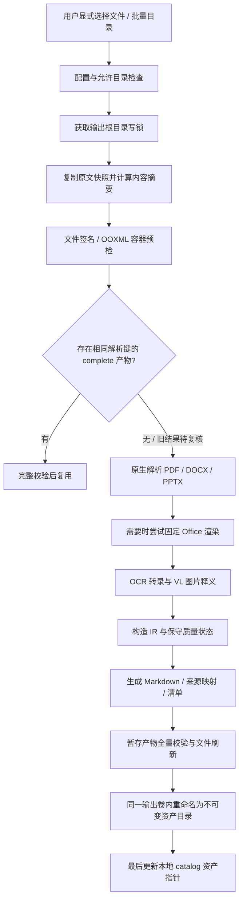

# doc2md 模块设计、实现与测试指南

> 实现版本：doc2md v0.1 / 数据契约 v1  
> 编写与测试日期：2026-10-24  
> 项目目录：`E:\Documents\ChatGPTWorkSpace\DocQA System`  
> 设计基线：[系统详细架构设计与实施方案](./DocQA系统详细架构设计与实施方案.md)、[系统任务统一梳理](./DocQA系统任务统一梳理.md)及 8 张 PPT 照片。  
> 阅读顺序：第 1～8 章解释实现；第 9 章给出实际测试证据；第 10～12 章用于手动测试；第 13 章安排后续优化。

## 1. 本次交付与范围

已实现一个可独立运行的 Python 模块，将本地 PDF、DOCX、PPTX 转为带原文快照、图片、结构化 IR 和来源映射的 Markdown。入口同时提供 Python API 和 CLI，能够报告解析缺失、校验产物、识别重复解析，并在批量处理中继续处理其他文件。

本模块对应 PPT 中的第一步 `doc2md`，产出供后续 DocBase 切片入库。DocBase 已独立交付，详见 [DocBase模块设计实现与测试指南](./DocBase模块设计实现与测试指南.md)。2026-10-25 已续接 [AGENTS 知识消费与问答](./AGENTS知识消费模块设计实现与测试指南.md)、[Service 自动化运维](./Service自动化运维模块设计实现与测试指南.md)与 [Web 工作台](./Web应用模块设计实现与测试指南.md)；本篇保留 doc2md 阶段记录。

### 1.1 功能完成情况

| 能力 | 本次实现 | 本次验证边界 |
| --- | --- | --- |
| PDF 原生文字、带线框表格、物理页码 | 已实现 | 生成的真实 PDF 及自动化测试通过 |
| PDF 扫描页、位图和矢量内容保留 | 已实现页面渲染与嵌入图提取 | 本地 PDFium 真实渲染通过；图语义还需真实 OCR / VL |
| PDF 旋转与可见 CropBox 坐标 | 已实现可见区域裁剪、方向处理、归一化 | 0° / 90° / 180° / 270°，混合文字方向与旋转表格测试通过 |
| DOCX 标题、段落、列表、表格、超链接文字、内嵌图 | 已实现主体顺序与对象定位 | 本地真实 DOCX 包测试通过；不编造 Word 页码 |
| PPTX 文字、表格、位图与组形状遍历 | 已实现幻灯片 / shape 定位 | 本地真实 PPTX 包测试通过 |
| 原生形状、连接线、图表等复杂 Office 视觉内容 | 已实现检测、缺口告警与可选整页渲染路径 | 检测真实测试通过；LibreOffice 实机转换待验证 |
| OCR | 已实现 Tesseract 适配器、语言检查、超时、限额 | 子进程 Mock 测试通过；当前机器真实 OCR 待安装 / 配置 |
| VL 图片释义 | 已实现 HTTP 适配器及结构化输出校验 | HTTP Mock 测试通过；真实模型端点、协议兼容性与质量待联调 |
| DOC / PPT 旧格式 | 显式开关后走 Office → PDF 转换 | 属于兼容路径；当前没有真实旧格式转换验收证据 |
| 原文快照、版本、完整性校验与本地缓存 | 已实现 | 原生输入、重试和篡改测试通过 |
| 批量解析与逐文件失败报告 | 已实现，串行执行 | 真实 CLI 混合批次测试通过 |

### 1.2 如何理解“已完成”

“产物能打开”“完整性校验通过”和“多模态语义完整”是三个不同的验收项。例如扫描 PDF 在未安装 OCR、未配置 VL 时仍会保存页面图片和原文，但状态是 `review_required`，不能据此宣布图片知识已可完整检索。

本版采用保守质量门禁：只有 `status=complete` 且 `eligible_for_indexing=true` 的产物可作为后续自动入库的候选。该状态表示没有当前程序已检测到的阻断项，不保证任意复杂文档的语义正确；真实业务样本仍需人工验收。

## 2. 模块组织与实际文件结构

```text
DocQA System/
├─ pyproject.toml                       # src 包布局、Python 版本、CLI 与工具配置
├─ README.md                            # 项目入口
├─ requirements.txt                     # 核心依赖兼容范围，非锁文件
├─ requirements-dev.txt                 # 自动化测试 / 检查工具
├─ configs/
│  ├─ doc2md.example.yaml                # 可提交的脱敏配置模板
│  └─ local.doc2md.yaml                  # 用户自行复制的本机配置，Git 忽略
├─ scripts/
│  ├─ check_environment.py              # 原有环境检查脚本
│  ├─ docqa.py                          # 无需安装项目包的仓库启动器
│  └─ generate_doc2md_samples.py         # 生成可重复手动测试的样例
├─ src/docqa/
│  ├─ __init__.py / __main__.py
│  ├─ domain/
│  │  ├─ documents.py                   # IR、定位、图片、VL、结果契约
│  │  └─ errors.py                      # DocQAError 稳定错误结构
│  ├─ doc2md/
│  │  ├─ __init__.py                     # parse_document / batch_parse 公共入口
│  │  ├─ config.py                      # YAML 与参数验证
│  │  ├─ security.py                    # 路径、格式与 OOXML 预检
│  │  ├─ common.py                      # 确定性摘要、ParseContext、图片资产
│  │  ├─ adapters.py                    # OCR / Office / HTTP VL 外部适配器
│  │  ├─ pipeline.py                    # 快照、流程编排、缓存、提交、验证
│  │  ├─ markdown.py                    # Markdown 投影与 UTF-8 字节映射
│  │  └─ parsers/
│  │     ├─ pdf.py                       # pdfplumber + PDFium
│  │     ├─ docx.py                      # Word 主体 XML 与 python-docx
│  │     └─ pptx.py                      # 幻灯片形状与 python-pptx
│  └─ cli/main.py                       # parse / batch / verify / doctor
├─ tests/
│  ├─ test_pdf_parser.py
│  ├─ test_office_parsers.py
│  ├─ test_doc2md_adapters.py
│  ├─ test_doc2md_pipeline.py
│  └─ test_doc2md_integrity.py
├─ Document/
│  └─ doc2md模块设计实现与测试指南.md     # 本文
└─ runtime/                             # 本地输入、输出与测试报告，Git 忽略
```

职责依赖为：`CLI → pipeline → 格式解析器 / 外部适配器 → domain`。格式解析器返回 `ParsedContent`，不直接写 SQLite，也不自行决定文档能否入库。Markdown 只由统一 IR 投影生成，避免不同格式产生不兼容的来源映射。

这是一份分阶段落地的目录：没有为尚未实现的 DocBase / Agent 创建空业务实现，也没有把本版的 `catalog.sqlite` 当作完整系统的全局注册表。

## 3. 全流程与提交边界



### 3.1 各阶段的输入、动作和失败行为

| 阶段 | 输入与动作 | 失败 / 降级行为 |
| --- | --- | --- |
| 配置 | 读取 UTF-8 YAML，字段禁止拼写不明的额外项，校验枚举和范围 | 不静默回退默认值，返回 `INVALID_CONFIG` |
| 路径与资源 | 解析规范路径，核对允许根目录、格式和文件体积 | 越界 / 不可读明确失败；批处理逐文件记录 |
| 加锁 | 一个输出根目录同一时刻一个写任务，等待 20 秒 | `LOCK_TIMEOUT`，不并发改同一 catalog |
| 快照 | 分块复制、SHA-256、文件刷新，再核对原文件状态与内容摘要 | 读取中变化报 `SOURCE_CHANGED_DURING_READ` |
| 预检 | 核对文件签名；检查 OOXML 所需部件、压缩包大小、XML 和外部资源 | 受保护 / 损坏 / 危险包明确拒绝 |
| 身份 / 缓存 | 计算版本与 profile，登记路径身份，检查已有资产 | 仅完整产物可整文档复用；损坏资产报错，不覆盖 |
| 原生解析 | 提取可证明的正文、表格、图片及本地定位 | 不能可靠提取的内容保留缺口告警 |
| Office 基线 | `auto` 仅在发现需要渲染的视觉内容时尝试；`required` 强制尝试 | auto 失败保留待复核产物；required 失败终止 |
| OCR / VL | 提取派生文字与结构化图语义，记录不确定项 | 可选能力缺失进入待复核；VL 失败可产生 partial |
| 投影 / 校验 | 生成所有文件，复算身份、引用、摘要和字节映射 | 任一不一致不登记成功资产 |
| 发布本地资产 | 文件包先落地，catalog 指针后提交 | 崩溃最多留下未引用包；没有实现分布式发布协议 |

### 3.2 原子性与恢复的实际边界

暂存目录位于同一输出根目录的 `staging/`。文件写完并校验后，再重命名到 `artifacts/<artifact_id>/`，最后用 SQLite 事务更新解析键到资产的映射。

该过程保证正常错误路径不会把半个产物当作可复用结果。它不是“文件系统 + SQLite”的跨系统事务，也不承诺任意断电情况下的目录持久性。`documents` 表可以在后续解析失败前登记最新观察到的版本；它不代表该版本已有合格资产，应以 `artifacts` 记录和资产质量报告为准。

当前没有自动清理孤立快照 / 未引用包、任务租约、页面级断点续跑、后台任务队列和索引代次发布。异常中断后可重跑整个文档；完整资产与可靠 VL 结果可复用。

## 4. 各格式的细节设计

### 4.1 PDF

1. `pdfplumber` 提取原生字形、行、线框表格；`pypdfium2` 负责页面渲染与嵌入图片解码。
2. 比较两套引擎的页数、旋转和可见区域。将原生内容裁剪到 MediaBox 与 CropBox 的可见交集，与页面图片使用相同坐标基准；不能可靠对应时返回 `PDF_GEOMETRY_UNSUPPORTED`。
3. 归一化坐标以旋转后的可见页左上角为原点，`bbox=(x0,y0,x1,y1)`，范围为 0～1。物理页码从 1 开始。
4. 跨裁剪边界的部分字形不作为完整可见文字输出，并报告 `PDF_CROP_BOUNDARY_TEXT`。不能把裁掉的隐藏文字当作可见原文。
5. 按字符基线方向分组提取，处理倒置、竖向及混合方向的常见拉丁文字；段落按显示位置排序。表格单元格使用同一方向处理，表格范围内文字从正文提取中排除，避免重复。
6. 有图片、矢量图形，或文字层缺失 / 可疑时保留整页视觉上下文。嵌入图是补充资产；其蒙版、裁剪和变换可能丢失，整页渲染才是可见内容基线。
7. 原生文字有效的纯文字页无需 OCR / VL；扫描页设置 `needs_ocr=true`。真正空白页不冒充扫描页。替换字符和未解析 CID 会触发文字层可疑告警。
8. 先检查页面数和预计像素数，再执行渲染。PDFium 的完整句柄生命周期由进程内共享锁保护，并显式释放，避免线程不安全和 Windows 文件占用问题。

**限制：**阅读顺序仍为几何启发式；不保证任意多栏、复杂排版、斜排 / 双向语言、无框表格、跨页表格、注释、表单、附件和图层语义完整。所有 PDF 会有信息级 `PDF_LAYOUT_HEURISTIC` 提示。加密 PDF 当前整体拒绝，包括空用户密码但存在加密处理器的文件。

### 4.2 DOCX

1. 遍历主体 XML，保持段落、表格和内嵌图的相对顺序；不是先取所有文字再把图片统一附到末尾。
2. 提取标题层级、普通段落、列表内容、超链接可见文字和表格文本。合并单元格关系保留在 IR 的 `cell_layout` / `native_xml_cells` 中。
3. 每个图片出现位置独立生成 `figure_id`，相同内容的图片文件可以共用一个资产。引用关系仍能区别“同一图在两处出现”。
4. 原生定位使用 Word 包部件和对象 XPath / 段落、表格对象信息，`locator_type=docx_object`，`page=null`。Word 流式布局没有稳定原生页码，不用段落序号或分页符猜页。
5. 裁剪、旋转、浮动或复杂变换图片保留原始资源，但不直接把不可见的完整原图送入语义分析；置 `analysis_required=false`，可见内容走 Office 渲染基线。
6. 页眉页脚、文本框、修订等未完整覆盖的结构报告告警，不悄悄混入正文或宣布无缺失。

**限制：**Markdown 表格用于阅读；合并单元格、嵌套表格和排版效果不能依靠 Markdown 无损还原。原文和 IR 是核对依据。

### 4.3 PPTX

1. 按幻灯片与 shape 顺序提取文字、表格和图片，并递归遍历组形状。
2. 定位包括 `slide`、`shape_path`、原 shape 标识和可证明的坐标。组形状坐标变换可确认时归一化；遇到不能可靠映射的变换时降低定位精度。
3. 检测原生形状、连接线、SmartArt、图表等视觉内容，标记 `needs_office_render`。不能把“找不到嵌入图片”解释成“页面没有图”。
4. 裁剪 / 旋转的图片采用与 DOCX 相同的可见区域策略；不根据隐藏部分推断流程。
5. 演讲者备注等未纳入主体语义的内容报告覆盖告警。

**限制：**shape 顺序是文档对象顺序，不保证等同于人类阅读顺序。形状文字可原生提取，不意味着连接关系也已恢复；纯 shape 流程图必须核对固定渲染与 VL 结果。

### 4.4 Office 固定渲染与旧格式

`LibreOfficeRenderer` 使用参数数组调用转换器、独立用户配置目录、headless 模式、宏安全级别设置、输出体积限制和超时清理。Windows 下隐藏子进程窗口，超时先尝试结束进程树，再结束并回收主进程。

转换后的 PDF 保存为 `renders/document.pdf`，派生页面定位使用 `derived_page`，只承诺定位到本次固定渲染的页。它不能反推出 Word 原生对象的精确页码。已有原生覆盖缺口告警不会因“成功转 PDF”自动消失，因此本版某些复杂文档即使已产生渲染图仍保持待复核。

OOXML 中含外部非超链接资源时阻止自动 Office 渲染；原生解析不获取外部图片。独立 Office profile 和宏安全配置**不是操作系统安全沙箱**。旧二进制 DOC / PPT 只在 `allow_legacy_office=true` 时尝试，当前未做真实旧格式联调，也不具备等同 OOXML 的内部预检能力。

## 5. OCR、VL 与图文一体资产

### 5.1 OCR

`TesseractOCR` 先执行语言发现，确认配置的语言都存在，再识别图片。默认 `chi_sim+eng`，输出为 UTF-8 派生文字；参数以列表传给子进程，不拼接 shell 命令。

| 模式 | 行为 |
| --- | --- |
| `auto` | 对需分析的图片尝试 OCR；缺工具 / 语言时保留诊断，扫描内容缺失触发待复核 |
| `disabled` | 不调用 OCR；扫描页报告 `OCR_DISABLED` |
| `required` | 需要调用 OCR 时，工具、语言、识别失败会终止该文档 |

本版会对可分析图片尝试 OCR，不仅针对扫描整页。扫描页 OCR 文字既保留在图对象，也生成 `origin=ocr` 的块；Markdown 明确标注它为转录。原生文字与 OCR 不是同一个证据来源，后续切片须按图关联避免重复计权。

### 5.2 VL 请求与结果

`HttpVisionClient` 接受**完整、明确的 chat/completions 兼容端点**，发送图片 data URL、可见文字 OCR 和截断后的上下文，要求返回 `vision.v1` JSON。这里的兼容协议是本项目适配器的约定，未证明公司实际服务兼容，也未默认某个模型名称可用。

```json
{
  "schema_version": "vision.v1",
  "status": "ok",
  "image_type": "flowchart",
  "entities": [
    {"id": "a", "label": "开始", "bbox": [0.1, 0.2, 0.3, 0.4]},
    {"id": "b", "label": "处理", "bbox": [0.5, 0.2, 0.8, 0.4]}
  ],
  "relations": [{"source": "a", "target": "b", "direction": "directed", "label": ""}],
  "observations": ["图中可见两个节点及连接箭头"],
  "interpretations": [],
  "uncertainties": []
}
```

以上是协议示例，不是本次真实模型推理结果。校验节点 ID 唯一性、边引用、bbox 顺序与范围；`ok` 必须有观察或节点。状态支持 `ok/partial/unreadable/no_semantic_content`。不确定方向必须显式标 `unknown`，不能补造箭头。

请求的稳定错误、认证失败和瞬态错误分别分类；瞬态请求有限次重试，结构错误最多额外修复一次。设置请求 / 响应体积限制，不自动跟随重定向。端点禁止内嵌认证信息、查询参数和 fragment，密钥仅从指定环境变量读取，错误信息不回显密钥或服务原始响应正文。

`vision.timeout` 为 HTTPX 的网络 I/O 等待超时，**不是包含所有重试、退避、格式修复的全流程硬截止时间**。OCR / Office 的 `external_timeout` 是每次子进程调用的超时；一张图的语言探测与识别也不合并成一个总超时。

### 5.3 缓存策略

VL 缓存键绑定规范图片内容、OCR 文字、最多 8000 字符的文档文本上下文、服务 fingerprint 和 `analysis_revision`。只缓存无不确定项、无未知边方向的 `ok/no_semantic_content` 结果。网络失败、不可读和部分结果不作为成功缓存。

整文档只复用已验证的 `complete` 资产；待复核 / partial 文档再次运行会重新尝试。这使“首次缺密钥 / 临时服务失败，稍后恢复”可以正常重试，不需要把密钥值纳入摘要。OCR 目前没有独立结果缓存。

更换模型部署但模型 ID 不变、更新语言数据 / 字体 / 解释策略时，应修改服务 `revision` 或 `analysis_revision`。本版不探测远端模型权重，也不自动对字体 / tessdata 内容做全量哈希。

### 5.4 原图、规范图与出现位置

- 原始资源可解码时保存原始字节；规范图按 EXIF 方向处理并转为 RGB PNG，便于 OCR / VL。
- 规范图片资产按 SHA-256 去重。不同原始图片即使像素相同，原始文件仍分别存档；每个出现位置保留自身的 `original_asset_id`。
- 图片路径包含来源文件名、Page / Slide / Figure 等标签和摘要前缀。权威溯源仍依赖 IR 标识与定位，不能只解析文件名。
- 规范图不保证透明度、动画或原始编码完全保真；这些效果需核对原始资源及可见页面。模型释义始终标为派生内容。

## 6. 数据契约、版本与输出结构

### 6.1 核心对象

| 对象 | 关键字段 | 作用 |
| --- | --- | --- |
| `DocumentIR` | schema、文档 / 版本 / profile / 资产 ID、块、图片、出现位置、告警 | 规范化知识资产 |
| `Block` | block_id、type、text、order、locators、origin、table_rows、figure_ids | 供后续结构切片与引用 |
| `SourceLocator` | locator_type、native_ref、page / slide、bbox、precision、版本绑定 | 原文定位；不猜页码 |
| `ImageAsset` | asset_id、sha256、relative_path、尺寸、derived_from | 图片文件身份与派生链 |
| `FigureOccurrence` | figure_id、asset_id、locator、original_asset_id、ocr_text、vision | 区别图片资源与出现位置 |
| `VisionDescription` | 可见节点 / 关系 / 观察 / 解释 / 不确定项 | 结构化图语义 |
| `ParseResult` | status、IDs、artifact_dir、markdown_path、eligible_for_indexing、reused、counts | API / CLI 返回值 |

契约使用 Pydantic，禁止未知字段。所有块和图定位最终绑定同一 `doc_id/revision_id/artifact_id`；PDF 页码与 PPT 页序均从 1 开始。

### 6.2 身份计算

令 `H(x)` 为规范 JSON（键排序、UTF-8、固定分隔符）的 SHA-256；文件内容摘要直接对字节计算。

```text
doc_id           = 首次按规范路径登记的 UUID；可显式传入合法 UUID
content_sha256   = SHA256(原文件快照字节)
revision_id      = H([doc_id, content_sha256])
parse_profile_id = H(解析代码摘要、实际库版本、配置、适配器和本地工具信息)
parse_key        = H([revision_id, parse_profile_id])
artifact_id      = H(不含自引用 artifact_id 的完整规范 IR)
```

同一个输出根目录内，同路径修改内容保留 `doc_id`，生成新 `revision_id`；另一个路径即使字节相同也默认是另一文档。更换输出根目录会创建独立 catalog。文件重命名的身份迁移尚未实现，不能据此承诺跨路径 / 跨机器的文档身份连续。

同一版本、同一 profile 的远端非确定性输出仍可能产生不同 `artifact_id`。旧包保留，新解析键指针指向最新产物；成功完整产物再运行会复用。profile 记录的是本机观测版本与显式配置，不是依赖锁文件，也不是远端服务不可变性的证明。

### 6.3 运行输出

```text
runtime/doc2md/
├─ .doc2md.lock
├─ catalog.sqlite                       # 仅 doc2md 本地目录身份与解析键映射
├─ blobs/<SHA前两位>/<SHA>.<ext>          # 不可变原文快照
├─ cache/vision/<缓存键>.json             # 合格图片释义缓存
├─ staging/parse-*/                      # 临时工作区，正常退出后清理
├─ artifacts/<artifact_id>/
│  ├─ manifest.json                     # 文件摘要、版本、快照、质量绑定
│  ├─ profile.json                      # 本次解析指纹，无密钥值
│  ├─ document.ir.json                  # 完整规范 IR
│  ├─ document.md                       # UTF-8、LF、相对图片与快照链接
│  ├─ source_map.json                   # 块锚点与字节区间
│  ├─ quality_report.json               # 质量状态、告警、计数
│  ├─ images/*.png                      # 规范图片；按需出现
│  ├─ images/original/*                 # 原始资源；按需出现
│  └─ renders/document.pdf              # 固定 Office 渲染；按需出现
└─ batch-report-<UUID>.json               # 每次批量结果
```

请完整保留输出根目录：只复制 `document.md` 会丢失相对图片、原文快照和可校验的版本关系。

### 6.4 Markdown 与来源映射

每个块有稳定 HTML 锚点，来源说明独立展示。正文进行 HTML / Markdown 转义，不能将原文中的标签或特殊语法当成系统生成结构。表格首行只是 Markdown 展示需要，生成器明确提示它不一定是真实表头。

`source_map.json` 的 `start_byte/end_byte` 是 **UTF-8 字节半开区间 `[start,end)`**；不能按 Python 字符索引、JavaScript UTF-16 索引或编辑器列号解释。区间覆盖该块锚点和内容，后附的来源说明不在块内容区间。`line_start/line_end` 为生成结果的行号；原始 `Block.text` 的码点区间与摘要另存，图块文本可以为空。

后续 DocBase 应读取 IR 与 source map，将正文、OCR、VL 及图出现位置一起映射到 Chunk；不能仅按 Markdown 文本猜来源。本次没有实现 Chunk 切片和三路索引。

### 6.5 `verify` 校验项

校验包括清单必需文件、文件哈希与目录边界、快照路径与内容、IR 身份、版本 / 解析键 / profile、一致的质量报告、图片派生引用、块 / 图定位版本，以及从 IR 重新生成的 Markdown 和 source map 是否逐字节一致。篡改文件后只修改清单哈希，仍不能绕过 IR 与投影校验。

校验成功只表示资产内部一致，不判断 OCR / 模型结论的业务正确性。校验器不是带签名的防伪机制；能够重写全部内容与身份的人仍可生成另一个自洽资产。当前 v1 验证依赖当前投影规则，未来变更应升级 schema / 提供兼容验证或重建，不能假定所有旧产物永远可由新投影器验证。

## 7. API、CLI、配置与错误语义

### 7.1 Python API

```python
from pathlib import Path
from docqa.doc2md import parse_document, batch_parse
from docqa.doc2md.config import ParseOptions
from docqa.doc2md.pipeline import verify_artifact

options = ParseOptions(allowed_roots=[Path(r"E:\MyDocuments")])
result = parse_document(
    Path(r"E:\MyDocuments\example.pdf"),
    Path(r"E:\DocQAOutput"),
    options=options,
)
print(result.status, result.markdown_path)
verified = verify_artifact(result.artifact_dir)
```

可注入 `ocr_client/vision_client/office_renderer` 以测试或适配新服务；分别遵循 `fingerprint()` 加 `recognize(Path)`、`describe(Path, ocr_text=..., context=...)`、`render(source, output_dir)` 的约定。此处为代码示例；使用真实存在且已授权的路径。仓库脚本无需安装包；直接在其他 Python 程序导入时可先执行 `python -m pip install -e . --no-deps` 注册本地包。

### 7.2 CLI

```text
python scripts/docqa.py doc2md parse <文件> --output <目录> --strict
python scripts/docqa.py doc2md batch <输入目录> --output <独立输出目录> --strict
python scripts/docqa.py doc2md verify <artifact_id目录>
python scripts/docqa.py doc2md doctor --config configs/local.doc2md.yaml
```

`parse` 支持 `--config/-c`、`--allow-root`（可重复）、`--doc-id`、`--analysis-revision`。`batch` 支持 `--recursive/--no-recursive` 与 `--types pdf,docx,pptx`，默认递归，只处理所选后缀，跳过 `~$` 临时文件。输入与输出目录不得互相包含。`doctor` 只探测本地可执行文件和配置，不验证 OCR 语言包或 VL 网络连接。

### 7.3 状态和退出码

| 状态 / 退出码 | 含义 |
| --- | --- |
| `complete` | 没有当前检测到的 warning/error 级缺口；信息级提示允许存在 |
| `review_required` | 产物可阅读，但有能力缺口、不确定项或空内容 |
| `partial` | 至少一个需分析图片的 VL 处理失败；已提取内容仍保留 |
| `failed` | 预留结果状态；当前硬失败通过异常 / 批次 failures 表达，不伪造资产 |
| CLI `0` | 操作成功；无 strict 时待复核解析也可返回 0，必须读取 JSON 状态 |
| CLI `2` | 参数 / 配置 / 不支持格式错误；Typer 参数语法错误也可为 2 |
| CLI `4` | 解析、存储、校验等硬失败，或批次至少一个文件失败 |
| CLI `5` | 开启 strict 且产物不符合自动入库门禁；产物通常已落地 |

批次若同时存在硬失败和待复核，优先退出 `4`。`verify` 对内部一致的待复核资产也返回 `0`，并在 JSON 中保留原质量状态。

错误结构为 `{"schema_version":"docqa.error.v1","error":{"code":"...","message":"...","retryable":false}}`。常见错误码包括 `INVALID_CONFIG`、`SOURCE_ACCESS_DENIED`、`FORMAT_MISMATCH`、`PARSE_CORRUPT`、`PASSWORD_REQUIRED`、`RESOURCE_LIMIT_EXCEEDED`、`UNSAFE_ARCHIVE`、`UNSAFE_XML`、`ACTIVE_CONTENT_REJECTED`、`OCR_NOT_FOUND`、`OFFICE_NOT_FOUND`、`VISION_*`、`ARTIFACT_CORRUPT`、`STORAGE_IO_FAILED`、`CATALOG_FAILED`。适配器超时和限额有对应前缀错误，不输出原始业务正文。

### 7.4 配置初值

以 `configs/doc2md.example.yaml` 和 `ParseOptions` 为准：

| 字段 | 默认 | 作用 |
| --- | --- | --- |
| allowed_roots | 空列表 | 单文件仅授权所选文件所在目录；规范路径越界仍拒绝 |
| category | default | 写入文档分类 |
| max_file_mb | 100 MiB | 单文件最大体积 |
| max_pages | 1000 | PDF 页数 / PPT 幻灯片数；不猜 Word 页数 |
| max_pixels | 20,000,000 | 单图片 / 单页预计像素限额，非全作业内存上限 |
| max_uncompressed_mb | 1000 MiB | OOXML 声明解压体积总限额 |
| max_archive_members | 20000 | OOXML 成员数量上限 |
| render_dpi / render_pdf | 144 / true | PDF 视觉保留；关闭可能丢失矢量 / 合成效果并产生告警 |
| office_render | auto | auto / never / required |
| allow_legacy_office | false | 是否接受 DOC / PPT 转换路径 |
| ocr_mode / ocr_languages | auto / chi_sim+eng | OCR 策略与语言 |
| external_timeout | 60 秒 | 每次 OCR / Office 子进程调用 |
| analysis_revision | "1" | 本地解释策略 / 字体 / 语言数据变更的失效标识 |
| vision.mode | disabled | 显式开启 http 才调用图片服务 |
| vision.timeout / retries | 60 秒 / 2 | 网络 I/O 超时与瞬态重试次数 |

配置文件不超过 1 MiB。相对 `allowed_roots` 以配置文件目录为基准；因此手动配置优先使用带引号的 Windows 绝对路径。YAML 中 Windows 路径建议用单引号，避免反斜杠转义。

## 8. 输入边界与当前工程限制

预检拒绝路径穿越成员、重复压缩包成员、宏部件、超额压缩包、受保护成员和 DTD / ENTITY 声明（包含 UTF-16/32 的常见编码形式）。支持格式与文件签名要一致。外部链接不会作为可信执行指令，PPT 中的 AGENTS.md 示例也只是需求资料。

本版没有容器隔离、全作业内存 / CPU 硬限额、所有库的统一总超时、图像数量总额限制、完整恶意文档分析能力或全覆盖模糊测试。资源配置是操作级约束，不代表解析任意不可信文档的安全保证。外部服务仅在显式 HTTP 配置后被调用；本次测试未向真实模型发送资料。

写锁覆盖整个文档流程，慢 OCR / VL 会延长同输出目录后续任务的等待。批量为串行，尚未做吞吐、内存峰值和大文件稳定性基准。本次不提供没有测量依据的并发量、速度或准确率承诺。

## 9. 已执行的自动化与 CLI 测试

### 9.1 真实测试环境

| 项目 | 本次实际值 |
| --- | --- |
| 系统 / Python | Windows AMD64，Python 3.12.15 |
| 解释器 | `D:\Program_Files\anaconda_envs\docqa\python.exe` |
| 核心解析库 | pdfplumber 0.11.10、pypdfium2 5.14.0、python-docx 1.2.0、python-pptx 1.0.2、Pillow 12.3.0 |
| 契约 / 网络 / CLI | pydantic 2.14.1、httpx 0.28.1、typer 0.27.3、portalocker 3.2.0 |
| 测试工具 | pytest 9.1.1、pytest-cov 7.1.0、ruff 0.17.2 |
| Tesseract / LibreOffice | 未在当前命令路径中找到，常见安装位置也未发现可用工具；允许后续显式配置 |
| 真实 VL | 未配置端点 / 密钥，未执行真实推理 |

原有 `check_environment.py --dev` 的 Python 依赖检查通过；加 `--system` 时会因上述两个工具缺失报告失败。这是当前环境缺口，不能写成系统依赖全部通过。

### 9.2 自动化结果

最终执行：

```powershell
python -m pytest -q --basetemp runtime/pytest-doc2md-final-002 `
  --cov=docqa --cov-report=term-missing `
  --cov-report=json:runtime/doc2md-coverage.json `
  --junitxml=runtime/doc2md-tests.xml
```

结果：**138 passed，11.46 秒；代码行覆盖率 84%（1801 statements，288 missed）**。覆盖率只统计该次 pytest 对 `src/docqa` 的执行；下述真实子进程 CLI 冒烟未并入覆盖率，Mock 分支覆盖也不等于真实服务验收。

本次新增代码的 `ruff check` 与 `ruff format --check` 均通过。检查范围为 `src`、`tests`、`scripts/docqa.py` 和 `scripts/generate_doc2md_samples.py`；没有为获得全仓库格式通过而重排原有环境脚本。

| 测试文件 | 主要验证 |
| --- | --- |
| test_pdf_parser.py | 原生页码与坐标、表格去重、扫描 / 矢量保留、真实加密文件拒绝、资源限额、文件释放、四向旋转 / CropBox / 混合方向 |
| test_office_parsers.py | 主体顺序、合并表格、重复图出现位置、修订与覆盖告警、外部图片、组形状坐标、裁剪图不误解释、纯 shape 流程图 |
| test_doc2md_adapters.py | OCR 语言与参数、子进程超时 / 树清理、Office profile 与输出检查、HTTP 协议 / 重试 / schema 修复 / 保密边界；均为外部能力 Mock |
| test_doc2md_pipeline.py | 幂等、内容变更版本、路径隔离、图释义缓存、失败恢复、损坏输入、配置拒绝、XML 编码、Markdown 转义、CLI 状态 |
| test_doc2md_integrity.py | 清单 / 快照 / profile / 质量 / IR / 图片 / source map 的组合篡改与路径逃逸，不能仅更新一个哈希绕过 |

报告位于本机忽略目录：`runtime/doc2md-tests.xml`、`runtime/doc2md-coverage.json`。它们是可复查运行证据，不作为固定依赖锁或性能基线。

### 9.3 真实命令行冒烟结果

使用样例生成器生成实际文件，以独立 Python 子进程调用 CLI。所有产物都进一步执行 `verify` 并返回 `valid=true`。此次使用默认配置，无真实 OCR / Office / VL。

| 输入 / 操作 | 实际结果 | strict 退出码 |
| --- | --- | --- |
| text.pdf | complete，2 页、6 块、0 图；仅 PDF_LAYOUT_HEURISTIC 信息提示 | 0 |
| 同一 text.pdf 再运行 | reused=true，身份与资产保持一致 | 0 |
| sample.docx | review_required，8 块、1 图；OCR_NOT_FOUND、VISION_DISABLED | 5 |
| sample.pptx | review_required，1 页、5 块、1 图；OCR_NOT_FOUND、VISION_DISABLED | 5 |
| vector.pptx | review_required，5 块、0 图片；检测到原生视觉缺口并报告 OFFICE_NOT_FOUND | 5 |
| scan.pdf | review_required，1 页、1 图、2 图片资产；缺 OCR 与 VL | 5 |
| broken.pdf | PARSE_CORRUPT，无成功资产 | 4 |
| unsupported.txt | UNSUPPORTED_FORMAT | 2 |
| 混合批次 | attempted=6、complete=1、needs_review=4、failed=1 | 4 |

共 14 次 CLI 调用，预期退出码、重复复用、资产校验及批次统计均符合预期。摘要保存在 `runtime/doc2md-cli-smoke-report.json`，实际产物在 `runtime/doc2md-cli-smoke/` 与 `runtime/doc2md-batch-smoke/`。

## 10. 手动测试：无需外部服务的基础验收

以下命令在 PowerShell、项目根目录执行。建议先完整走本章，再启用真实 OCR / Office / VL，以便定位问题。

### M01：激活环境并确认入口

```powershell
conda activate docqa
Set-Location -LiteralPath 'E:\Documents\ChatGPTWorkSpace\DocQA System'
python --version
python -c "import sys; print(sys.executable)"
python scripts/check_environment.py --dev
python scripts/docqa.py doc2md --help
python scripts/docqa.py doc2md doctor
```

预期：Python 3.12.x；解释器来自 docqa 环境；依赖可导入；帮助中有 `parse/batch/verify/doctor`。doctor 明确返回 `connection_tested=false`。如 `python` 未指向正确环境，可暂用已验证的完整解释器路径。

如果 PowerShell 管道显示中文乱码，可先设置终端与子进程 UTF-8，再重试：

```powershell
$env:PYTHONIOENCODING = 'utf-8'
[Console]::OutputEncoding = [System.Text.UTF8Encoding]::new()
$OutputEncoding = [System.Text.UTF8Encoding]::new()
```

### M02：准备独立样例

本次已生成 `runtime/manual-input/`。你可以直接使用；若要重新独立验收，执行下列命令，后文统一使用 `manual-input-user`：

```powershell
python scripts/generate_doc2md_samples.py --output runtime/manual-input-user
Get-ChildItem -LiteralPath runtime/manual-input-user
```

预期 9 个文件：`text.pdf`、`scan.pdf`、`sample.docx`、`sample.pptx`、`vector.pptx`、`broken.pdf`、`unsupported.txt`、`diagram.png`、`README_样例说明.md`。`text.pdf` 是两页原生文字，`vector.pptx` 仅含原生形状 / 连接线；坏文件与 TXT 用于错误测试。

重复生成到同一目录默认拒绝覆盖，这是预期保护；使用另一个新目录，或明确需要重置这些生成样例时使用 `--overwrite`。请不要把真实资料放到样例生成目标目录。

### M03：原生 PDF 解析及阅读

```powershell
$pdf = python scripts/docqa.py doc2md parse runtime/manual-input-user/text.pdf `
  --output runtime/manual-output --strict | ConvertFrom-Json
$pdfExit = $LASTEXITCODE
$pdf | Format-List
$pdfExit
Get-Content -LiteralPath $pdf.markdown_path -Encoding UTF8
```

预期：退出 `0`，`status=complete`、`eligible_for_indexing=true`、`counts.pages=2`、`counts.blocks=6`。Markdown 包含 `NATIVE-TEXT-001` / `NATIVE-TEXT-002`，顺序正确，来源分别定位 PDF 第 1 / 2 页；原文快照链接可打开。用 VS Code Markdown 预览与原 PDF 对照。

`PDF_LAYOUT_HEURISTIC` 是信息提示，不导致 strict 失败。若有硬失败，请先查看完整 JSON 的 `error.code`，不要直接读取空的 `$pdf.markdown_path`。

### M04：检查 IR 与来源映射

```powershell
$irPath = Join-Path $pdf.artifact_dir 'document.ir.json'
$mapPath = Join-Path $pdf.artifact_dir 'source_map.json'
$ir = Get-Content -LiteralPath $irPath -Raw -Encoding UTF8 | ConvertFrom-Json
$map = Get-Content -LiteralPath $mapPath -Raw -Encoding UTF8 | ConvertFrom-Json
$ir.blocks | Select-Object order,type,text
$ir.blocks[0].locators | Format-List
$map.entries[0] | Format-List
python scripts/docqa.py doc2md verify $pdf.artifact_dir
```

预期：`order` 连续从 0 开始，定位版本与文档一致，`page` 是物理页；`verify` 返回 `valid=true`、`status=complete`、退出 `0`。字节区间检查可在 Python 中执行 `Path(md).read_bytes()[start:end].decode('utf-8')`，不要直接按字符数切片。

### M05：同版本重复运行

```powershell
$again = python scripts/docqa.py doc2md parse runtime/manual-input-user/text.pdf `
  --output runtime/manual-output --strict | ConvertFrom-Json
$again.reused
$again.doc_id -eq $pdf.doc_id
$again.revision_id -eq $pdf.revision_id
$again.artifact_id -eq $pdf.artifact_id
```

预期四项都是 `True`。配置、代码、依赖或可执行文件信息发生变化会生成新 profile，届时不应期待旧资产被直接复用。

### M06：Word 主体顺序、图片与定位

```powershell
$word = python scripts/docqa.py doc2md parse runtime/manual-input-user/sample.docx `
  --output runtime/manual-output --strict | ConvertFrom-Json
$wordExit = $LASTEXITCODE
$wordExit
$word.warnings | Format-Table code,severity,message -Wrap
Get-Content -LiteralPath $word.markdown_path -Encoding UTF8
$wordIr = Get-Content -LiteralPath (Join-Path $word.artifact_dir 'document.ir.json') `
  -Raw -Encoding UTF8 | ConvertFrom-Json
$wordIr.blocks | Select-Object order,type,text
$wordIr.figures[0].locator | Format-List
python scripts/docqa.py doc2md verify $word.artifact_dir
```

未配置外部能力时，预期退出 `5`，review_required，8 块、1 图。对照 Word 检查标题、前后段落、表格和图位置；在 Markdown 预览中能看到图片。原生定位应为 `docx_object` 且 `page` 为空；`counts.pages=0` 表示未取得稳定页数，不表示源文件没有页面。verify 仍应通过。

### M07：普通 PPT 与纯 shape 流程图

```powershell
$ppt = python scripts/docqa.py doc2md parse runtime/manual-input-user/sample.pptx `
  --output runtime/manual-output --strict | ConvertFrom-Json
$pptExit = $LASTEXITCODE
$pptExit
$ppt.warnings | Format-Table code,severity
Get-Content -LiteralPath $ppt.markdown_path -Encoding UTF8
python scripts/docqa.py doc2md verify $ppt.artifact_dir

$vector = python scripts/docqa.py doc2md parse runtime/manual-input-user/vector.pptx `
  --output runtime/manual-output --strict | ConvertFrom-Json
$vectorExit = $LASTEXITCODE
$vectorExit
$vector.warnings | Format-Table code,severity,message -Wrap
```

默认环境中两个解析都预期待复核、退出 `5`。普通 PPT 应有 1 页、5 块、1 图，检查文字、表格与图片。纯 shape PPT 没有嵌入图文件，但必须报告 `NATIVE_VISUAL_NOT_EXTRACTED` / `VISUAL_RENDER_REQUIRED`；没有 LibreOffice 时还会有 `OFFICE_NOT_FOUND`。不能把其 0 图片误判为视觉内容已完整解析。

### M08：扫描 PDF 的降级行为

```powershell
$scan = python scripts/docqa.py doc2md parse runtime/manual-input-user/scan.pdf `
  --output runtime/manual-output --strict | ConvertFrom-Json
$scanExit = $LASTEXITCODE
$scanExit
$scan | Format-List status,eligible_for_indexing,counts
$scan.warnings | Format-Table code,severity,message -Wrap
Get-Content -LiteralPath $scan.markdown_path -Encoding UTF8
python scripts/docqa.py doc2md verify $scan.artifact_dir
```

未装 OCR、未启用 VL 时预期退出 `5`，页面图片可读，存在能力缺失提示，不能看到假造的 OCR / 图释义。打开原 PDF 与 Markdown 图核对扫描内容。真实 OCR 转录在 M14 检查。

### M09：错误输入不伪造成功

```powershell
python scripts/docqa.py doc2md parse runtime/manual-input-user/broken.pdf --output runtime/manual-output
$LASTEXITCODE
python scripts/docqa.py doc2md parse runtime/manual-input-user/unsupported.txt --output runtime/manual-output
$LASTEXITCODE
```

预期依次返回 `PARSE_CORRUPT / 4` 与 `UNSUPPORTED_FORMAT / 2`。此处坏 PDF 专门构造成有 PDF 签名但内容损坏；普通伪装文件也可能返回 FORMAT_MISMATCH。

### M10：批量处理继续执行

```powershell
$batch = python scripts/docqa.py doc2md batch runtime/manual-input-user `
  --output runtime/manual-batch-output --strict | ConvertFrom-Json
$batchExit = $LASTEXITCODE
$batch | Select-Object attempted,complete,needs_review,failed
$batchExit
$batch.failures | ConvertTo-Json -Depth 8
Get-ChildItem runtime/manual-batch-output/batch-report-*.json
```

默认环境预期：6、1、4、1，退出 `4`；损坏 PDF 不影响其他 5 个文件产出。TXT、PNG 和样例说明未包含在默认处理后缀中。启用真实工具后质量计数可能改善，但 `attempted=6`、损坏文件 `failed=1` 仍应成立。

### M11：源文档修改后的版本

```powershell
Copy-Item -LiteralPath runtime/manual-input-user/sample.docx `
  -Destination runtime/manual-input-user/revision-test.docx
$before = python scripts/docqa.py doc2md parse runtime/manual-input-user/revision-test.docx `
  --output runtime/manual-output | ConvertFrom-Json
```

用 Word 打开 `revision-test.docx`，在正文加入独特标记 `MANUAL-REVISION-002`，保存并关闭，再运行：

```powershell
$after = python scripts/docqa.py doc2md parse runtime/manual-input-user/revision-test.docx `
  --output runtime/manual-output | ConvertFrom-Json
$before.doc_id -eq $after.doc_id
$before.revision_id -ne $after.revision_id
$before.artifact_id -ne $after.artifact_id
$afterIr = Get-Content -LiteralPath (Join-Path $after.artifact_dir 'document.ir.json') `
  -Raw -Encoding UTF8 | ConvertFrom-Json
$afterIr.blocks | Where-Object { $_.text -like '*MANUAL-REVISION-002*' }
python scripts/docqa.py doc2md verify $before.artifact_dir
python scripts/docqa.py doc2md verify $after.artifact_dir
```

预期身份比较全部 True，新增标记出现在新 IR 与 Markdown 预览，旧资产与新资产均可校验。原始 Markdown 会转义连字符，不应使用未转义标记直接搜索其文件字节。此步骤会增加样例目录中的文件数量，因此 M10 的固定批次计数请在本步骤之前检查，或重新使用另一份原始样例目录。

### M12：允许目录与真实业务文件

从已授权的资料目录选择一个代表性文件，输出保持独立，例如：

```powershell
python scripts/docqa.py doc2md parse 'E:\MyDocs\example.pdf' `
  --allow-root 'E:\MyDocs' --output runtime/business-smoke --strict
```

将示例路径替换为实际路径。先对 1～3 个文件逐项核对原文、图片、文字顺序、表格、定位和缺口提示，再扩大批量。文件超出显式根目录时应拒绝，而不是自动扩大权限。复杂 PDF 即使 complete，也要检查双栏顺序与表格是否符合业务需要。

## 11. 手动测试：配置真实 OCR、Office 和 VL

本章是待完成的外部联调，不在本次 138 项自动化通过的结论内。可逐项启用，不必一次开启全部能力。

### M13：创建本机配置与工具探测

首次执行：

```powershell
Copy-Item -LiteralPath configs/doc2md.example.yaml -Destination configs/local.doc2md.yaml
```

如果已有本机配置，直接编辑现有文件，保留你的设置。按实际安装位置填写：

```yaml
allowed_roots:
  - 'E:\Documents\ChatGPTWorkSpace\DocQA System\runtime\manual-input-user'
category: manual-test
office_executable: 'C:\Program Files\LibreOffice\program\soffice.com'
tesseract_executable: 'C:\Program Files\Tesseract-OCR\tesseract.exe'
ocr_languages: eng
ocr_mode: auto
office_render: auto
analysis_revision: 'manual-1'
vision:
  mode: disabled
```

这些路径仅为常见示例，必须替换为本机真实可执行文件。保留模板内其他配置或让未填写字段使用默认值。生成的扫描样例为英文，使用 `eng` 可先验证链路；中文资料需同时安装并配置 `chi_sim`。OCR 与 LibreOffice 是系统程序，不是仅通过 pip 安装相同名字就能获得的功能。

```powershell
python scripts/docqa.py doc2md doctor --config configs/local.doc2md.yaml
& 'C:\Program Files\Tesseract-OCR\tesseract.exe' --list-langs
& 'C:\Program Files\LibreOffice\program\soffice.com' --version
```

预期 doctor 返回工具实际路径 / 版本信息，语言清单包含配置语言。doctor 不替代真实转换和识别测试。

### M14：真实扫描页 OCR

先将 `ocr_mode` 改为 `required`，VL 仍 disabled，执行：

```powershell
$ocrResult = python scripts/docqa.py doc2md parse runtime/manual-input-user/scan.pdf `
  --config configs/local.doc2md.yaml --output runtime/manual-tools-output --strict | ConvertFrom-Json
$ocrExit = $LASTEXITCODE
$ocrExit
Get-Content -LiteralPath $ocrResult.markdown_path -Encoding UTF8
$ocrIr = Get-Content -LiteralPath (Join-Path $ocrResult.artifact_dir 'document.ir.json') `
  -Raw -Encoding UTF8 | ConvertFrom-Json
$ocrIr.figures | Select-Object ocr_text,semantic_state
```

预期转录含 `SCANNED DOCUMENT`、`OCR TEST`、`SCAN-ID-001`，并有 `origin=ocr` 的块；逐字核对，记录错字而不是改测试预期。VL 未启用时仍可退出 `5`，这表示图语义链尚未验收。若是 `error` 且没有资产路径，先处理语言缺失 / 工具错误，再重试。`required` 不代表整张图片一定有可识别字符，只约束调用失败必须显式失败。

### M15：真实 Office 纯 shape 渲染

设置 `office_render: required`；OCR 先设 auto，避免 OCR 缺口掩盖 Office 联调结果，执行：

```powershell
$officeResult = python scripts/docqa.py doc2md parse runtime/manual-input-user/vector.pptx `
  --config configs/local.doc2md.yaml --output runtime/manual-tools-output --strict | ConvertFrom-Json
$officeExit = $LASTEXITCODE
$officeExit
$officeResult.warnings | Format-Table code,severity,message -Wrap
Get-ChildItem -LiteralPath (Join-Path $officeResult.artifact_dir 'renders')
python scripts/docqa.py doc2md verify $officeResult.artifact_dir
```

预期实际出现 `renders/document.pdf`、整页规范图、`OFFICE_RENDER_AVAILABLE`，与源 PPT 的节点 / 箭头 / 文字布局对照一致；派生定位为 `derived_page`。存在原生覆盖告警时仍可能 strict 退出 `5`，不能用退出 0 作为该步骤唯一标准。工具失败且 mode=required 应退出 `4`，不伪装渲染成功。

### M16：真实 VL 服务

向服务提供方确认：完整接口 URL、请求兼容协议、实际模型 ID、部署版本、图片输入方式、认证与可接受体积。将本机配置的 vision 段替换为实际值：

```yaml
vision:
  mode: http
  endpoint: 'https://实际服务主机/实际路径/chat/completions'
  model: '服务实际接受的模型ID'
  revision: '由服务方确认的部署版本'
  api_key_env: DOCQA_VISION_KEY
  timeout: 60
  retries: 2
```

完整端点不能仅填服务 base URL。若实际服务不兼容本协议，应新增适配器，不靠静默改模型或丢弃校验来通过。示例 URL / 模型不是可直接使用的服务。

需要认证时，在当前 PowerShell 会话内输入密钥，避免将明文写入文档、配置或历史命令：

```powershell
$visionSecret = Read-Host '请输入 VL 服务密钥' -AsSecureString
$env:DOCQA_VISION_KEY = [System.Net.NetworkCredential]::new('', $visionSecret).Password
Remove-Variable visionSecret

$vlResult = python scripts/docqa.py doc2md parse runtime/manual-input-user/sample.pptx `
  --config configs/local.doc2md.yaml --output runtime/manual-tools-output --strict | ConvertFrom-Json
$vlExit = $LASTEXITCODE
$vlExit
Get-Content -LiteralPath $vlResult.markdown_path -Encoding UTF8
python scripts/docqa.py doc2md verify $vlResult.artifact_dir
```

核对：存在 VL 派生释义，节点名称 / 连接方向与图一致，未编造节点，观察与推断分离，不确定项明确。普通样例无其他缺口且 VL 返回可靠结构时可以 complete；任何未知方向 / 不确定项都应待复核。随后对 `scan.pdf` 和 `vector.pptx` 重复解析，核对整页视觉内容；不要只测静态嵌入位图。

测试结束按需清除当前会话密钥：

```powershell
Remove-Item Env:DOCQA_VISION_KEY
```

### M17：真实服务故障与恢复

仅对这些非业务测试样例操作：用不存在的密钥环境变量名建立一次新测试配置，并将 `analysis_revision` 改为从未用过的 `fault-test-1`，再解析测试文件。否则已成功的整文档 / VL 缓存可能让本次不发请求，无法验证故障。也可以在允许范围内暂停专用测试服务，并使用新的 analysis_revision。预期返回明确的 `VISION_*` 告警 / partial，不产生伪造的成功描述；恢复正确配置、保持本次 fault-test-1 后重跑同一文件，应重新尝试并可恢复。

不要以生产服务压测制造故障；本步骤只检查可控制的测试条件。重新部署、字体 / OCR 语言数据变化时同步提升 `revision/analysis_revision`，避免成功缓存遮蔽真实联调。保留旧产物，比较两次 IR 与质量报告。

## 12. 复测、记录与完成判据

### 12.1 复现自动化测试

```powershell
python -m pytest -q --basetemp runtime/pytest-user-001
python -m ruff check src tests scripts/docqa.py scripts/generate_doc2md_samples.py
python -m ruff format --check src tests scripts/docqa.py scripts/generate_doc2md_samples.py
git --no-optional-locks -c core.fsmonitor=false status --short
```

每轮使用新的、专用于 pytest 的 basetemp 名称：pytest 会清理指定 basetemp，不要将项目根目录、手动输入 / 输出或真实资料目录传给该参数。运行产生的样例、缓存、密钥配置和报告已由 Git 忽略；本次没有自动提交代码。

### 12.2 人工测试记录模板

| 用例 | 环境 / 配置版本 | 实际状态与退出码 | 原文与结果核对 | 结论 / 问题 |
| --- | --- | --- | --- | --- |
| M03 原生 PDF | 待填写 | 待填写 | 页码、文字、快照 | 待填写 |
| M06 DOCX | 待填写 | 待填写 | 顺序、表格、图、无虚构页码 | 待填写 |
| M07 PPTX / shape | 待填写 | 待填写 | 位图、形状、缺口提示 | 待填写 |
| M08 / M14 扫描 PDF | 待填写 | 待填写 | 可见页面、OCR 字符 | 待填写 |
| M10 混合批次 | 待填写 | 待填写 | 失败隔离、计数 | 待填写 |
| M11 版本 | 待填写 | 待填写 | 身份保持、新旧资产 | 待填写 |
| M15 Office | 待填写 | 待填写 | 固定渲染、箭头与字体 | 待填写 |
| M16 / M17 VL | 待填写 | 待填写 | 节点、方向、不确定、恢复 | 待填写 |

反馈问题时提供：用例编号、脱敏命令、Python / 工具版本、错误码、状态 / 告警、对应 `artifact_id`、可公开的小型复现文件。不要粘贴密钥或敏感文档正文。

### 12.3 阶段门禁

1. **本地模块可用：**M01～M11 的基础行为与预期一致，自动化通过，产物完整性通过。缺外部工具时质量状态必须诚实，不能取消告警来“通过”。
2. **多模态真实链路可用：**M14～M17 在真实工具 / 服务上验证 OCR、Office、VL 和恢复，至少一份扫描文档、一份嵌入图文档、一份原生形状流程图完成人工核对。
3. **可进入 DocBase 开发：**保持 IR / source map / 身份契约稳定；DocBase 默认只接纳合格资产。对 review_required 的显式人工放行、原因记录和质量规则调整应作为下一阶段设计，不能由当前 CLI 自动忽略。

当前已满足自动化与本地 CLI 行为验证；人工基础验收和真实多模态联调仍由后续测试填写，未替用户宣告通过。

## 13. 后续细分工作与优化顺序

| 优先级 | 工作 | 验收产物 |
| --- | --- | --- |
| P0 | 按本指南完成用户基础手测，记录原文 / 输出差异 | 人工记录与最小复现样例 |
| P0 | 安装 / 配置 OCR 与 Office，确认实际 VL 协议 | 工具版本、脱敏配置、真实链路报告 |
| P0 | 建立中文、表格、扫描、矢量 / shape、裁剪图等业务金样集 | 固定输入与人工标注，包含失败案例 |
| P1 | 提升多栏阅读顺序、无框 / 合并表格，增加可见区域裁剪能力 | 对原金样无回归，新增样本可验证改善 |
| P1 | 精化 Office 渲染到原生对象映射及覆盖缺口核销规则 | 逐对象覆盖证据，不能因渲染成功直接移除告警 |
| P1 | 补独立 OCR 缓存、整作业 deadline、图片数量 / 内存预算 | 失败恢复与资源测试，实际性能测量 |
| P1 | 对接系统级 Registry、任务状态、版本迁移与资产垃圾回收 | 与本地 catalog 边界明确，升级 / 中断测试 |
| P2 | 基于已验证资产开发 DocBase 结构切片及三路索引 | Chunk 保留原生 / OCR / VL 类型和双向来源 |
| P2 | 实测后引入并发、页面断点与增量优化 | 吞吐、峰值内存、正确率和恢复基线 |

优化必须同时检查：原生内容正确率、图片语义正确率、定位准确性、失败透明度和资源成本。不能只以 Markdown 字数或调用次数判断效果。

## 14. 技术依据

以下官方资料用于理解底层能力与限制；本模块行为以代码、实际依赖版本和上述测试证据为准。

- [pdfplumber 官方仓库](https://github.com/jsvine/pdfplumber)：字符 / 图形坐标、文本提取与表格接口；本模块额外处理可见 CropBox 和字符方向。
- [pypdfium2 API](https://pypdfium2-team.github.io/pypdfium2/python_api.html)：页面渲染、图片与对象释放；PDFium 调用的线程安全限制促使本模块串行保护句柄生命周期。
- [python-docx Document API](https://python-docx.readthedocs.io/en/latest/api/document.html)：主体对象能力及修订等覆盖限制；Word 页码仍需固定排版才能确定。
- [python-pptx Shapes](https://python-pptx.readthedocs.io/en/latest/api/shapes.html)：shape / group / picture 对象与位置，不能替代完整 Office 渲染。
- [Tesseract 命令行](https://tesseract-ocr.github.io/tessdoc/Command-Line-Usage.html)：语言选择与识别调用；真实语言数据需本机确认。
- [LibreOffice 启动参数](https://help.libreoffice.org/latest/en-US/text/shared/guide/start_parameters.html)：headless、配置目录与格式转换入口，实际保真度需样本核对。
- [HTTPX 超时](https://www.python-httpx.org/advanced/timeouts/)：connect / read / write / pool 超时语义，不应解释为整个重试流程的总时限。
