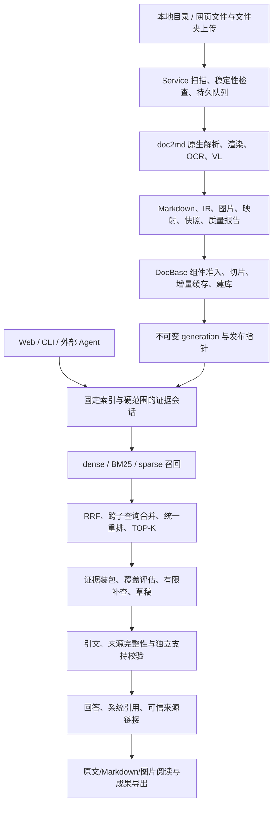

# DocQA 系统设计说明

> 安装和运行见 [README](../README.md)。

## 1. 系统定位与边界

面向个人本地 PDF、DOCX、PPTX 资料，将正文、图像和版式中的可解析内容转为带定位的 Markdown，建立本地持久化知识库，通过受控 Agent 生成有依据的回答和可导出成果。

基线为 Python 3.12 / 64 位。

推荐组合为百炼原生联合 dense/sparse＋BM25＋模力方舟 Reranker；VL 独立使用模力方舟，回答生成与独立支持检查使用 DeepSeek。角色由配置选择，代码不绑定特定供应商。

## 2. 总体架构



doc2md 不依赖 Web；DocBase 消费解析资产；Agent 消费固定版本的 DocBase；Service 组织摄入和发布；Web 组织入口、工作台及无头问答。共享 `domain` 契约与完整性工具不依赖界面。

## 3. 文件与系统组织

```text
DocQA System/
├── README.md                         配置、安装、运行与排错
├── AGENTS.md / AGENT.md               知识消费约定与兼容入口
├── Document/系统设计说明.md            唯一维护的系统设计文档
├── requirements.txt                  应用与测试统一依赖
├── pyproject.toml                    打包、CLI、测试、Lint
├── configs/
│   ├── .env.example                  空密钥与端点示例
│   ├── doc2md.example.yaml           单独解析
│   ├── docbase.example.yaml          真实三路检索
│   ├── agent.example.yaml            CLI Agent
│   ├── service.example.yaml          授权、调度、解析、建库
│   ├── web.example.yaml              Web、Service 连接、问答
│   └── *.demo.example.yaml           合成演示，隔离运行数据
├── scripts/                          CLI、环境检查、合成样例与接口自检
├── src/docqa/
│   ├── domain/                       文档/RAG/答案/成果/错误契约
│   ├── doc2md/                       解析器、适配器、分类、映射
│   ├── docbase/                      切片、模型协议、存储、融合检索
│   ├── agent/                        证据会话、预算、校验、渲染
│   ├── service/                      注册表、扫描、持久队列、发布
│   ├── web/                          API、工作台、阅读、成果、删除
│   ├── cli/                          doc2md/docbase/ask/agent/service/web
│   ├── integrity.py                  有边界的完整性检查缓存
│   └── sparse_service.py             历史可选稀疏服务，不参与默认部署
├── tests/                            单元、HTTP、集成、安全、浏览器验收
├── data/private/                     本机原文、上传副本，不提交
└── runtime/                          资产、索引、会话、成果，不提交
```

配置不会跨 YAML 自动同步。Service `parse` 与单独 doc2md 配置独立；Service `retrieval`、Web `agent.retrieval` 和独立 DocBase 配置必须匹配同一索引 profile。

## 4. doc2md：多模态解析

### 4.1 解析流水线

1. 校验类型、授权根、大小、页数、像素、Office 压缩包成员和展开大小；拒绝越界和不安全成员。
2. 保存内容寻址的原始快照，建立文档身份、内容修订和解析 profile。
3. PDF 抽取文字与对象定位，必要时渲染页面；DOCX 读取段落、表格、图片和原生对象；PPTX 读取幻灯片、形状、文字及关系。
4. 保存位图；需要视觉渲染的矢量图、复杂形状与版式经渲染转为可识别位图。不是所有矢量格式都已完整支持，失败必须进入质量缺口。
5. 调用 Tesseract OCR 转录需要识别的文字；调用独立 VL 端点释义图片，保留原图、OCR、VL 结果及不确定项。
6. 输出 IR 与 Markdown，将成功图片释义写入 Markdown 并绑定定位；质量报告记录工具缺失、渲染或模型失败、无法解析等问题。
7. 生成文件摘要与 manifest，校验后发布 artifact；同内容、同解析 profile 可复用。

### 4.2 产物与来源

后台产物：`runtime/service-user/parsed/artifacts/<artifact_id>/`。

| 资产 | 用途 |
| --- | --- |
| `document.md` | 可读正文、检索和证据载体 |
| `document.ir.json` | 块、组件、定位、图像与语义类型 |
| `source_map.json` | Markdown UTF-8 字节范围与原对象映射 |
| `quality_report.json` | 完整性、缺口、不确定项 |
| `profile.json` / `manifest.json` | 解析身份、环境与文件摘要 |
| `images/`、`images/figures/` | 内容图像与按出现位置命名的别名 |

图像可读命名为 `文档名_Page<页或幻灯片>图<序号>_Figure<标题>`，文件名再附 figure ID 前缀防冲突。Word 无可靠分页时为 `PageNA`，不伪造页码；`figure_id`、IR 和源定位保留链接关系，文件名不是唯一来源依据。

PDF 用物理页，PPT 用幻灯片号，Word 用段落/表格/原生对象，有可靠渲染页时另行说明。Markdown 字节范围与组件字符范围不可混用。原生正文、OCR 转录、VL 释义不得混称作者原文。

### 4.3 分类与准入

`category: auto` 或来源 `--category auto` 启用本地关键词分类，含研究论文、技术规范、项目汇报、使用指南和其他资料；显式分类优先。这是规则分类，不是大模型全语义分类。

DocBase 三种准入策略：

- `reject`：不完整来源不准入。
- `native_only`：不完整来源仅保留符合规则的原生正文。
- `validated_parts`：接纳符合规则的成功原生/OCR/VL 组件，排除失败和不确定组件。

后两种不代表全文解析完整。覆盖缺口随证据传递，相关回答保留 partial 与提示。补齐 Office、OCR 语言包、字体或 VL 后重新解析并发布；仅改准入不能修复图片。

## 5. DocBase：持久化与三路融合

### 5.1 构建与增量

校验解析资产 → 组件准入 → 按结构和字节预算切片并保留上下文/来源 → 计算模型输入和 profile → 查缓存 → 编码缺失项 → 建 dense/BM25/sparse → staging 校验 → 发布不可变 generation。

示例切片目标 2400 UTF-8 字节、上限 3600、重叠 320；不是 token 数。模型、维度、分词/前缀、切片、路线、准入策略变化需要重建。托管 revision 标签不保证云端权重永远不变；供应商升级时需要更新标识并重建。

默认 dense 存储为 **SQLite-vec**，在每个索引代内持久化；兼容已有 NumPy 后端。BM25/sparse 为本地倒排结构；SQLite 注册表记录索引代和发布状态，不依赖 Milvus、Qdrant 或 Chroma。历史代保留供答案回源，不可随意删除。

### 5.2 百炼联合编码

`dashscope.text-embedding` 调用完整原生接口，要求响应同时包含真实 dense/sparse。两个视图共享联合 provider；相同文本和任务类型在同批只发一次请求，联合结果进入两类缓存，不将稠密向量伪装成稀疏向量。

校验返回数量、顺序、维度、有限数值和稀疏词项；缺一路则失败。`vocab_size` 是安全索引上界，不代表已知供应商词表大小。配置控制字节上限与批量。

### 5.3 检索顺序

1. 固定 generation，应用用户指定文档、类型与分类过滤，补查不得扩大硬范围。
2. dense 召回语义，BM25 匹配技术词，sparse 使用模型返回的词项权重。
3. 各路候选经加权 RRF：`score(d) = Σ weight(route) / (rrf_k + rank(route,d))`，排名从 1 起；不直接比较不同路线原始分数。
4. 跨子查询候选去重合并，再统一 Reranker 重排，取 TOP-K，保留来源与诊断。
5. 查询和候选缓存受 profile 限制；请求及重试共享时限，服务超时不当作零命中。

真实示例为三路、RRF k=60、各路权重 1、route/fusion 候选 50、TOP-K 8；Agent 最多向重排提交 30 个候选。两路必须显式选择 dense＋BM25 且索引一致。前端按实际索引 profile 显示路线。

## 6. Agent：证据与发布

### 6.1 会话与流程

Web 以固定 Python 无头子进程运行内置受控 Agent，不执行任意外部 CodeAgent 命令。CLI 提供 `ask`；外部宿主通过 `agent session`、`answer validate`、`source resolve` 消费证据。

会话固定 generation、硬范围、问题点、已交付 evidence ID 和轮次/查询/字节/提交预算。每轮最多两个互补子查询，缺证据才补查；覆盖足够、无新增证据、预算耗尽或服务失败时停止。Web 示例两轮、四次查询。

覆盖评估可与初稿合并一次模型请求，但最终支持检查独立执行。证据包限制字节并均衡片段，遗漏内容不能声称参与回答。文档、OCR/VL 和草稿中的命令均视为数据。

### 6.2 检查契约

`AnswerDraft` 包含 claims、topic_ids、evidence_ids、逐字 quotes、冲突、关系与未回答主题。模型仅可使用会话交付的完整 `E000001` 等 ID；`C0001` 是系统发布时生成的引用编号。

发布前依次执行：

1. schema、主题、白名单、引文键和实际使用集合检查。
2. 引文必须为对应证据的连续精确子串；quotation 正文与引文一致。
3. 固定版本原始来源、摘要与范围检查。
4. 独立模型逐项检查事实、主题覆盖、冲突和关系支持；删除无支持或不确定内容。
5. 系统生成引用、可信链接和 Markdown/表格/受限 Mermaid，不直接发布自由草稿。

内置流程只能重建冗余 `used_evidence_ids` 汇总，不修改未知实际引用、不放宽逐字检查。外部提交仍需汇总正确。最多一次受预算限制的修复携带具体规则和上一份草稿；仍失败则拒绝。

状态为 answered、partial、insufficient_evidence、conflicting_evidence、failed、cancelled。synthetic、verified、production_ready 与状态分别表达，不能把“带引用”等同于真实语义验收。

### 6.3 时间与诊断

预算从会话准备开始；示例 Agent 90 秒、runner 120 秒，为启动及落盘复核留余量。剩余时间不足时跳过可选补查/修复，不能跳过引用或支持检查。HTTP 请求、重试、等待受剩余时间约束；底层文件操作不一定能即时取消，runner 提供外层终止边界。

记录会话、索引、召回重排、证据、模型和发布耗时，以及不含正文的失败规则。并行耗时有重叠，不能相加。初次完整性检查和云端波动仍可能慢，不承诺所有问题秒回。

## 7. Service 自动维护

Service 用持久注册表和队列管理来源、文档版本、解析与索引发布。

| 功能 | 行为 |
| --- | --- |
| 来源登记 | 授权根内新增；类型、递归、间隔、分类、启停 |
| 定时扫描 | 文件大小/修改时间/摘要与稳定性窗口，避免写入中解析 |
| 增量更新 | 新增或变更后排队解析，成功后建库，复用未变编码 |
| 单文档 | `service parse` 排队，可 force，仍受来源与类型边界限制 |
| 文件消失 | 多次确认后从新索引排除，不擅自删用户原件 |
| 图片管理 | 查看状态、触发显式重解析，不手改 IR |
| 索引管理 | build/status/verify，阻止 profile 混读 |
| 任务恢复 | 持久状态、心跳、去重、有限重试、取消与过期工作恢复 |

`source add`、`parse`、`index build` 返回 job ID 主要表示排队。`work` 消费任务，`run --once` 调度一次并执行有限工作；持续 `run` 承担定时目录维护。锁、去重键和版本校验协调多进程，防止过时结果覆盖新状态。

## 8. Web、来源和成果

FastAPI 提供同源 API，前端为原生 ES modules＋CSS，无需打包器。左侧上传/资料/范围/历史，中间聊天，右侧来源/图片/成果；支持折叠、窄屏切换、主题和面板调整。

- 选择/拖拽上传 PDF/DOCX/PPTX；文件夹上传递归筛选类型，校验相对路径，将副本保存到受管目录。
- 范围为全部或选定一至三种类型，并转换为固定 generation 的 doc_id 硬过滤；历史对话不自动切换新库。
- SSE 推送进度及**校验完成后的**答案段落，不将未经检查的模型 token 当结论展示；回答首段仍需等待检索与校验。
- 引用贴近结论，点击可读定位、原始文件、Markdown 和图片。阅读器检查选中文档，不为读取一份 Markdown 重载整库向量；缓存不能掩盖篡改。
- 原文件按浏览器能力内嵌或下载；不承诺浏览器直接渲染 DOCX/PPTX。图片画廊展示已提取/渲染图像，不表示全部图均成功释义。
- 成果支持表格、关系图、思维导图、研究文档、演示文稿；事实绑定已校验 claim/citation。AI 可编排主题、层级和标签，不能新增未经支持事实；关系缺少可靠证据时说明缺口。
- 支持各成果适用的 JSON、Markdown、CSV、SVG、PNG、DOCX、PPTX 导出，具体格式由后端约束，并非任意互转。

会话、消息和成果在 `questions.sqlite` 相关表与资产目录保存。永久删除通过持久清理任务先阻止访问，等待运行任务结束，再清除相关问答、会话、成果与导出。未完成返回 pending，失败可重试；共享原文与索引代不随聊天删除。

## 9. 完整性与安全

路径经授权根、规范化、穿越和链接检查；网页对象按浏览器会话所有者隔离，同源和 CSRF 校验，文件/响应/队列/并发均有限额。模型无权任意选择本机文件或可执行程序。

快照、artifact、generation、证据和答案以身份和摘要串联，先 staging 后发布，读取端固定版本。完整性缓存只在身份与状态条件满足时复用。修改云端模型配置不能将旧向量冒充新结果。

密钥只从指定环境变量读取，本机 dotenv 显式加载；模板、答案和诊断不保存密钥。当前本机鉴权不抵御拥有同用户文件写权限的恶意程序；公网部署需另行设计身份、授权、TLS 和审计。

## 10. 验证与未完成边界

Python 测试覆盖解析映射、切片向量、供应商协议、RRF/重排、增量发布、证据白名单、引文支持、硬范围、任务恢复、上传、阅读、删除、成果和时间预算。可选浏览器脚本补充布局、点击和来源验收。测试主要使用合成资料与 HTTP Mock，不能代替真实模型质量验收。

当前明确边界：

1. 云端权限、模型可用性、业务回答质量及视觉语义需按部署人工验收；示例不是供应商服务承诺。
2. 复杂 Office/矢量图可能解析不全，缺口保留；调整准入不能补全原文。
3. 内置文本支持检查不等于逐像素原图核验；流程类问题按 [AGENTS.md](../AGENTS.md) 对照，未完成不能声称完成。
4. 自动分类为规则分类；成果丰富程度受实际证据覆盖限制。
5. 浏览器文件夹上传不是实时监控，应监控服务器可访问目录。
6. 仅实现内置 Agent runner，未实现通用外部 CLI runner、系统服务安装与计划任务注册。
7. 历史代保留，尚无满足历史引用保护的通用安全 GC，不得手动清空 generations。
8. 可选向量后端迁移不等于通用数据库 schema 自动迁移；升级前需备份并检查兼容性。

后续优化先用隔离基准定位慢阶段，再改善 I/O、候选、覆盖与模型调用；不能靠关闭溯源、跳过支持检查或隐藏缺口取得表面成功。
