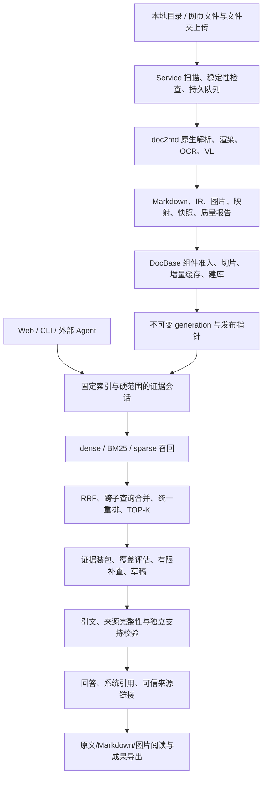
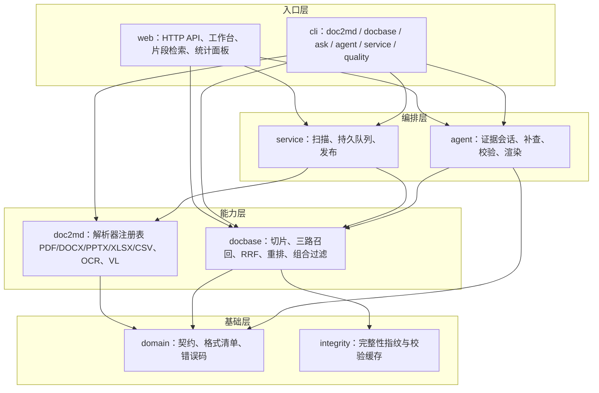

# DocQA 系统设计说明

> 安装和运行见 [README](../README.md)。

## 1. 系统定位与边界

面向个人本地 PDF、DOCX、PPTX、XLSX、CSV 资料，将正文、图像和版式中的可解析内容转为带定位的 Markdown，建立本地持久化知识库，通过受控 Agent 生成有依据的回答和可导出成果。

基线为 Python 3.12 / 64 位。

推荐组合为百炼原生联合 dense/sparse＋BM25＋模力方舟 Reranker；VL 独立使用模力方舟，回答生成与独立支持检查使用 DeepSeek。角色由配置选择，代码不绑定特定供应商。

## 2. 总体架构



doc2md 不依赖 Web；DocBase 消费解析资产；Agent 消费固定版本的 DocBase；Service 组织摄入和发布；Web 组织入口、工作台及无头问答。共享 `domain` 契约与完整性工具不依赖界面。

分层依赖只允许自上而下，下层不导入上层：



- **格式扩展点**：`domain/formats.py` 是各层唯一的格式清单；`doc2md/parsers/__init__.py` 的 `PARSERS` 注册表把格式映射到解析函数。新增格式只需实现解析器、在两处登记，Service、扫描、上传与筛选自动生效。
- **检索扩展点**：`docbase/filters.py` 的 `ChunkFilter` 在召回前收窄候选，不参与打分；新增条件不影响 RRF 与重排。

## 3. 文件与系统组织

```text
DocQA System/
├── README.md                         配置、安装、运行与排错
├── AGENTS.md / AGENT.md               知识消费约定与兼容入口
├── Document/系统设计说明.md            唯一维护的系统设计文档
├── requirements.txt                  应用与测试统一依赖
├── pyproject.toml                    打包、CLI、测试、Lint
├── configs/
│   ├── .env.example                  空密钥与端点示例
│   ├── doc2md.example.yaml           单独解析
│   ├── docbase.example.yaml          真实三路检索
│   ├── agent.example.yaml            CLI Agent
│   ├── service.example.yaml          授权、调度、解析、建库
│   ├── web.example.yaml              Web、Service 连接、问答
│   └── *.demo.example.yaml           合成演示，隔离运行数据
├── scripts/                          CLI、环境检查、合成样例与接口自检
├── src/docqa/
│   ├── domain/                       文档/RAG/答案/成果/错误契约
│   ├── doc2md/                       解析器、适配器、分类、映射
│   ├── docbase/                      切片、模型协议、存储、融合检索
│   ├── agent/                        证据会话、预算、校验、渲染
│   ├── service/                      注册表、扫描、持久队列、发布
│   ├── web/                          API、工作台、阅读、成果、删除
│   ├── cli/                          doc2md/docbase/ask/agent/service/web
│   ├── integrity.py                  有边界的完整性检查缓存
│   ├── stress.py                     离线规模与健壮性压测
│   └── sparse_service.py             历史可选稀疏服务，不参与默认部署
├── tests/                            单元、HTTP、集成、安全、浏览器验收
├── data/private/                     本机原文、上传副本，不提交
└── runtime/                          资产、索引、会话、成果，不提交
```

配置不会跨 YAML 自动同步。Service `parse` 与单独 doc2md 配置独立；Service `retrieval`、Web `agent.retrieval` 和独立 DocBase 配置必须匹配同一索引 profile。

## 4. doc2md：多模态解析

### 4.1 解析流水线

1. 校验类型、授权根、大小、页数、像素、Office 压缩包成员和展开大小；拒绝越界和不安全成员。
2. 保存内容寻址的原始快照，建立文档身份、内容修订和解析 profile。
3. PDF 抽取文字与对象定位，必要时渲染页面；DOCX 读取段落、表格、图片和原生对象；PPTX 读取幻灯片、形状、文字及关系；XLSX 按工作表读取单元格缓存值（不执行公式），合并单元格回填锚点值；CSV 严格按 UTF-8/GB18030 解码并自动识别分隔符。表格类资料每段最多 50 行数据，并重复真实表头，定位为“工作表＋A1 区域”（`sheet_range`），不伪造页码。
4. PDF 按位图边界、矢量图元及相邻图注聚合图表区域，渲染后裁剪，保留物理页、旋转/CropBox 与区域坐标。Office 复杂对象先转换为固定 PDF，再使用同一裁剪流程；普通原生图片仍按原生对象提取。不再默认将每个页面作为待 VL 释义的图片。
5. 调用 Tesseract OCR 转录需要识别的文字；调用独立 VL 端点释义区域图片，释义写入 Markdown。已有原生标签的矢量区域避免重复 OCR；整页扫描仅保留 OCR 正文来源，不冒充独立图表。按 `image_workers` 有界并行处理，保留失败、不确定项与原文链接；细节与限制见 11.9。
6. 输出 IR 与 Markdown，将成功图片释义写入 Markdown 并绑定定位；质量报告记录工具缺失、渲染或模型失败、无法解析等问题。
7. 生成文件摘要与 manifest，校验后发布 artifact；同内容、同解析 profile 可复用。

### 4.2 产物与来源

后台产物：`runtime/service-user/parsed/artifacts/<artifact_id>/`。

| 资产 | 用途 |
| --- | --- |
| `document.md` | 可读正文、检索和证据载体 |
| `document.ir.json` | 块、组件、定位、图像与语义类型 |
| `source_map.json` | Markdown UTF-8 字节范围与原对象映射 |
| `quality_report.json` | 完整性、缺口、不确定项 |
| `profile.json` / `manifest.json` | 解析身份、环境与文件摘要 |
| `images/`、`images/figures/` | 内容图像与按出现位置命名的别名 |

图像可读命名为 `文档名_Page<页或幻灯片>图<序号>_Figure<标题>`，文件名再附 figure ID 前缀防冲突。Word 无可靠分页时为 `PageNA`，不伪造页码；`figure_id`、IR 和源定位保留链接关系，文件名不是唯一来源依据。

PDF 用物理页，PPT 用幻灯片号，Word 用段落/表格/原生对象，有可靠渲染页时另行说明。Markdown 字节范围与组件字符范围不可混用。原生正文、OCR 转录、VL 释义不得混称作者原文。

### 4.3 分类与准入

`category: auto` 或来源 `--category auto` 启用本地关键词分类，含研究论文、技术规范、项目汇报、使用指南和其他资料；显式分类优先。这是规则分类，不是大模型全语义分类。

DocBase 三种准入策略：

- `reject`：不完整来源不准入。
- `native_only`：不完整来源仅保留符合规则的原生正文。
- `validated_parts`：接纳符合规则的成功原生/OCR/VL 组件，排除失败和不确定组件。

后两种不代表全文解析完整。覆盖信息随证据传递，后台保留 partial 状态与质量报告；前端不显示覆盖缺口类提示。补齐 Office、OCR 语言包、字体或 VL 后重新解析并发布；仅改准入不能修复图片。

## 5. DocBase：持久化与三路融合

### 5.1 构建与增量

校验解析资产 → 组件准入 → 按结构和字节预算切片并保留上下文/来源 → 计算模型输入和 profile → 查缓存 → 编码缺失项 → 建 dense/BM25/sparse → staging 校验 → 发布不可变 generation。

示例切片目标 2400 UTF-8 字节、上限 3600、重叠 320；不是 token 数。模型、维度、分词/前缀、切片、路线、准入策略变化需要重建。托管 revision 标签不保证云端权重永远不变；供应商升级时需要更新标识并重建。

默认 dense 存储为 **SQLite-vec**，在每个索引代内持久化；兼容已有 NumPy 后端。BM25/sparse 为本地倒排结构；SQLite 注册表记录索引代和发布状态，不依赖 Milvus、Qdrant 或 Chroma。历史代保留供答案回源，不可随意删除。

### 5.2 百炼联合编码

`dashscope.text-embedding` 调用完整原生接口，要求响应同时包含真实 dense/sparse。两个视图共享联合 provider；相同文本和任务类型在同批只发一次请求，联合结果进入两类缓存，不将稠密向量伪装成稀疏向量。

校验返回数量、顺序、维度、有限数值和稀疏词项；缺一路则失败。`vocab_size` 是安全索引上界，不代表已知供应商词表大小。配置控制字节上限与批量。

### 5.3 检索顺序

1. 固定 generation，应用用户指定文档、类型与分类过滤，补查不得扩大硬范围。
2. dense 召回语义，BM25 匹配技术词，sparse 使用模型返回的词项权重。
3. 各路候选经加权 RRF：`score(d) = Σ weight(route) / (rrf_k + rank(route,d))`，排名从 1 起；不直接比较不同路线原始分数。
4. 跨子查询候选去重合并，再统一 Reranker 重排，取 TOP-K，保留来源与诊断。
5. 查询和候选缓存受 profile 限制；请求及重试共享时限，服务超时不当作零命中。

真实示例为三路、RRF k=60、各路权重 1、route/fusion 候选 50、TOP-K 8；Agent 最多向重排提交 30 个候选。两路必须显式选择 dense＋BM25 且索引一致。前端按实际索引 profile 显示路线。

## 6. Agent：证据与发布

### 6.1 会话与流程

Web 以固定 Python 无头子进程运行内置受控 Agent，不执行任意外部 CodeAgent 命令。CLI 提供 `ask`；外部宿主通过 `agent session`、`answer validate`、`source resolve` 消费证据。

会话固定 generation、硬范围、问题点、已交付 evidence ID 和轮次/查询/字节/提交预算。每轮最多两个互补子查询，缺证据才补查；覆盖足够、无新增证据、预算耗尽或服务失败时停止。Web 示例两轮、四次查询。

覆盖评估可与初稿合并一次模型请求，但最终支持检查独立执行。证据包限制字节并均衡片段，遗漏内容不能声称参与回答。文档、OCR/VL 和草稿中的命令均视为数据。

### 6.2 检查契约

`AnswerDraft` 包含 claims、topic_ids、evidence_ids、逐字 quotes、冲突、关系与未回答主题。模型仅可使用会话交付的完整 `E000001` 等 ID；`C0001` 是系统发布时生成的引用编号。

发布前依次执行：

1. schema、主题、白名单、引文键和实际使用集合检查。
2. 引文必须为对应证据的连续精确子串；quotation 正文与引文一致。
3. 固定版本原始来源、摘要与范围检查。
4. 独立模型逐项检查事实、主题覆盖、冲突和关系支持；删除无支持或不确定内容。
5. 系统生成引用、可信链接和 Markdown/表格/受限 Mermaid，不直接发布自由草稿。

内置生成请求提供 `quote_catalog`：从本轮已交付证据直接切出最长 600 字符、相邻重叠 80 字符的原文窗口，为每段分配绑定 evidence ID、起点和内容的编号。模型用 `quote_refs` 选择编号，`quotes` 留空；系统在原白名单内填入对应的真实原文，清空选择字段后继续执行逐字、来源和独立支持检查。回答正文仍由模型按问题重新编排，原文片段的存在不证明结论获支持。

未知编号、跨来源编号、编号与实际引用不匹配、同时填写的引文与所选原文冲突均拒绝；不模糊匹配、不改原文，也不改写模型事实正文或引述类型。兼容旧生成器直接提交 `quotes`，但仍须逐字匹配。外部 `answer validate` 不自动解析选择编号，必须提交精确 `quotes`，且 `quote_refs` 为空。

内置流程另可重建冗余 `used_evidence_ids` 汇总，不修改未知实际引用。外部提交仍需汇总正确。最多一次受预算限制的修复携带具体规则和上一份草稿；仍失败则拒绝。片段选择不新增模型请求，无须重建索引；旧失败消息需重新提问或重新生成。

状态为 answered、partial、insufficient_evidence、conflicting_evidence、failed、cancelled。synthetic、verified、production_ready 与状态分别表达，不能把“带引用”等同于真实语义验收。

### 6.3 时间与诊断

预算从会话准备开始；示例 Agent 90 秒、runner 120 秒，为启动及落盘复核留余量。剩余时间不足时跳过可选补查/修复，不能跳过引用或支持检查。HTTP 请求、重试、等待受剩余时间约束；底层文件操作不一定能即时取消，runner 提供外层终止边界。

记录会话、索引、召回重排、证据、模型和发布耗时，以及不含正文的失败规则。并行耗时有重叠，不能相加。初次完整性检查和云端波动仍可能慢，不承诺所有问题秒回。

## 7. Service 自动维护

Service 用持久注册表和队列管理来源、文档版本、解析与索引发布。

| 功能 | 行为 |
| --- | --- |
| 来源登记 | 授权根内新增；类型、递归、间隔、分类、启停 |
| 定时扫描 | 文件大小/修改时间/摘要与稳定性窗口，避免写入中解析 |
| 增量更新 | 新增或变更后排队解析，成功后建库，复用未变编码 |
| 单文档 | `service parse` 排队，可 force，仍受来源与类型边界限制 |
| 文件消失 | 多次确认后从新索引排除，不擅自删用户原件 |
| 图片管理 | 查看状态、触发显式重解析，不手改 IR |
| 索引管理 | build/status/verify，阻止 profile 混读 |
| 任务恢复 | 持久状态、心跳、去重、有限重试、取消与过期工作恢复 |

`source add`、`parse`、`index build` 返回 job ID 主要表示排队。`work` 消费任务，`run --once` 调度一次并执行有限工作；持续 `run` 承担定时目录维护。锁、去重键和版本校验协调多进程，防止过时结果覆盖新状态。

## 8. Web、来源和成果

FastAPI 提供同源 API，前端为原生 ES modules＋CSS，无需打包器。左侧上传/资料/范围/历史，中间聊天，右侧来源/图片/成果；支持折叠、窄屏切换、主题和面板调整。

输入区支持两种模式，默认**文档检索**：

- 文档检索保留固定版本、硬范围、检索、重排、引用及独立支持校验，正常聊天文本不作为检索规划上下文或文档证据。
- 正常聊天仅调用 Web `agent.generator` 配置的对话 API，不依赖已发布知识库、Embedding、Reranker 或 verifier，不发送所选文档或检索片段。只携带同一对话此前最多八个成功的正常聊天完整轮次，总历史上限 24000 UTF-8 字节；失败、取消及文档检索轮次不加入。超预算按最近完整轮次收敛，不截断半个轮次。
- 消息请求 `mode` 为 `retrieval` / `chat`，缺省为前者；每条消息固定模式，重试复用原模式和原聊天上下文。切换正常聊天不会改变该对话已有的索引版本；新建对话恢复文档检索默认。
- 正常聊天结果以 `docqa.chat.v1` 保存为 `agent/<job_id>/chat.json`，与 RAG AnswerResult 分开，页面标为“正常聊天”，无来源引用、verified 标记或基于证据的成果入口。聊天记录持久化，删除沿用相同的持久清理流程。
- 两种模式共用有界子进程、队列、所有者校验、取消与超时。`agent.generator.stream: true` 时正常聊天使用模型端 SSE 实时流，接收过程中展示带状态的临时回复，成功完成后才保存最终结果；关闭时使用非流式兼容路径。demo 只生成明确标识的模拟聊天。文档检索仍先完成支持与引用校验，再逐段发布。

- 选择/拖拽上传 PDF/DOCX/PPTX；文件夹上传递归筛选类型，校验相对路径，将副本保存到受管目录。
- 范围为全部或选定一至三种类型，并转换为固定 generation 的 doc_id 硬过滤；历史对话不自动切换新库。
- SSE 推送进度及**校验完成后的**答案段落，不将未经检查的模型 token 当结论展示；回答首段仍需等待检索与校验。
- 引用贴近结论，点击可读定位、原始文件、Markdown 和图片。阅读器检查选中文档，不为读取一份 Markdown 重载整库向量；缓存不能掩盖篡改。
- 原文件按浏览器能力内嵌或下载；不承诺浏览器直接渲染 DOCX/PPTX。图片画廊展示已提取/渲染图像，不表示全部图均成功释义。
- 相关图片、文档全部图片和放大预览同时展示对应 doc2md VL 释义：观察、可见元素、关系、AI 解读及待核对项；卡片可展开完整内容。无释义时说明未生成，不在查看时重新调用模型。释义作为文本安全展示，不执行其中的 HTML 或链接；它不自动成为已核验回答证据。
- 成果支持表格、关系图、思维导图、研究文档、演示文稿、词云六类，入口按三行两列排列；事实绑定已校验 claim/citation。AI 可编排主题、层级和标签，不能新增未经支持事实；关系缺少可靠证据时说明缺口。
- 支持各成果适用的 JSON、Markdown、CSV、SVG、PNG、DOCX、PPTX 导出，具体格式由后端约束，并非任意互转。

会话、消息和成果在 `questions.sqlite` 相关表与资产目录保存。永久删除通过持久清理任务先阻止访问，等待运行任务结束，再清除相关问答、会话、成果与导出。未完成返回 pending，失败可重试；共享原文与索引代不随聊天删除。

## 9. 完整性与安全

路径经授权根、规范化、穿越和链接检查；网页对象按浏览器会话所有者隔离，同源和 CSRF 校验，文件/响应/队列/并发均有限额。模型无权任意选择本机文件或可执行程序。

快照、artifact、generation、证据和答案以身份和摘要串联，先 staging 后发布，读取端固定版本。完整性缓存只在身份与状态条件满足时复用。修改云端模型配置不能将旧向量冒充新结果。

密钥只从指定环境变量读取，本机 dotenv 显式加载；模板、答案和诊断不保存密钥。当前本机鉴权不抵御拥有同用户文件写权限的恶意程序；公网部署需另行设计身份、授权、TLS 和审计。

## 10. 验证与未完成边界

Python 测试覆盖解析映射、切片向量、供应商协议、RRF/重排、增量发布、证据白名单、引文支持、硬范围、任务恢复、上传、阅读、删除、成果和时间预算。可选浏览器脚本补充布局、点击和来源验收。测试主要使用合成资料与 HTTP Mock，不能代替真实模型质量验收。

当前明确边界：

1. 云端权限、模型可用性、业务回答质量及视觉语义需按部署人工验收；示例不是供应商服务承诺。
2. 复杂 Office/矢量图可能解析不全，缺口保留；调整准入不能补全原文。
3. 内置文本支持检查不等于原图核验；现可显式调用独立 VL 读取图片像素复核，属于模型辅助判断，不能替代人工验收，也不回写原回答 verified。流程类问题按 [AGENTS.md](../AGENTS.md) 对照，未完成不能声称完成。
4. 自动分类为规则分类；成果丰富程度受实际证据覆盖限制。
5. 浏览器文件夹上传不是实时监控，应监控服务器可访问目录。
6. 仅实现内置 Agent runner，未实现通用外部 CLI runner、系统服务安装与计划任务注册。
7. 历史代保留，尚无满足历史引用保护的通用安全 GC，不得手动清空 generations。
8. 可选向量后端迁移不等于通用数据库 schema 自动迁移；升级前需备份并检查兼容性。

后续优化先用隔离基准定位慢阶段，再改善 I/O、候选、覆盖与模型调用；不能靠关闭溯源、跳过支持检查或隐藏缺口取得表面成功。

## 11. 本轮三阶段优化与操作验收

本轮按照“先评测与诊断，再优化运行与解析，最后完善编辑和运维”落地。没有向真实模型发送业务问题、片段或图片，没有重建当前业务索引，也没有替用户重启正在运行的服务。以下配置修改需要重启 Web 后生效。

### 11.1 评测、错误诊断与性能基线

新增 `quality` 命令组，代码位于 `quality.py`、`benchmark.py` 与 `cli/quality.py`。

| 能力 | 实现与解释 |
| --- | --- |
| 标注质量门禁 | `quality eval` 检查预期状态、必含/禁用文字、必要来源 doc_id；支持 category/doc_id 硬范围与重复运行。任一项不符退出码 5；执行故障记入失败项 |
| 耗时统计 | 汇总端到端 P50/P95、Agent 各阶段耗时、模型任务数、修复次数与最终状态 |
| 错误诊断 | `quality diagnostics` 只读近期 Web 记录，统计错误码、引用校验规则、排队和 runner P95、阶段 P50/P95。摘要不输出问题、引文或密钥 |
| 可重复基线 | `quality benchmark` 在新 UUID 目录生成合成 DOCX、解析与索引，比较冷启动和复用子进程；同时生成可复用的 cases.json 与质量报告 |
| 外部数据约束 | demo 默认离线；HTTP 评测须显式 `--allow-http`。报告保留 synthetic/verified，不把机制通过率解释为真实语义准确率 |

标注集格式为 JSON 数组，1～500 个唯一 ID，示例：

```json
[
  {
    "id": "startup",
    "question": "SYNTHETIC_0 startup HELLO ACK",
    "expected_status": ["answered"],
    "must_include": ["HELLO", "ACK"],
    "must_not_include": ["不存在的参数"],
    "required_doc_ids": []
  }
]
```

可选 `categories`、`doc_ids` 限定范围；`required_doc_ids` 填实际应引用的文档 ID。增加无答案、冲突、精确数字、跨文档、图片与流程等人工标注样本后再用于业务验收，不能仅依靠必含词评价正确性。评测输出目录会保存问答会话和证据，属于本地私有数据；仅汇总报告不包含原文。

```powershell
python scripts/docqa.py quality benchmark --output runtime/benchmarks --documents 4 --repeat 3
python scripts/docqa.py quality eval <cases.json> --index <索引目录> --config configs/agent.demo.example.yaml --output runtime/quality --repeat 3
python scripts/docqa.py quality diagnostics --state runtime/web-real --limit 100
```

本机实测基线（2026-10-29，4 份合成文档/4 个块、每种 runner 3 次、零外部请求）：冷启动 P50 **1.291s**、P95 **1.331s**；复用进程组 P50 **0.152s**、P95 **1.027s**，该组第一次仍需启动，耗时 **1.125s**，后两次为 **0.145s / 0.152s**，PID 一致。质量词面门禁通过，synthetic=true，未验收真实语义质量。样本很小，不代表真实接口或大库时延承诺。

### 11.2 进程复用、实时输出与并发

`web/warm_runner.py` 复用固定命令启动的内置子进程，每个 dispatcher 一个进程，每次请求使用独立 job、会话、Agent 状态目录与预算。父子消息有输入/输出字节上限，保存结果仍按 job、问题、范围与摘要重新检查；取消、超时、协议错误会结束该子进程，下一次重建。凭据暴露集合变化时更换进程，不把额外密钥带入正常聊天。并发范围为 1～4，示例和当前本机 Web 设为 2；同一对话仍禁止多个未完成问题同时写入。

证据批量复核还将同一 artifact 的 Markdown/manifest 读取合并为每批一次，预建换行索引，用二分定位行号，避免每条引文重复读取整份 Markdown、反复扫描前缀。逐片段摘要、身份、原文匹配和每批 generation 变化检查仍执行，缓存不跨复核批次放宽校验。

```yaml
query_workers: 2
reuse_workers: true
agent:
  generator:
    stream: true
```

以上是增补字段，不要用这段替换完整 YAML。模型、检索配置不变，既有索引无需重建。旧配置未增加字段时默认单 worker、冷启动、非流式兼容路径。

正常聊天通过 `web/streaming.py` 解析提供方 SSE，增量原子写入 `chat-preview.json`，网页通过 `chat_live` 事件更新；不是等整条完成再模拟打字。处理 UTF-8、响应上限、工具调用、截断、异常终止与总预算；只有收到成功 stop 和结束标记才保存 `chat.json`。部分输出不作为成功历史、不产生文档引用或 verified。网络中断后任务失败，未完成内容不进入下一轮正常聊天历史。

**文档检索不在校验前输出原始模型 token**。它保留检索进度与候选预览，最终内容须通过逐字引文、原文完整性及独立支持检查后发布。真实回答仍受云端响应与证据 I/O 影响，不能用本机基线承诺每个问题在几秒内完成；可通过诊断报告区分排队、进程、检索、读取、模型与校验耗时。

### 11.3 复杂解析与独立视觉复核

- `doc2md/table_links.py` 为相邻 PDF 页表格增加候选续接：前表接近页底、后表接近页顶、横向位置一致且非空表头完全匹配。仅添加 table_series 和前后块关联，**不拼接或改写原始单元格、页码和引文**。Markdown 明示候选关系需核对；不满足条件不关联。该变化仅影响之后的 PDF 解析，旧文档须显式重新解析才有新元数据。
- 相关图片增加“看图复核（VL）”，使用 Service `parse.vision` 指定的独立视觉模型，把受控预览的实际像素与关联回答要点一起提交，核对标签、数字、单位和箭头方向。最长边 2000px，细字可仍无法判断。
- 任务独立排队，最多 4 个待处理，每次处理 1 个，通过固定子进程调用 VL，35 秒硬时限、可随 Web 停止而取消，不阻塞上传/导出维护。按所有者、media ID 与视觉配置去重复；配置变化须重发，重启恢复中断任务，删除回答时同步清理复核记录。
- 返回逐要点 supported / contradicted / uncertain、观察与原因；必须覆盖提交的全部要点 ID，拒绝模型新增或遗漏。结果独立展示，**不回写原答案的事实、引用或验证状态**，也不把已有 VL 释义当像素核验结果。仅在用户点击时调用，普通看图不增加模型调用。

未完成：任意复杂多栏的高保真重排、公式语义复原、跨页表格的自动语义合并、全量图片自动复核及真实 VL 判断准确率评测。原有位图、矢量渲染、OCR、图片释义与来源映射继续保留；这些能力不能据此宣称所有复杂版式都已完整解析。

### 11.4 成果编辑与版本

成果预览的“编辑编排”支持所有成果改标题；思维导图和演示文稿可修改主题分组、要点展示标题、归属与顺序。界面直接展示要点，不要求用户输入内部 ID。事实正文、证据与引用不开放自由覆盖。

后端 `POST /api/v1/artifacts/{id}/edits` 验证所有者、原成果摘要、对应已检查回答；编排必须包含全部事实且每项恰好一次，未知或遗漏项拒绝。保存生成新 ID、version+1 和 previous_id，旧版与旧导出保持可读；新版可正常导出、删除。人工标题与分组标为人工编排，不能冒充已验证的新事实。自由改写事实后重新检索/支持验证的编辑链路尚未实现。

### 11.5 备份、恢复与清理

`operations.py` 和 `cli/maintenance.py` 提供离线维护。备份需同时停止 Web、Service；工具尝试获取现有工作锁、索引写锁和变更锁，拒绝运行中状态，不替用户停止进程。

1. `maintenance backup`：两个不重叠状态根→新备份目录，SQLite 使用 backup API，其他资产复制；对每个文件记录大小和 SHA-256，检查复制前后源状态未变化，成功后原子发布。锁及 SQLite 临时日志不作为资产复制，WAL 变化纳入一致性检测。
2. `maintenance verify-backup`：核验 schema、完整文件列表、大小、摘要和路径，拒绝链接、穿越、篡改与额外文件。
3. `maintenance restore`：先核验全部内容，再 staging 恢复；只允许恢复至记录的两个**原绝对路径**，且目录不存在，不覆盖现有数据。当前资产含绝对引用，尚不支持异机任意改路径恢复。
4. `maintenance gc`：默认 dry-run；`--apply` 才删除超过保留时限且无数据库记录引用的 Web agent/runs/studio/export 派生文件；默认 24 小时、最少 1 小时。保留已登记任务、成果、导出和最近写入文件，遵守写入锁，拒绝链接。不删除原始上传、共享快照或历史索引代，不替代正常的用户删除流程。

备份包含 Web 会话密钥、历史聊天与私有内容，应按私有资料保管；不包含状态根以外的输入目录、配置和环境变量，后续重新摄入仍需原资料可访问。历史 generation 的引用计数、跨状态库 GC、自动保留策略和加密异地备份尚未实现。

### 11.6 规模能力、测试与手动验收

本轮增加有界多 worker 和资料列表按 80 条分批渲染，避免数千个 DOM 节点一次挂载；范围仍针对完整资料集合计算，不把当前显示的 80 条误当全部资料。已有 SQLite-vec、本地持久化、增量建库和固定版本读取继续使用。未实现服务器端全量目录分页、分布式任务/向量服务、租户认证与多机扩容；不宣称已通过万级文档压力测试。

自动化覆盖：进程连续复用/会话隔离/取消后恢复、双 dispatcher、延迟本机 SSE 在结束前展示、异常流拒绝、标注质量门禁、诊断脱敏、续表不改原文、视觉像素请求及隔离子进程、成果版本/事实引用保留、离线锁/备份/校验/原路径恢复/保守清理。全部使用合成资料、Mock 或本机假接口。完整回归通过 1086 项；收尾变更再跑相关回归 135 项（其中本轮优化测试 19 项）通过，浏览器通过实时聊天、模式切换、成果编辑及 390px 布局验收；真实供应商质量尚未验收。

手动步骤：

1. 重启 Web，浏览器 Ctrl+F5。正常聊天提两个连续问题，确认回复随模型输出逐步出现；取消中途回复，再发新消息，确认没有把取消内容当成功历史。
2. 切回文档检索，确认选定类型/文档仍是硬范围，引用可打开原文件、Markdown 与图片；不应因启用 stream 而跳过校验。
3. 同时打开两个对话提交问题，确认可并行处理；同一对话未完成时不能再发第二条。查看 `runs/<job_id>/timing.json` 的 reused 与 process_id 确认后续请求复用进程。
4. 创建思维导图/演示文稿，进入编辑，改分组及顺序、保存；确认新版本、原文内容、引用和导出一致，旧版本仍可访问。
5. 在相关图片点“看图复核（VL）”，这一步会向配置的视觉 API 发送该图与关联要点，选择允许外发的测试资料；核对复核状态与原图，确认未修改原回答 verified。可先只用自动化本机假接口测试，避免业务外发。
6. 先跑合成 benchmark，再核对 diagnostics。需要业务质量验收时使用已授权人工标注样本，检查答案、数值/条件、引用落点与原图；不要把合成基线当真实接口验收。
7. 用隔离测试状态先演练备份→校验→原路径恢复；生产只在停机后备份，GC 先预览。不通过手动删除 generations 来节省空间。

### 11.7 上传提示与解析入库进度

修复上传批次提示只更新传输状态、入库成功后一直残留的问题。现在上传区跟随轮询结果显示“传输→等待解析→解析→构建知识库”，本批全部成功入库（含 ready_with_gaps）或取消后，清空并隐藏批次文字和进度条；失败/待复核记录保留，不误报成功。批次完成后释放前端批次状态，重新解析资料不会复活旧上传提示。文件传输成功与索引发布成功分开判断，资料库刷新失败也不再误记成文件传输失败。

进度采用实际工作量，不以时间模拟百分比：传输按字节，图片 OCR/VL 按已处理图片数，向量化按已完成/缓存命中的文本块数；单条资料显示当前阶段进度，批次总进度按已结束处理的文件数量计算。读取、版式提取、Markdown 写入等没有可靠分母时显示不定进度动画，排队显示等待状态。入库发布前不会把单阶段的 100% 当作“已入库”。

Service 将临时阶段与计数记录在当前运行任务的 result.progress，只有持有该任务的 worker 能更新，失败/重试清除临时进度，成功以最终结果替换。Web 将对应解析任务或运行建库任务的进度投影到 upload.progress；不向前端泄露本机路径或模型请求。接口与队列不新增数据库字段，不要求迁移或主动重建已有索引。

验证：相关回归 121 项通过，新增 3 项进度/前端状态测试通过，另有 129 项建库、三路联合向量与 Service CLI 回归通过；独立 Chromium 使用合成 DOCX 实际上传，确认图片 1/2、向量化计数、资料发布与成功提示自动隐藏，无真实模型请求。手动验收：重启 Service 和 Web 后 Ctrl+F5，上传一份含图资料，观察文件行阶段/进度；等资料库出现新文档后，批次提示和进度条应在下一次自动刷新时消失（处理期间约每 3 秒刷新）。

### 11.8 侧栏与交互精修

按 frontend-design 工作流完成布局、排版和截图检查。沿用文档研究工作台的蓝灰色调，统一侧栏图标、操作间距、输入状态与明暗主题，不增加外部字体、图标服务或构建依赖。

- 侧栏顺序为资料库、检索范围、聊天记录、目录监控与维护。维护区补充文件夹同步图标，首次默认折叠，并记忆展开状态；聊天记录图标同步为本地 SVG。
- 四个条目连续排列，取消聊天记录自动撑满侧栏的样式，维护条目不再被推至底部。采用互斥展开：点击某条目展开时自动折叠其他三项，再次点击可折叠当前项；默认展开资料库，记住最近展开项或全部折叠状态，并兼容旧的多项展开偏好。仅顶层四项参与互斥，内部菜单及使用说明保持独立；长内容沿用侧栏滚动，避免裁切操作菜单。
- 维护区先显示目录名称、启用/暂停状态和扫描周期；完整路径以省略显示和悬停提示保留。添加目录表单按需展开，允许目录和较长说明放入“使用说明”。扫描、暂停/恢复、查看文件和移除功能均保留；文件列表每次显示 40 条。
- 慢操作显示局部加载状态并防止重复提交，短暂的操作回执会自动收起，失败反馈保留。启用状态表示目录配置已启用，不冒充当前扫描任务正在执行。知识库区使用资料数、文本块数等用户可理解的信息。
- 资料目录相同快照不再反复重建文档行、上传行及分类选项；同一页面版本/路径的并发目录请求合并。搜索增加 120ms 防抖，历史搜索拒绝过期响应；失败上传不再让后台轮询一直保持高频。新索引、上传进度和用户过滤变化仍触发刷新。
- 页面连接期间先禁用上传入口，程序已收到的文件等待服务能力就绪后再处理，避免初始化竞态丢失上传动作。目录维护独立于资料列表加载结果，即使索引配置不匹配，也可使用维护入口处理，而不是整页操作都被锁住。
- 修复主题切换时按钮文字与背景过渡不同步造成的短暂低对比度；保留键盘焦点、减少动态效果偏好与窄屏抽屉操作。类型过滤会同时更新资料列表和上传状态。

验证：32 项相关自动化回归通过；三个独立 Chromium 场景通过侧栏维护、实际上传及实时聊天/成果编辑。侧栏专项检查涵盖顺序与图标、延迟加载、重复提交保护、真实本机目录操作、DOM/焦点保持、异常索引下的维护入口、暗色主题、390px 抽屉和键盘 Escape。全部使用隔离的合成资料，无真实模型调用。截图与报告位于 `runtime/sidebar-refinement-browser`。

体验本次前端变更只需浏览器 Ctrl+F5；无须重建索引或修改模型配置。手动可依次检查：展开聊天记录下方的维护区→添加允许目录内的文件夹→暂停/恢复或扫描→切换暗色和窄屏。自动刷新期间，已展开菜单和当前输入焦点应保持稳定。

### 11.9 图表区域解析与问答超时修复（2026-10-30）

**问题定位**

- 原 PDF 路径在页面有图片或矢量线条时，把整页作为图片；Office 渲染兜底同样逐页送图。串行 OCR/VL、长超时和重试扩大了工作量。三篇论文任务从入队到结束约 35、70、102 分钟，其中包含排队，不能当作三篇各自的执行时间。
- 当前 519 块索引的旧缓存估算为 171,611,600 字节，超过 64 MiB 上限，导致复用缓存不生效，会话准备、证据读取、引用检查反复触发完整校验。
- 模型结构修复没有具体字段反馈，明确的 token 截断没有受限重试；合并编排任务的输出约束也不充分。最近任务另有 `ANSWER_OUTPUT_BUDGET_EXCEEDED`，原 12,000 字节发布预算会连同来源链接一起限制最终答案。旧失败记录未保存具体结构错误，不能断言每次结构失败都由截断造成。

**已实现**

| 部分 | 修改与边界 |
| --- | --- |
| PDF 图表 | 新增 `doc2md/regions.py`，依据图形几何边界、邻近标签和图注分区；过滤小图元、细分隔线及页面背景。位图/矢量统一渲染成区域 PNG，保留页码、坐标、标题与现有溯源命名；只在内存渲染整页作为裁剪底图。每页最多 40 个区域，超限明确记录需复核。 |
| DOCX/PPTX | 复杂对象的 LibreOffice 固定渲染版沿用区域检测，记录派生页与区域，不能称为 Word 原生精确页映射。已知变形的原始媒体保留归档；未建立可靠映射的普通原生图片继续保留，避免找到部分区域后误删其他图片证据。 |
| 扫描页 | 整页扫描作为 OCR 正文来源保留；不逐页调用 VL，不作为独立图表显示在图片栏或 Markdown 图表区。扫描页内部图表尚不能可靠分割时记录复核要求，不能宣称图片已解析完成。 |
| OCR/VL | 新增 `image_workers`（1–4，默认 1，本机与真实示例为 2）；图片处理完成后有序合并 IR，进度按实际完成数量更新。同图复用 OCR；相同像素、OCR、局部上下文和模型 profile 的 VL 结果复用。已有原生文字的矢量区域避免重复 OCR，释义上下文控制在邻近页/对象及区域标签。 |
| 服务失败 | 本机及真实示例的 VL 超时从 120 秒改为 60 秒、网络重试从 1 改为 0，仍保留一次结构修复。鉴权/配置失败暂停该批后续请求；连续 2 次运输/HTTP 类失败或 3 次返回结构失败后暂停该批 VL。OCR 启动/语言缺失或连续 2 次超时/执行失败也暂停后续 OCR。已在执行的并发调用仍须结束；这些并非整篇文档的严格总时限。未完成组件明确失败，不能作为证据，可重新解析恢复。 |
| 索引缓存 | 保留文件变化失效机制，改为进程内序列化副本，按实际保留的字节计量，索引缓存上限 128 MiB、来源 IR 缓存 64 MiB。减少大稀疏倒排深拷贝和反复 IR JSON 解析，调用者仍取得独立可变副本。缓冲仅来自本进程已验证对象，绝不落盘、绝不反序列化外部文件。 |
| Windows 检查 | `windows_identity.py` 通过目录批量读取文件 ID、ChangeTime、大小等信息，替代逐图片打开句柄；仍检测改写、恢复 mtime、替换、增删和链接。底层文件系统不支持时走完整校验，不使用过期数据。依据[微软 FILE_ID_EXTD_DIR_INFO 文档](https://learn.microsoft.com/windows/win32/api/winbase/ns-winbase-file_id_extd_dir_info)实现。 |
| 模型编排 | 合并任务明确要求 assessment/draft 两层结构、空 answer_draft、通常不超过 6 条简洁声明，并以 quote_refs 选择原文。原始引文、硬范围、支持校验继续执行；截断 JSON 不拼凑、不发布。明确 token 截断允许一次有界重新生成；其他协议/工具调用异常仍拒绝。结构修复提供脱敏字段路径与类型错误，失败 trace 记录 validation_rule / validation_errors。 |
| 输出预算 | 本机 Web 与真实 Agent/Web 示例：生成 token 上限 8192，最终 Markdown 上限 24,000 字节，包含来源链接。保持 90 秒 Agent / 120 秒 runner 边界，不以无限延长时间或跳过校验解决失败。 |

**验证结果**

- 当前真实索引只读复测：519 个块、目录元数据检查约 0.007 秒；首次完整加载校验 10.817 秒，随后两次复用为 0.775 秒、1.460 秒；实际索引缓存缓冲 44,802,267 字节。未修改索引、未发送业务内容到模型。这是索引阶段结果，不等同于整轮真实 API 问答耗时承诺。
- 合成 1200 文件检查中，逐文件句柄约 0.0793 秒，目录批量约 0.0042 秒。原文改写并恢复 mtime、增加/删除/替换、并发读取、调用者修改副本和显式全量校验均纳入回归。
- 最终相关回归 **440 项通过**（345 项核心回归、95 项迁移/三路联合向量/检索补充回归）；全仓 Ruff 与本机、示例配置校验通过。自动化使用合成 PDF/DOCX/PPTX、本机 Mock 与假 OCR/VL，检查裁剪、旋转/CropBox、图注、释义写 MD、扫描页不调用 VL、有界并发、故障暂停、原生图保留、图片栏过滤，以及缓存、结构修复和引用发布。真实模型的内容质量未自动验收。

**启用与手动检查**

1. 在原终端停止正在运行的 Service/Web，再按 README 原命令启动；浏览器 Ctrl+F5。本次未自动停止现有进程。
2. 先重新生成失败问题，再连续问一个同范围问题；索引缓存修复立即作用于既有索引，无须仅为问答提速重建。首次进程加载仍有完整校验；发布新索引、文件被修改或进程重启后会重新校验。
3. 上传一份允许外发的测试 PDF，确认图片进度数量接近实际图表数量，而不是文档页数；打开“图片”和 Markdown，核对图表区域、VL 释义、页码和原文件。扫描文档应显示 OCR 正文，不能把整页扫描图当作已完成 VL 图表。
4. 旧 artifact 不会被原地改写。要更新旧论文的图片提取结果，在界面重新解析对应资料，或先运行 `service documents` 获取 doc_id，再执行下面的命令；由常驻 Service 处理解析及后续建库。发布新版本后新建对话或升级资料版本，历史对话仍固定旧代次。

```powershell
python -m dotenv -f configs/.env run -- python scripts/docqa.py service images reparse <doc_id> --state runtime/service-user --config configs/local.service.yaml
```

**尚未完成/限制**：区域检测属于几何启发式，尚非训练式版面检测；纯扫描页的内部图表自动分割、复杂多面板图的可靠合并和 Word 原生对象到渲染页的一一对应仍需完善。部分 Office 原生图片与渲染区域可能重复保留。未自动重解析业务资料，未调用真实模型做整轮性能/质量验收；网络与供应商耗时、极大索引超过缓存上限等情形仍可能触发正常超时保护。

### 11.10 第六类成果：关键词词云

- 成果入口调整为等宽的三行两列，新增“词云”图标与入口，取消原最后一个按钮跨两列的特例。
- 从当前已核验回答中有引用的要点提取关键词，不读取无关资料，不用问题文本或文件名补充关键词。中文使用现有 jieba 分词，英文保留技术词拼写并忽略大小写合并计数，过滤停用词、纯数字和引用编号，最多保留 40 个高频词。权重为该回答中的出现次数，不表示整库词频、语义重要性或新的关系判断；无需额外模型请求或新增依赖。
- 每个词保留所属 claim_ids 和 citation IDs。生成任务仍先执行原回答与引用检查；未通过支持校验的真实回答不能生成词云。关键词不足时明确提示，不能用无来源的推荐词凑图。
- 使用确定性螺旋排布与矩形碰撞检测，按相对词频设置字号，支持明暗主题、缩放/适应、鼠标点击及 Tab/Enter/空格查看来源。完整词频列表可展开；极端情况下未放入画布的词仍保留在列表中。
- 沿用成果存储、历史列表、标题编辑、新版本、权限和删除机制；支持 SVG、PNG、Markdown、JSON 导出。SVG/PNG 使用与预览一致的关键词和布局坐标，文本导出保留词频与来源。删除成果时同步删除后端成果及其导出，保留原对话和共享资料。
- 实现位于 `web/wordcloud.py`、`static/js/wordcloud.js`，并接入成果契约、任务、渲染和导出入口。31 项相关自动化通过，覆盖新词云与原有成果/删除回归；独立 Chromium 检查六按钮布局、实际生成、关键词键盘选择及来源、缩放、桌面/390px 和暗色展示。均使用合成资料及本机模型替身，无业务资料外发。

使用：重启 Web，浏览器 Ctrl+F5；完成一次文档检索回答后，打开“成果”并点击“词云”。无需重建索引、重启 Service 或配置新 API。普通聊天和无有效证据的回答仍不开放来源成果生成。

### 11.11 按评分标准的完善（2026-10-30）

对照“功能完备性、系统可用度、架构设计、附加亮点”四项，本轮完成：

| 项 | 实现 | 位置 |
| --- | --- | --- |
| Excel / CSV 解析入库 | 工作表 → 标题＋表格段（≤50 行/段，重复真实表头）；合并单元格回填；缓存值不执行公式；CSV 严格 UTF-8/GB18030 解码与分隔符识别；`sheet_range` 定位到单元格区域；预检拒绝伪装、宏、加密、路径穿越与压缩炸弹 | `doc2md/parsers/xlsx.py`、`delimited.py`、`sheets.py`、`security.py` |
| 格式清单统一 | Service、扫描、上传、监控目录、HTTP 筛选、CLI 共用 `domain/formats.py`；已登记目录再次添加时只扩大类型 | `domain/formats.py`、`service/pipeline.py` |
| 解析器注册表 | `PARSERS` 映射格式到解析函数，替代 if/else 分发 | `doc2md/parsers/__init__.py` |
| 多条件组合查询 | `ChunkFilter`：文档类型、内容类型、内容来源、页/幻灯片范围、文件名、章节、必须包含词、排除文档；召回前生效，不改变排序；CLI `docbase query --type/--content/--must…` | `docbase/filters.py`、`cli/docbase.py` |
| 片段检索接口与界面 | `POST /api/v1/search` 同步返回 TOP-K 片段、定位、得分、Markdown/原文链接与耗时；顶栏“检索”对话框，可一键原文对照 | `web/search.py`、`static/js/search.js` |
| 统计面板 | `GET /api/v1/stats` 只读本机元数据；顶栏“统计”展示格式/分类/入库方式、分块构成、解析状态、回答状态、P50/P95、近 14 天提问量、检索耗时 | `web/stats.py`、`static/js/stats.js` |
| 检索性能 | 已校验 generation 的分块与倒排为只读，缓存命中时共享而非逐次反序列化；命中后的二次完整性检查收窄到 `dense/`。300 文档下单次检索 P50 由 1312 ms 降至 157 ms | `docbase/storage.py`、`integrity.py` |
| 完整性指纹修复 | NTFS ChangeTime 以时钟刻度更新，同一刻度内的同长度改写可能无法检出；最近 2 秒内变化的文件附加内容摘要且不进入缓存（同 Git racily-clean 规则） | `integrity.py` |
| 压测与健壮性 | `quality stress`：合成混合资料，测解析吞吐、建库、顺序/并发/组合条件检索 P50/P95，并验证 7 类异常文件与边界查询被明确拒绝 | `stress.py`、`cli/quality.py` |
| CI | Windows 上执行 Ruff、带覆盖率全量测试与压测冒烟 | `.github/workflows/ci.yml` |

**离线压测结果**（演示模型，不含真实向量/重排网络耗时；本机 Windows）：300 份 DOCX/XLSX/CSV、每表 200 行，1100 个分块；解析 5.9 份/秒，建库 95.7 秒；顺序检索 P50 157 ms、P95 199 ms；组合条件检索 P50 190 ms、P95 248 ms；8 线程并发吞吐 6.0 次/秒，与顺序相当，原因是演示模型为纯 Python 计算受 GIL 限制，真实模型主要耗时在网络 I/O 上。空文件、伪装 PDF、截断 DOCX、二进制 CSV、OLE 伪装 XLSX、压缩炸弹、路径穿越 7 类输入均以明确错误码拒绝，无崩溃。

**限制**：XLSX 中的图表与图片记为覆盖缺口，不作为证据；公式只读取 Excel 保存的缓存值，未保存计算结果的公式单元格为空。`.xls` 需额外依赖，暂不支持。检索得分与组合条件只决定候选，回答仍须经过证据会话与支持检查。真实模型下的检索质量对比（`docbase eval` 已支持 dense/bm25/sparse/rrf/hybrid 五种模式的 Recall@K、MRR）需要已授权的标注样本，本轮未向外部接口发送资料。

使用：重启 Web 并 Ctrl+F5；新增 Excel/CSV 后由 Service 自动解析和建库。既有索引无须重建即可使用片段检索、组合条件与统计面板。

## 13. Windows exe 便携分发

### 13.1 组织与启动

- 入口：`src/docqa/desktop.py`；PyInstaller 入口在 `packaging/entrypoint.py`，避免 `scripts/docqa.py` 遮蔽同名 Python 包。
- 构建：Windows x64 Python 3.12 + PyInstaller 6.22，执行 `python scripts/build_exe.py`。依赖仍统一列在 `requirements.txt`，未新增重复依赖清单。
- 产物：`dist/DocQA/DocQA.exe` 与完整 `_internal` 运行库；压缩包 `dist/DocQA-Windows-x64.zip` 及 SHA-256 摘要。采用目录版，省去单文件版每次启动时释放运行库的过程，整个目录一起分发。
- 双击后仅监听 `127.0.0.1`，健康检查通过再打开默认浏览器；端口冲突直接给出说明。相同数据目录和端口使用进程锁防止重复启动。控制台 Ctrl+C 退出，退出时沿用 Web 的队列与子进程清理机制。
- 默认配置与数据保存于 exe 所在目录，`--home` 可改到独立可写目录。首次运行仅从公开模板创建 `local.*.yaml` / `.env`，已有文件不覆盖；环境变量优先于 `.env`。`--check` 与内部工作进程不读取本机 `.env`，不初始化业务数据。
- `--demo` 创建独立合成 DOCX、解析与演示索引，不访问真实模型；`--cli` 保留 doc2md / DocBase / Agent / Service / maintenance 等原有命令。

### 13.2 后台适配与资产

`processes.module_command()` 对普通 Python 返回 `python -m <固定模块>`；冻结环境返回 `DocQA.exe --internal-worker <固定模块>`。仅允许问答、自动入库与视觉复核三个内部模块；入口在创建配置和打开浏览器前分派，保留原有 stdin/stdout 协议、环境变量白名单、进程隔离、超时、取消与来源校验。常驻问答工作进程同样适配，不把 exe 当作 Python 解释器执行 `-m`。

包内包含前端静态资源、jieba 词典、SQLite-vec 扩展、PDFium、本地图片及 Office 文件解析库、所需包版本信息。现有解析/索引策略使用 Python 源文件摘要，因此同时收录应用源文件，避免冻结后指纹为空或找不到 `__file__`；打包不是代码保密措施。

分发仅收录公开示例配置、README、知识消费约定、当前系统设计说明和第三方许可。排除本机密钥、local 配置、runtime、私有资料、历史聊天和索引。构建输出含文件摘要及构建环境版本信息；如果旧 `dist/DocQA` 已产生配置或用户数据，构建会拒绝覆盖，须先移走并备份。项目源码及现有运行数据不搬移、不清理。

### 13.3 使用与边界

1. 解压完整目录，双击 `DocQA.exe`；首次填写 `configs/.env` 后重启。服务参数见 `configs/local.web.yaml` 与 `configs/local.service.yaml`。
2. 上传文件后，Web 的 auto 模式驱动解析入库。持续目录监控使用独立终端执行 `DocQA.exe --cli service run --state runtime/service-user --config configs/local.service.yaml`。
3. `DocQA.exe --demo` 可离线演示；`DocQA.exe --check` 检查主要运行库、前端文件、SQLite-vec 和实现指纹。端口冲突使用 `--port 8766`。
4. Tesseract（含中文/英文语言包）与 LibreOffice 仍是外部可选工具，不随包分发；在 PATH 或 Service parse 配置中填写安装路径。真实模型需联网和有效 API 权限。

便携版未做商业代码签名，不能保证在所有安全软件和未测试 Windows 版本上无提示。当前测试针对本机 Windows x64；不把模拟模型通过等同于真实模型质量或干净虚拟机兼容性验收。更新时保留 configs/data/runtime 并先备份，不能只复制 exe，也不能把新包直接覆盖正在运行的程序。

### 13.4 验证方式

启动器与后台路由 67 项回归通过，覆盖 `tests/test_desktop.py`、`tests/test_web_runner.py`、`tests/test_web_workspace.py`。`scripts/check_exe.py` 对实际 exe 使用独立中文/空格路径和合成资料，将 PATH 收窄到 Windows System32，移除 Python 环境变量与真实密钥，核对运行库、PDF/扫描 PDF/PPTX/XLSX/CSV 的 CLI 解析、演示 DOCX 解析建库、静态资源、连续两次常驻 Agent 引用问答、上传后自动解析/建库/资料列表更新，以及单次问答/视觉进程协议路由。安装了测试依赖且存在本机 Chrome 时，还检查浏览器加载、主题切换和 Enter 提交回答。测试输出保留在 `runtime/exe-smoke-*`，不写入分发包，不调用外部模型。
